# Manga Reader Web Application (`QL-DocTruyen`)

Complete **Full-Stack Modular Monolith** Manga Reader Web Application, built from the specifications in [`docs/agent-plan/Setup/`](docs/agent-plan/Setup/00_README_AGENT_ENTRYPOINT.md) (`Lab8.docx`, `Lab9.docx`, `Lab10.docx`, and `manga-reader-package:2.0` JSON Schema Draft 2020-12) and verified end-to-end across SQL Server 2022, FastAPI, and React 19.

> **Current Stage:** Production-Ready Full-Stack Completion — **47 Canonical ORM Tables + 3 System Tables** on SQL Server 2022 (`QL_DocTruyen`, 10 T-SQL business-rule triggers, 9 covering index groups), **12 Backend Domain Modules** (`90` `/api/v1` endpoints), **Shared JSON Schema v2.0 Contracts**, **19-Route React 19 SPA** (animated 4-tab Manga Detail with paginated chapters), full NFC Unicode Vietnamese support (`use_setinputsizes=False` + `Unicode`/`UnicodeText`), Real Gmail SMTP OTP recovery & verification, Reading List Cover Art + Empty Default SVG Artwork, Interactive Overflow-Safe SVG Analytics Dashboards, and Full Codebase Traceability Dictionaries (`64 / 64` automated tests passing).

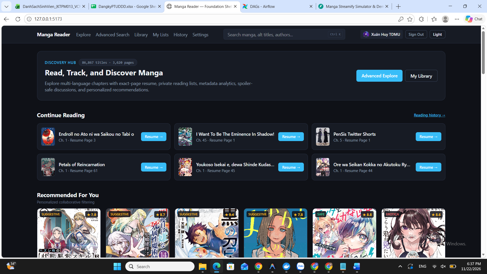

---

## Visual UI Showcase

Live application screenshots captured directly against SQL Server 2022 (`QL_DocTruyen`) and MinIO S3 (`manga-media`):

### Discovery, Search & Manga Detail Workspace

| Catalog Grid (`86,867` Titles · `3,620` Pages) | Unified Advanced Search & Multi-Axis Filters |
|---|---|
| 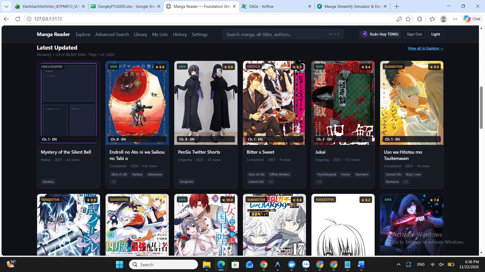 | 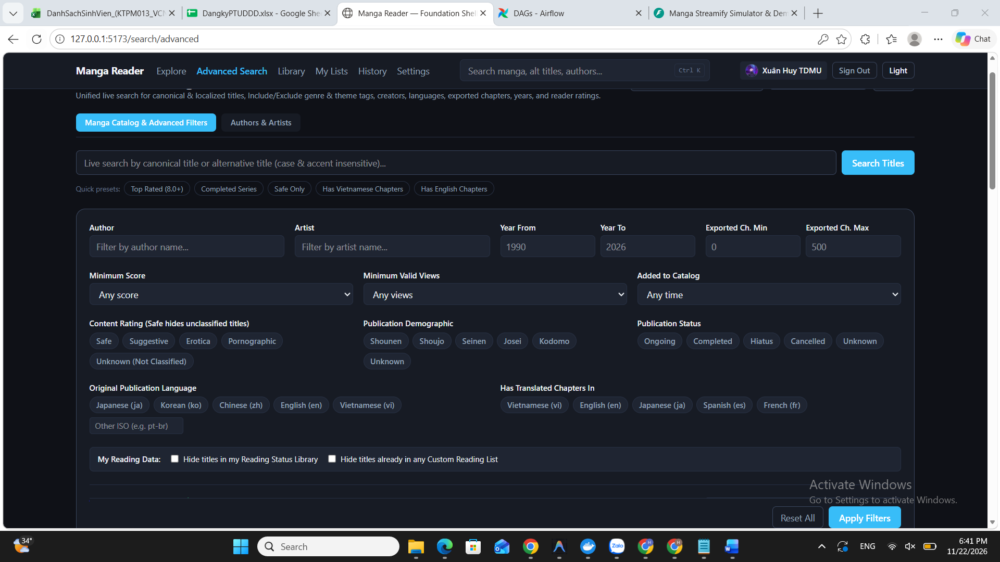 |

| Manga Detail Hero (Authors vs Artists · Localized AKA) | Threaded Comments, Spoiler Masking & Edit History |
|---|---|
| 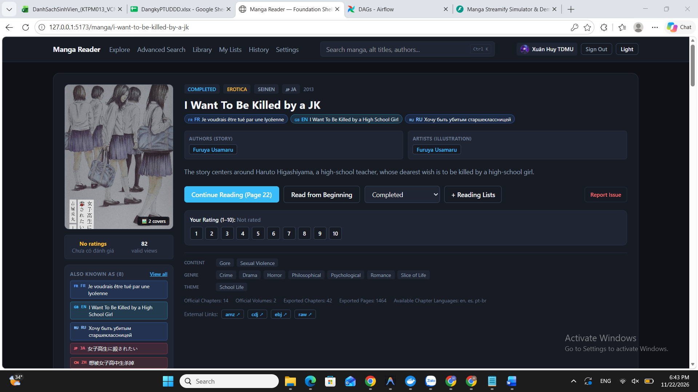 | 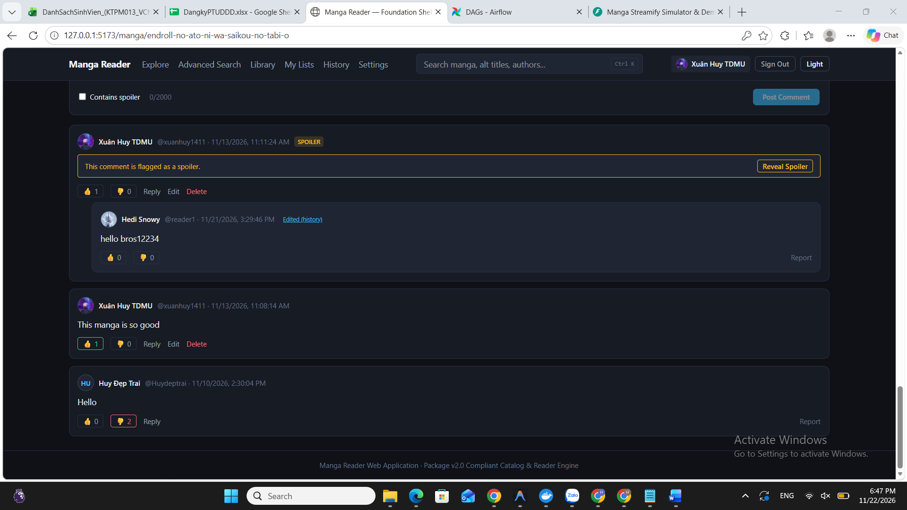 |

### Personal Tracking, Lists, History & Reader Studio

| Personal Library (5 Statuses · View Modes) | Add to Private Lists Modal |
|---|---|
| 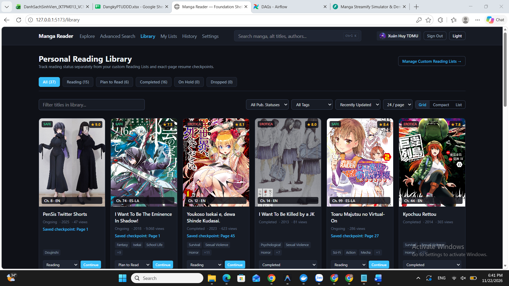 | 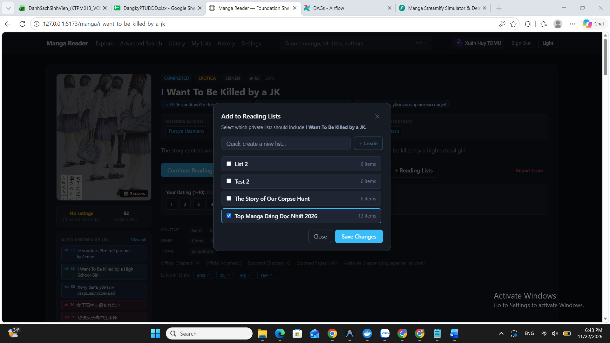 |

| Reading History Timeline with Cover Art | Reader Preferences Studio & Live Simulator |
|---|---|
| 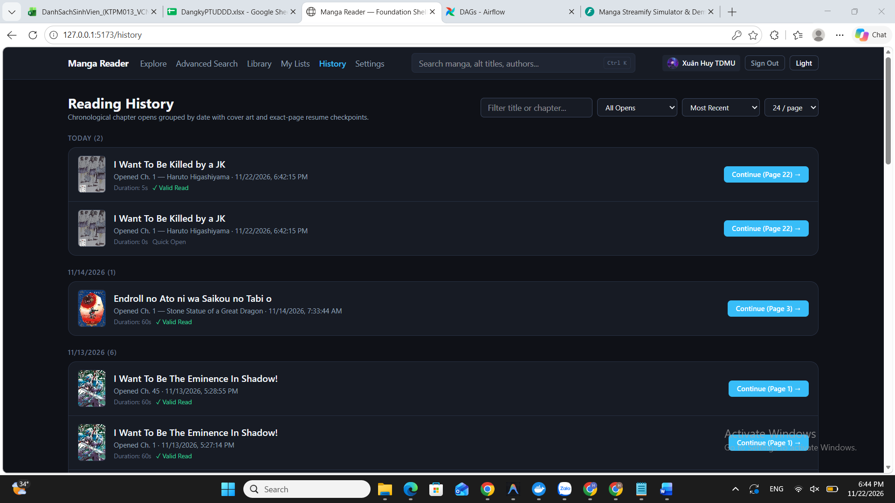 | 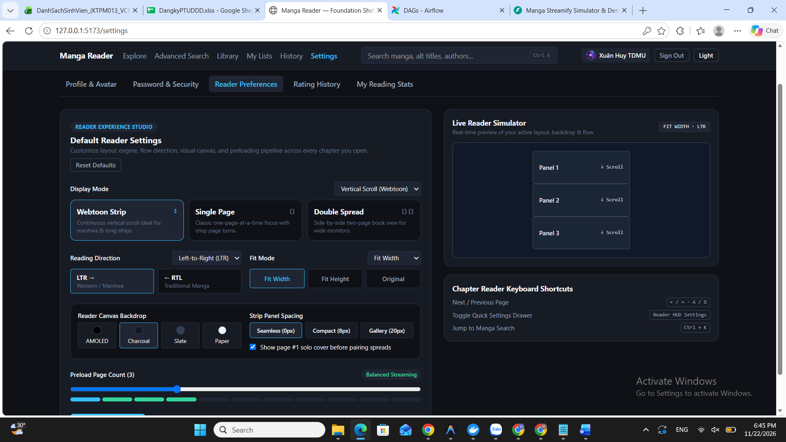 |

### Profile, SVG Analytics & Admin Moderation Console

| Account Profile & Avatar Upload | Personal Reading Statistics (SVG Charts) |
|---|---|
| 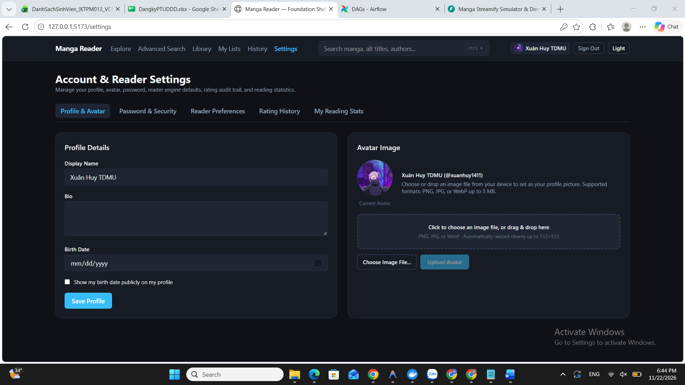 | 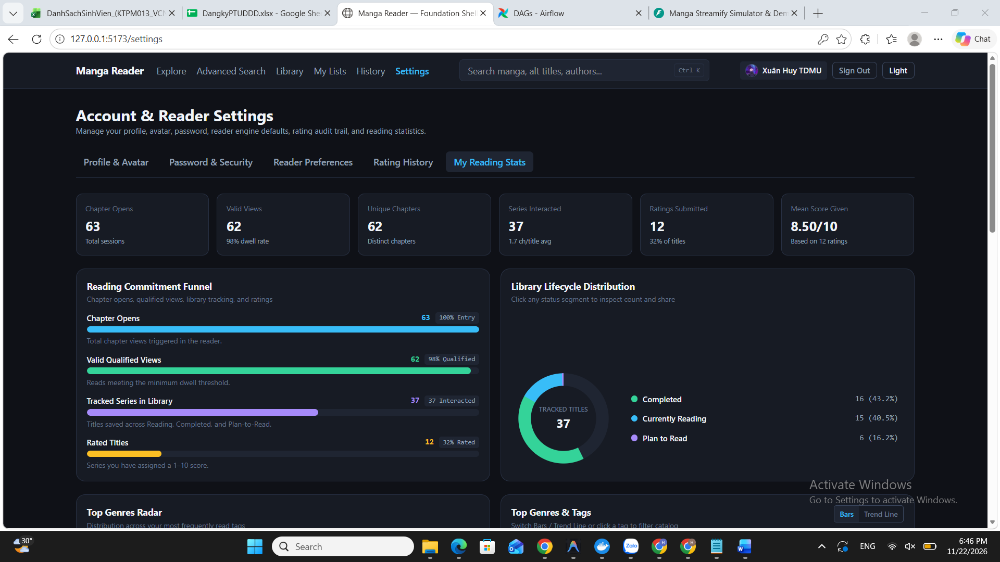 |

| Separated Top Authors vs Top Artists Charts | Admin Analytics Dashboard & Reconcile |
|---|---|
| 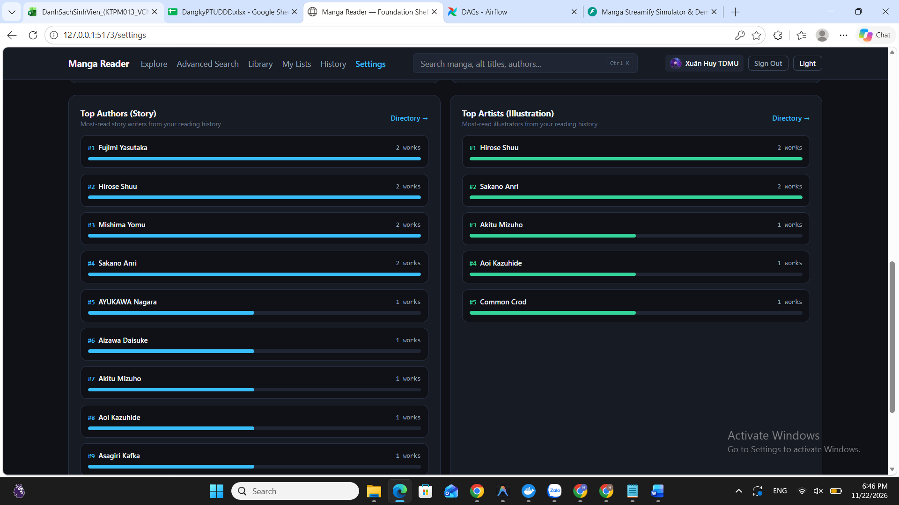 | 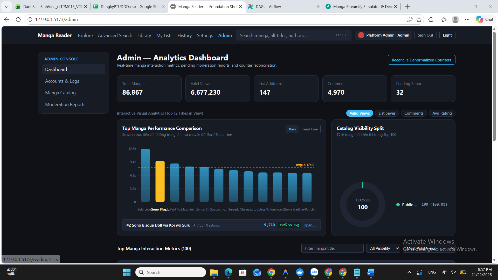 |

| Admin Manga Catalog Management | Split-Pane Moderation Reports Workbench |
|---|---|
| 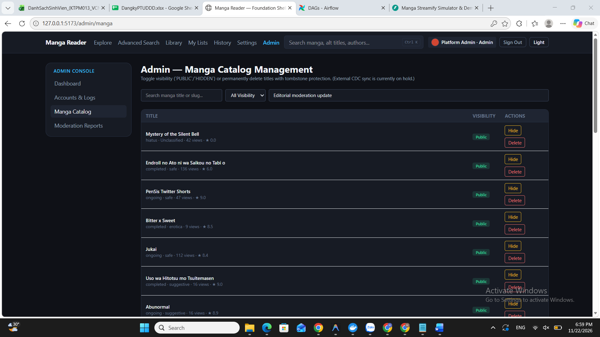 | 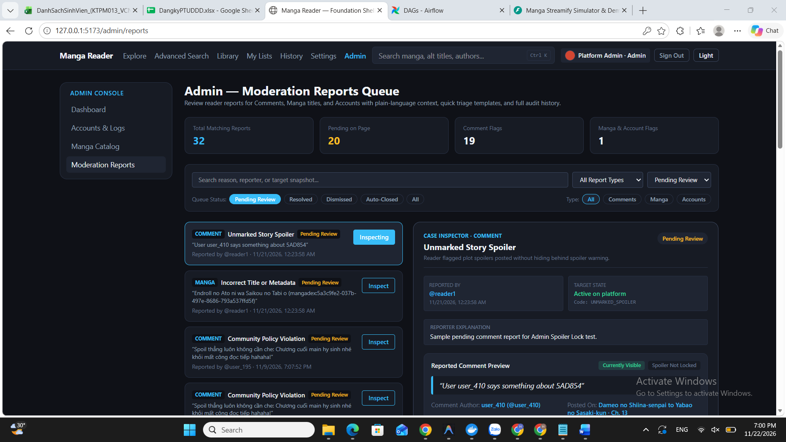 |

---

## Architecture & Technology Stack

| Layer | Technology | Location |
|---|---|---|
| **Frontend Web SPA** | React 19 + TypeScript (strict) + Vite + React Router v7 + TanStack Query v5 + Tailwind CSS v4 (45 files, 4 Layouts, 19 Routes) | [`apps/web/`](apps/web/) |
| **Backend API Monolith** | Python 3.13 + FastAPI + Uvicorn + Pydantic v2 + SQLAlchemy 2.x Async + Pillow + Argon2id + PyJWT + `uv` (83 Python files, 12 Modules) | [`apps/api/`](apps/api/) |
| **Shared Data Contract** | `manga-reader-package:2.0` (JSON Schema Draft 2020-12, Ajv2020 + Python `jsonschema`, fixtures) | [`packages/contracts/`](packages/contracts/) |
| **Database & Migrations** | SQL Server 2022 (`QL_DocTruyen` primary — 50 tables, 10 T-SQL triggers, covering indexes) + Alembic (`0001`, `0002`) + SQLite fallback | [`database/`](database/) |
| **Cache / Storage / Email / Worker** | `CacheAdapter` (Redis/Memurai or InMemory), `ObjectStorageAdapter` (MinIO S3 + HMAC Signed Media Proxy / LocalDev), `EmailAdapter` (Gmail SMTP STARTTLS / DevConsole), `BackgroundWorkerBoundary` | [`apps/api/src/manga_reader/infrastructure/`](apps/api/src/manga_reader/infrastructure/) |
| **CI Pipeline** | GitHub Actions (`contracts-and-web` + `backend-api`) | [`.github/workflows/ci.yml`](.github/workflows/ci.yml) |

---

## Key Capabilities & Domain Modules

1. **Canonical Schema, Migrations & SQL Server Integrity (`Phase 1` + Indexing/Triggers):**
   - Combines all 39 Lab10 domain tables with ADR reconciliations `M-001`..`M-011` (`47` SQLAlchemy ORM tables in [`models_auth.py`](apps/api/src/manga_reader/infrastructure/orm/models_auth.py), [`models_catalog.py`](apps/api/src/manga_reader/infrastructure/orm/models_catalog.py), and [`models_reader_social.py`](apps/api/src/manga_reader/infrastructure/orm/models_reader_social.py), plus 3 system tables on SQL Server `QL_DocTruyen`).
   - Enforced at DB level on SQL Server 2022 by **10 T-SQL triggers** (`51010..51017`: admin lock protection, immutable `activity_logs`, reading-history gate before ratings, automatic average rating recalculation, valid-view atomic increment, comment reaction counters, reading list `item_count` sync, self-report/duplicate-report guards, safe deletion cleanup) and **9 covering/lookup index groups** (`IX_mangas_sort_*`, `IX_manga_stats_languages_lang`, `IX_chapters_manga_volume`, `IX_reports_filter`).
   - 2-phase catalog pagination in [`CatalogDiscoveryService`](apps/api/src/manga_reader/modules/catalog_discovery/application/service.py) designed for large-scale catalogs (`QL_DocTruyen` local dataset with `86,867` titles and `1.76M+` chapters via [`import_local_mangalibrary.py`](database/seeds/import_local_mangalibrary.py)).

2. **Authentication, Email OTP Verification & Security Center (`account_auth`):**
   - Registration with cache-only 6-digit OTP verification (`120s` TTL, `60s` resend cooldown, zero OTP leakage to HTTP responses when `EMAIL_DEV_LOG_OTP=false`) powered by [`SmtpEmailAdapter`](apps/api/src/manga_reader/infrastructure/email.py) (Gmail SMTP STARTTLS) or zero-credential `DevConsoleEmailAdapter`.
   - 3-Step **Forgot Password** recovery wizard in [`ForgotPasswordPage`](apps/web/src/features/auth/AuthPages.tsx) (`/forgot-password`: Account lookup → 6-digit Email OTP verification → New password + [`PasswordStrengthMeter`](apps/web/src/components/PasswordStrengthMeter.tsx)), revoking active refresh sessions on reset.
   - Rotating refresh token cookies (`mr_refresh_token`) with reuse revocation, live JWT + DB session/status verification, direct multipart file avatar upload verified with Pillow, 2-column Security Center password management in [`AccountSettingsPage`](apps/web/src/features/account/SettingsPage.tsx), and Admin account lock/unlock notifications.

3. **Catalog Discovery, Unified Search & Manga Detail Experience (`catalog_discovery`, `manga_creator`):**
   - Unified search & advanced filtering at `/explore` and `/search/advanced` (with `/search` redirecting seamlessly), offering 3-state tag filtering (`Include` / `Exclude` / `Ignore`, strictly keeping `unknown` separate from `safe`), separate **Author (Story)** and **Artist (Illustration)** creator pickers, debounced live search (`Ctrl+K` global header autocomplete), accent/case-insensitive search, and skeleton loading states.
   - [`MangaDetailPage`](apps/web/src/features/manga/MangaDetailPage.tsx) and [`AuthorDetailPage`](apps/web/src/features/creator/AuthorDetailPage.tsx) provide separated **Authors (Story)** and **Artists (Illustration)** sections, localized **Also Known As** badges with language flags/colors, and an animated 4-tab detail workspace (`Chapters` with `CatalogPagination` in both **Group by Volume** & **Flat List** modes plus Scanlation Group/Language/Sort/`Locate Resume Ch.` filters, locale-filtered **Cover Art Gallery** + Lightbox, **Recommendations**, and threaded **Comments**).

4. **Multi-Mode Reader Canvas, Hybrid Media Delivery & Progress Resume (`reader_engine`):**
   - Reader modes (`VERTICAL_WEBTOON`, `SINGLE_PAGE`, `DOUBLE_PAGE` respecting `LTR`/`RTL`), fit modes (`FIT_WIDTH`, `FIT_HEIGHT`, `ORIGINAL`), Focus mode (`F`), exact active-page preservation across mode switches, debounced `reader_progress` checkpoints with `pages_revision` conflict recovery, and valid-view threshold deduplication.
   - Zero-copy HMAC-signed `/api/v1/media/{bucket}/{object_key}` proxy streaming directly from MinIO S3 (`manga-media` / `manga-reader-media`) or local storage, with optional MangaDex At-Home CDN and deterministic in-memory WebP fallbacks.

5. **Ratings, Threaded Comments, Private Reading Lists & Recommendations (`ratings`, `comments_reactions`, `reading_lists`, `recommendations`):**
   - Reading-gated `1–10` ratings (`RATING_REQUIRES_READING`) with immutable `rating_histories`, 1-level threaded comments with edit history & Admin spoiler lock, NFC Unicode Vietnamese storage without `pyodbc` `?` corruption or HTML double-encoding, and atomic Like/Dislike/None reactions.
   - Owner-exclusive Private Reading Lists (`404` for non-owners) with Clone/Merge deduplication, [`ReadingListCover`](apps/web/src/components/ReadingListCover.tsx) cover art collage (1–4 covers + SVG `"Empty List"` default artwork), quick-create membership sync, and interactive metadata breakdown charts.
   - Multi-strategy recommendations (`ITEM_BASED`, anonymized `USER_BASED`, TF-IDF `CONTENT_BASED`) with deterministic cold-start fallbacks.

6. **Interactive SVG Dashboards & Plain-Language Moderation Workbench (`admin_analytics`, `moderation_reporting`):**
   - Custom pure-SVG interactive data visualizations in [`DataStoryCharts.tsx`](apps/web/src/components/DataStoryCharts.tsx) (`InteractiveDonutChart` with overflow-safe center labels & wrapping legends, `InteractiveTrendChart`, `GenreRadarChart`, `EngagementFunnelChart`) powering `My Reading Stats`, `ReadingListDetailPage`, `AdminDashboardPage`, and `AdminAccountsPage` without external chart library bloat.
   - Split-pane Moderation Workbench in [`AdminReportsPage`](apps/web/src/features/admin/AdminPages.tsx) with KPI queue summary, plain-language target resolution cards, audit history timeline, and atomic single-transaction actions (`WARN_USER`, `LOCK_COMMENT_PERMISSION`, `LOCK_ACCOUNT`, `HIDE_COMMENT`, `DELETE_COMMENT`, `HIDE_MANGA`, or automatic `SYSTEM` `CLOSED` on deleted targets).

7. **Manga Package v2.0 ETL & CDC Ingestion (`etl_cdc`):**
   - Strict Draft 2020-12 validation (`ADR-012` optional `chapters`, `ADR-017` dual-role creator deduplication), per-manga isolated batch ETL (`PARTIAL_FAILED` + single-item retry), HMAC CDC webhooks with revision ordering and tombstone resurrection protection. *(External ETL sidebar toggle configurable via `VITE_EXTERNAL_ETL_ENABLED`.)*

---

## Codebase Traceability & Technical Dictionaries (`docs/reference/`)

Comprehensive source-linked reference guides tracing every requirement, screen, endpoint, and SQL table down to exact file paths and line numbers:

| Document | Scope | Link |
|---|---|---|
| **Use Case → Code Traceability** | All 8 parent UCs & 50 sub-UCs (`UC-1`..`UC-8`, including `UC-6.7` Forgot Password OTP), `Ctrl+F` keyword index, Actor RBAC matrix, runtime flow diagram, code snippets, and ADR mapping | [`docs/reference/USECASE_CODE_TRACEABILITY.md`](docs/reference/USECASE_CODE_TRACEABILITY.md) |
| **Web UI → Code Dictionary** | `UI-00`..`UI-16`: all 4 layouts, 19 routes, header autocomplete, tabs, modals, drawers, SVG charts, shared components, and quick Q&A lookup | [`docs/reference/WEB_UI_CODE_DICTIONARY.md`](docs/reference/WEB_UI_CODE_DICTIONARY.md) |
| **Backend API & DB Dictionary** | 12 domain modules, all `90` HTTP endpoints under `/api/v1`, 13 error classes, infrastructure adapters, 47 ORM tables + 3 system tables, 9 covering index groups, and all 10 T-SQL triggers | [`docs/reference/BACKEND_API_AND_DATABASE_DICTIONARY.md`](docs/reference/BACKEND_API_AND_DATABASE_DICTIONARY.md) |

---

## Repository Layout

```text
QL-DocTruyen/
├── apps/
│   ├── api/                 # FastAPI modular monolith (83 Python files, 12 domain modules + unit/E2E tests)
│   └── web/                 # React 19 + Vite SPA (45 TS/TSX/CSS files, 19 interactive routes + Vitest suite)
├── packages/
│   └── contracts/           # Pinned manga-reader-package:2.0 JSON Schema Draft 2020-12 + fixtures + Ajv2020
├── database/
│   ├── alembic.ini          # Forward-only migration runner configuration
│   ├── migrations/          # Alembic env.py + revisions 0001 & 0002 (47 canonical ORM tables)
│   ├── seeds/               # Dev seeder (seed_dev.py) & SQL Server bulk importer (import_local_mangalibrary.py)
│   └── documentation/       # 3-way schema reconciliation plan (Lab10 vs QL_DocTruyen vs M-001..M-011)
├── storage/                 # Media identity (bucket + object_key) & storage adapter documentation
├── infrastructure/
│   ├── docker/              # Opt-in dev Compose profiles (protects Drive C:)
│   └── scripts/             # Service diagnostics (check-local-services.ps1) & AI codebase dumper
├── tests/
│   ├── integration/         # Cross-module integration test placeholders
│   └── e2e/                 # Reserved Playwright harness directory
└── docs/
    ├── agent-plan/          # Original specification files (Setup/ 15 files & Design/ 9 files)
    ├── architecture/        # Assessment, ADR-TECH-STACK, Architecture, Guidelines, Init & Completion Reports
    ├── media/               # Curated live UI screenshots showcased in README
    ├── operations/          # LOCAL_SETUP.md & TROUBLESHOOTING.md
    ├── reference/           # Traceability/UI/API/DB dictionaries + original Lab8/Lab9/Lab10 docx & drawio
    └── system_dump/         # Host machine schema/inventory reference dump (heavy archives excluded in .gitignore)
```

---

## Quick Start & Demo Credentials

> **Zero-Credential Start:** Copying `.env.example` to `.env` runs out-of-the-box with local SQLite, InMemory cache, LocalDev storage, and `DevConsoleEmailAdapter`. See [`docs/operations/LOCAL_SETUP.md`](docs/operations/LOCAL_SETUP.md) for SQL Server 2022 (`QL_DocTruyen`), MinIO (`:9010`), Redis (`:6379`), and Gmail SMTP (`:587`) configuration.

```powershell
# 1. Create local env file (never commit .env with real secrets)
Copy-Item .env.example .env

# 2. Install JS/TS and Python dependencies (caches stay inside repo on Drive D:)
pnpm install
uv --project apps/api sync

# 3. Apply canonical 47-table migration & seed local dev data (idempotent)
pnpm db:migrate
pnpm db:seed

# 4. Start backend API (http://127.0.0.1:8020) and web SPA (http://127.0.0.1:5173)
pnpm dev:api
pnpm dev:web
```

### Local Dev Seeded Accounts ([`database/seeds/seed_dev.py`](database/seeds/seed_dev.py))

| Role | Username | Email | Password |
|---|---|---|---|
| **Administrator** | `admin` | `admin@manga-reader.local` | `Admin@123456` |
| **Reader 1** | `reader1` | `reader1@manga-reader.local` | `Reader@123456` |
| **Reader 2** | `reader2` | `reader2@manga-reader.local` | `Reader@123456` |

---

## Engineering Commands & Quality Gates

| Command | Description |
|---|---|
| `pnpm dev:api` | Start FastAPI backend with reload on `127.0.0.1:8020` |
| `pnpm dev:web` | Start Vite frontend dev server on `127.0.0.1:5173` (proxies `/api` → `:8020`) |
| `pnpm lint` | Run ESLint (`contracts` + `web`) and Ruff (`api` + `database` + `tests`) |
| `pnpm format:check` | Check formatting with Prettier and `ruff format --check` |
| `pnpm format:write` | Auto-format JS/TS/JSON/MD and Python source files |
| `pnpm typecheck` | Run `tsc --noEmit` (strict) and `mypy --strict` |
| `pnpm test` | Execute all `64` automated tests (`7` contracts + `28` web + `29` API/E2E) |
| `pnpm build` | Compile `@manga-reader/contracts` and build `apps/web` production bundle |
| `pnpm db:migrate` | Run Alembic `upgrade head` |
| `pnpm db:migrate:sql` | Preview generated SQL offline without mutating DB |
| `pnpm db:seed` | Run idempotent development seeder (`3` accounts, `5` Package v2.0 manga) |
| `pnpm db:import-local` | Bulk-sync local `MangaLibrary` dataset into `QL_DocTruyen` (idempotent) |
| `pnpm dump:context` | Export full repository code snapshot to `exports/codebase-dump/` |
| `pnpm check:all` | Run all five quality gates sequentially (`lint`, `format:check`, `typecheck`, `test`, `build`) |

---

## Additional Architecture & Operations Docs

- **Architecture & Reports:**
  - [`docs/architecture/COMPLETION_REPORT.md`](docs/architecture/COMPLETION_REPORT.md)
  - [`docs/architecture/INITIALIZATION_REPORT.md`](docs/architecture/INITIALIZATION_REPORT.md)
  - [`docs/architecture/REPOSITORY_ASSESSMENT.md`](docs/architecture/REPOSITORY_ASSESSMENT.md)
  - [`docs/architecture/ADR-TECH-STACK.md`](docs/architecture/ADR-TECH-STACK.md)
  - [`docs/architecture/SYSTEM_ARCHITECTURE.md`](docs/architecture/SYSTEM_ARCHITECTURE.md)
  - [`docs/architecture/MODULE_BOUNDARIES.md`](docs/architecture/MODULE_BOUNDARIES.md)
  - [`docs/architecture/DEVELOPMENT_GUIDELINES.md`](docs/architecture/DEVELOPMENT_GUIDELINES.md)
- **Data & Storage:**
  - [`database/documentation/SCHEMA_IMPLEMENTATION_PLAN.md`](database/documentation/SCHEMA_IMPLEMENTATION_PLAN.md)
  - [`packages/contracts/README.md`](packages/contracts/README.md)
  - [`storage/README.md`](storage/README.md)
- **Operations:**
  - [`docs/operations/LOCAL_SETUP.md`](docs/operations/LOCAL_SETUP.md)
  - [`docs/operations/TROUBLESHOOTING.md`](docs/operations/TROUBLESHOOTING.md)
- **Original Specifications:** [`docs/agent-plan/Setup/00_README_AGENT_ENTRYPOINT.md`](docs/agent-plan/Setup/00_README_AGENT_ENTRYPOINT.md) → [`14_HANDOFF_MANIFEST.md`](docs/agent-plan/Setup/14_HANDOFF_MANIFEST.md)
