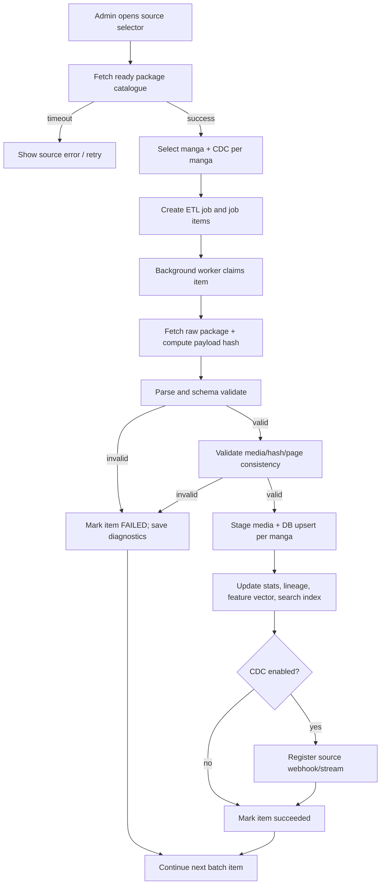

# `manga-reader-package` v2.0 — Contract, ETL & CDC Implementation Plan

## 1. Contract identity and boundary

- Schema Draft: JSON Schema 2020-12.
- `$id`: `urn:manga-datalake:contract:manga-reader-package:2.0`.
- `contract_name`: constant `manga-reader-package`.
- `contract_version`: constant `2.0`.
- Root object: `MangaReaderPackage`.
- Root required fields: `exported_at`, `manga`.
- Optional root field: `chapters` array. Do not assume this array is always present because it is not root-required by the contract.
- Root is a package envelope, not an API URL or a list endpoint.
- Nested definitions use `additionalProperties:false` (closed object contract); unknown nested fields must be rejected rather than silently persisted/dropped.

The package is the universal data contract for a manga pool. The Reader system does not crawl or manipulate raw images; it accepts package data already crawled, cleaned, upscaled/watermarked and exported by the upstream system.

## 2. Exact data definitions

### 2.1 Root `MangaReaderPackage`

| Property | Meaning / constraint |
|---|---|
| `contract_name` | constant `manga-reader-package` |
| `contract_version` | constant `2.0` |
| `exported_at` | date-time; required |
| `manga` | `ReaderManga`; required |
| `chapters` | array of `ReaderChapter`; optional; contract description says sorted by `chapter_numeric`, `language` |

### 2.2 `ReaderManga`

Required: `pool_manga_id`, `slug`, `source_manga_id`, `title`.

| Field | Contract semantics |
|---|---|
| `pool_manga_id` | Stable pool primary key, e.g. `pm_...`; canonical ingest key |
| `slug` | Unique URL-friendly slug; not DB identity |
| `source_manga_id` | ID in source review system; traceability |
| `mangadex_id` | Nullable MangaDex manga UUID |
| `title` | Primary display title |
| `alt_titles` | Array of alternative titles, any language |
| `description` | Synopsis plain text/Markdown; default empty string |
| `status` | `ongoing`, `completed`, `hiatus`, `cancelled`, `unknown`; default unknown |
| `content_rating` | `safe`, `suggestive`, `erotica`, `pornographic`, `unknown`; default unknown; unknown must be treated as NOT safe |
| `publication_demographic` | `shounen`, `shoujo`, `seinen`, `josei`, `kodomo`, `unknown`; default unknown |
| `original_language` | Nullable lowercase ISO 639-1 (examples ja/ko/zh); may include region per related fields |
| `year` | nullable integer 1800–2200 |
| `published_start_date`, `published_end_date` | nullable strings; can be free-form or ISO per source |
| `official_volumes`, `official_chapters` | nullable non-negative integers; not exported counts |
| `creators` | array of `ReaderCreator` |
| `tags` | array of `ReaderTag` |
| `links` | array of `ReaderLink` |
| `primary_cover` | nullable `ReaderMediaRef` |
| `cover_arts` | array of `ReaderCoverArt` |
| `stats` | `ReaderMangaStats`; derived from exported chapters/pages only |
| `lineage` | `ReaderLineage`; revision/hash for change detection |

**Important count distinction:** `official_chapters`/`official_volumes` represent official source counts; `stats.chapter_count/page_count/total_size_bytes` represent the actual exported package content. Never substitute one for another.

### 2.3 `ReaderChapter`

Required: `pool_chapter_id`, `pool_manga_id`, `source_chapter_id`, `chapter_number`.

| Field | Contract semantics |
|---|---|
| `pool_chapter_id` | Stable package primary key; use for chapter upsert |
| `pool_manga_id` | Foreign key to `manga.pool_manga_id` |
| `source_chapter_id` | ID at source review system |
| `chapter_number` | Display string, e.g. `10.5`, `Extra` |
| `chapter_numeric` | Numeric sort key; default 0; description: ORDER BY `chapter_numeric`, `language` |
| `volume` | string or null |
| `title` | string, default empty |
| `language` | lowercase ISO 639-1, may include region e.g. `pt-br`; default `en` |
| `scanlation_group` | string or null |
| `publish_at` | nullable date-time |
| `source` | provider origin, default `mangadex` |
| `source_id` | nullable origin provider chapter ID |
| `page_count` | integer >=0, default 0 |
| `total_size_bytes` | integer >=0, default 0 |
| `pages_revision` | integer >=1, default 1; increments when pages edited |
| `manifest_sha256` | SHA-256 digest string, default empty |
| `updated_at` | nullable date-time |
| `pages` | array of `ReaderPage` |

### 2.4 `ReaderPage`

Required: `page_uid`, `page_number`, `filename`, `media`.
- `page_uid`: stable page identifier; primary key at pool/page domain.
- `page_number`: 1-indexed reading order, contiguous `1..N`.
- `filename`: original image filename; display/storage metadata, not storage locator.
- `media`: `ReaderMediaRef`.

### 2.5 `ReaderMediaRef`

Required: `bucket`, `object_key`.

| Field | Constraint/meaning |
|---|---|
| `bucket` | string; max length 63; Object Storage bucket |
| `object_key` | string; object key inside bucket |
| `content_type` | nullable MIME (`image/jpeg`, `image/webp`, etc.) |
| `width`, `height` | nullable pixel dimensions |
| `file_size` | integer >=0; byte size; default 0 |
| `md5_hash` | nullable hex digest, used for deduplication |
| `sha256` | nullable hex digest, integrity |

Do not reinterpret `bucket/object_key` as URL. Generate signed/CDN URL at runtime from a trusted media service. Never accept arbitrary external image URL from this contract as the render URL.

### 2.6 `ReaderCreator`

Required: `creator_id`, `slug`, `name`, `role`.
- `creator_id`: canonical creator UUID (MangaDex UUID or deterministic UUIDv5); disambiguates homonyms.
- `slug`: route-friendly path component.
- `name`: display name.
- `role`: only `author` or `artist`.
- `mangadex_id`: nullable MangaDex author UUID.
- `biography`: localized object `{language: text}`.
- `links`: object `{platform: url}` e.g. twitter, pixiv, youtube, website.
- A creator with both roles appears twice (one row per `(creator_id,role)` credit), but canonical creator identity should remain one creator entity in Reader DB and separate role rows in `manga_creators`.

### 2.7 `ReaderTag`

Required: `slug`, `name`.
- `slug`: stable URL-safe unique key derived from English name.
- `source_tag_id`: nullable source tag ID.
- `mangadex_id`: nullable MangaDex UUID.
- `group`: enum `genre`, `theme`, `format`, `content`, `other`; default `genre`.
- `name`: localized object `{language: displayName}`; `en` key always present.

### 2.8 `ReaderCoverArt` and `ReaderLink`

- `ReaderCoverArt`: `media` required; `cover_id`, `volume`, `locale`, `description` nullable; `media` is `ReaderMediaRef`.
- `ReaderLink`: `site` and `url` required; url absolute URL. Validate scheme/length before render; do not render javascript/data schemes as links.

### 2.9 `ReaderLineage` and `ReaderMangaStats`

`ReaderLineage`:
- `pool_revision` >=1, default 1; increments on every pool change.
- `source_metadata_revision` >=1, default 1.
- `manifest_sha256` hash of pooled manga content.
- `published_at` first publish to pool, nullable UTC ISO timestamp.
- `updated_at` last pool modification, nullable UTC ISO timestamp.

`ReaderMangaStats`:
- `chapter_count`, `page_count`, `total_size_bytes` non-negative integer.
- `languages`: distinct chapter language list, sorted.
- Stats describe exported chapters/pages only and must never be stale; recompute/update atomically with package import.

## 3. Strict validation sequence

The ingest boundary must validate before opening the database transaction:

1. Read raw bytes with a maximum package size limit (configurable); compute raw `payload_sha256` before JSON parsing.
2. Parse UTF-8 JSON; reject invalid JSON, duplicate keys if parser supports detection, non-finite numeric values.
3. Validate against exact schema draft 2020-12 and `$id`; pin schema version `2.0` in importer.
4. Enforce `contract_name` and `contract_version` constants.
5. Validate date-time strings and normalize UTC.
6. Validate all enum values; `unknown` remains explicit (never coerce to `safe`, `ongoing` or default positive classification).
7. Validate cross-object relations: chapter `pool_manga_id` equals package manga ID; every chapter page belongs to its chapter; duplicate stable IDs rejected.
8. Validate chapter sorting and page numbering: 1..N contiguous; no duplicate page UID/number within chapter.
9. Validate count consistency: chapter `page_count == len(pages)`; `total_size_bytes` equals sum page file sizes when all known; `manga.stats` matches exported chapters/pages/languages.
10. Validate `ReaderMediaRef` bucket/key path safety and object metadata; reject traversal-like object keys, invalid bucket names, unexpected MIME and out-of-range dimensions/bytes.
11. If checksum/manifest is supplied, verify against defined canonicalization rules; never compare incompatible digest layers.
12. Build an immutable normalized import model; keep original payload hash/raw payload in job item/object archive if retention policy permits.

## 4. Hash layers — do not conflate them

| Hash | Scope | Source field / storage |
|---|---|---|
| Raw payload SHA-256 | Exact package bytes received over transport | Computed at ingress → `etl_job_items.payload_sha256` |
| Manga lineage manifest SHA-256 | Pool manga metadata/content manifest | `manga.lineage.manifest_sha256` → `manga_lineage.manifest_sha256` |
| Chapter manifest SHA-256 | One chapter's page manifest/content | `chapter.manifest_sha256` → `chapters.manifest_sha256` |
| Media SHA-256 | Individual object bytes | `ReaderMediaRef.sha256` → `media_objects.sha256` |
| Media MD5 | Individual object dedup convenience | `ReaderMediaRef.md5_hash` → `media_objects.md5_hash` |

The schema text does not specify the canonical serialization used to compute the manga/chapter manifest hashes. Upstream and reader must share a byte/field ordering spec before treating manifest mismatch as authoritative. Until that exists, raw payload checksum can verify transport integrity; object SHA can verify bytes; do not invent a canonical manifest algorithm.

## 5. Idempotent upsert strategy

### 5.1 Manga identity

- Look up by `pool_manga_id` first.
- If absent, create local `manga_id` and store stable `pool_manga_id`.
- `slug` and `mangadex_id` are unique secondary identifiers; collisions are an error requiring conflict resolution, never merge records based on title.
- Preserve `source_manga_id` traceability.

### 5.2 Chapter identity

- Resolve `pool_manga_id` to internal `manga_id`.
- Upsert each chapter by `pool_chapter_id`.
- Verify existing chapter belongs to same pool manga; if it points elsewhere, fail package item and alert (identity corruption).
- `pages_revision`: if same revision and same manifest, no page data change; if higher revision, replace/update pages according to complete chapter snapshot semantics; if lower revision, ignore stale event/package or classify stale.
- If revision equal but hash differs, treat as source inconsistency and quarantine until resolved.

### 5.3 Creator/tag/media relationships

- Upsert Creator by `creator_id`, not name; homonyms allowed under distinct IDs.
- Upsert Tag by slug/canonical source IDs; slug collision with different identity requires manual/source resolution.
- Upsert media by `(bucket,object_key)`, update verified metadata only after content hash checks.
- Replace association rows from complete package snapshot carefully; do not delete relations on partial package.

### 5.4 Full snapshot vs partial payload

Root `chapters` is optional. An omitted chapters property must not mean “delete every existing chapter.”
- When a complete package explicitly says `chapters: []`, this can represent zero chapters only if upstream contract owners confirm snapshot completeness.
- When chapter data is omitted, treat package as metadata-only update.
- Never infer deletion from a missing object in a partial CDC event; explicit `CHAPTER_DELETED` is required.

## 6. Batch ETL flow

### 6.1 User-visible ETL job states

`etl_jobs.status`: `QUEUED`, `RUNNING`, `SUCCEEDED`, `PARTIAL_FAILED`, `FAILED`, `CANCELLED`.

`etl_job_items.status` in SQL: `QUEUED`, `PROCESSING`, `SUCCEEDED`, `FAILED`, `SKIPPED`.

- Whole job `SUCCEEDED`: all actionable items succeeded (or explicitly skipped by policy).
- `PARTIAL_FAILED`: at least one succeeded and at least one failed.
- `FAILED`: no item successfully committed, or job-level failure prevented processing.
- `CANCELLED`: Admin/system cancellation before completion; item completion counts remain visible.
- UI displays aggregate job and per-manga outcomes; do not show `SUCCEEDED` before DB commit/search index finalization is consistent.

### 6.2 Per-manga atomicity

- One manga item is the failure isolation boundary (Lab8 exception flow).
- Stage file uploads in temporary prefix; don't publish incomplete metadata.
- In one DB transaction: create/update manga/catalog relations/chapter/page rows, `manga_stats`, `manga_lineage`, job item result.
- Search index and content vectors can be async via transactional outbox; job is fully “catalog visible” only after index result or UI communicates index pending.
- Failed item gets error code/message, checksum_validated value, attempt_count and times; continue valid batch items.

## 7. CDC ingestion

### 7.1 Subscription lifecycle

- Admin chooses CDC for each selected manga.
- Persist `manga_sync_subscriptions` unique per manga, including provider subscription key if returned.
- `mangas.is_cdc_enabled` should match active subscription state.
- Disable/delete cancels provider webhook/stream; if cancel fails, set subscription to FAILED/PAUSED and reject future events using local state/tombstone.

### 7.2 Event receiver

1. Verify sender authentication/signature and source identity.
2. Validate event envelope, external event ID, event type and payload schema/version.
3. Compute/verify `payload_sha256`.
4. Insert `cdc_events` as PENDING with unique `external_event_id`; duplicate conflict returns accepted/already seen, no duplicate mutation.
5. Acknowledge source after durable event receipt, not after full image ingestion if queue design is used.
6. Enqueue event ID to durable MQ/outbox.
7. Consumer claims PENDING → PROCESSING with lease/lock.
8. Resolve manga and check CDC subscription and deletion tombstone.
9. Process event idempotently using stable pool IDs/revisions; update chapter or metadata.
10. Mark PROCESSED and processed_at; update subscription last_event_at.
11. On transient network/storage/service error: retry with exponential backoff + jitter; record attempt and error.
12. On invalid schema/hash/identity conflict: mark FAILED/quarantine; require operator action rather than infinite retry.

### 7.3 Event ordering and duplicate protection

- Unique external event ID prevents duplicate execution.
- `pool_revision` and `pages_revision` prevent stale state overwriting newer package data.
- Events may arrive out of order. Store event received time and revision; compare revision, not arrival time alone.
- For multiple events on same manga/chapter, serialize by stable key or use optimistic concurrency.
- `CHAPTER_DELETED` is explicit; do not infer from chapter omission.
- If chapter is being read while update arrives, old cached URLs may continue until revision invalidation; UI should refresh manifest when page request returns 404/hash mismatch.
- A deletion tombstone must win over delayed CDC event for same manga.

## 8. Operational observability

Every job/event log should include:
- `job_id`, `job_item_id`, `event_id`, correlation/trace ID;
- `source_system`, `pool_manga_id`, `pool_chapter_id` when available;
- contract name/version, raw payload hash, manifest/revision;
- stage name (download/parse/schema/media/DB/index/CDC-register);
- attempt number, duration, result/error class and retryable flag;
- do not log signed URLs, credentials or raw OTP/tokens.

Admin UI requires filters by job status, source, time, manga ID/title and per-item error. Retry button must only retry eligible failed item and be idempotent.

## 9. Version evolution policy

- v2.0 importer must pin exact schema; do not accept `2.x` loosely unless schema explicitly permits it.
- Additive fields are not guaranteed safe because nested objects disallow additional properties.
- For contract v2.1, deliver a versioned schema and compatibility tests before deployment. Reader should fail closed with an actionable “unsupported contract version” item error.
- Do not modify contract to include reader-only fields (user progress, rating, comment, local visibility, list). Those belong to Reader DB/API.
