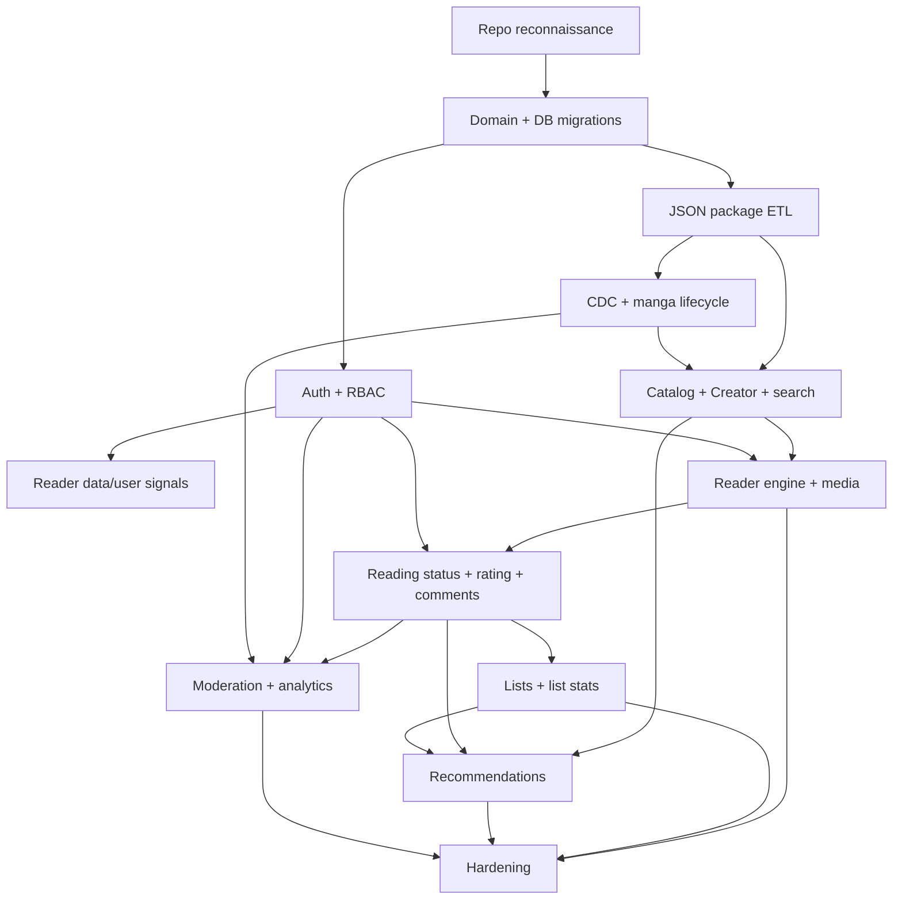

# Implementation Roadmap & Dependency Order

> Roadmap sắp xếp theo dependency và giảm rủi ro, không giả định công nghệ/framework cụ thể. Agent cần đọc repo thực tế trước khi quyết định package/folder naming, persistence framework, queue, search engine và storage provider.

## Phase 0 — Repository reconnaissance and architecture baseline

**Goal:** Không code feature trên một architecture chưa kiểm tra.

Tasks:
1. Inspect repository structure, framework/runtime, current routes, migrations, auth model, dependency versions, tests, deployment config.
2. Identify current DB engine and migration tool; compare actual schema with Lab10 baseline.
3. Identify existing Object Storage/CDN, Redis/cache, MQ, email provider, search index and logging stack.
4. Map current implementation to all 8 modules and 65 UC IDs; label implemented/partial/missing/contradictory.
5. Decide architecture boundaries (router/controller → application service → domain/service → repository → DB/provider adapter); avoid route handler with business logic.
6. Create architecture diagrams/context map and ADR process.

**Gate:** Written repo assessment; no schema mutation yet; one implementation plan based on actual repo.

## Phase 1 — Domain skeleton and database integrity

**Goal:** Stabilize identities, status enums and base schema.

Tasks:
1. Implement baseline entities and DB migrations from Lab10.
2. Add all business unique constraints and indexes.
3. Add migrations M-001..M-011 from `04_DATABASE_SCHEMA_AND_MIGRATIONS.md` as required by selected features.
4. Add enum validation/CHECK constraints.
5. Add timestamps UTC convention and audit/event base tables.
6. Establish transaction management and outbox pattern for side effects.
7. Add repository tests for uniqueness/relations/delete semantics.

**Gate:** DB migrations apply on clean DB and existing DB; consistency tests pass; no untracked schema differences.

## Phase 2 — Authentication, account lifecycle and RBAC

**Goal:** Secure identity before social/user data is exposed.

Tasks:
1. Register PENDING_VERIFICATION account and Reader profile.
2. OTP challenge Redis storage, TTL 120s, email outbox worker.
3. OTP verify/resend, one-use consumption and rate limits.
4. Login email/username, password hash, temporary login throttling.
5. Session creation/refresh rotation/logout/revocation.
6. Admin and Reader role guard; self-resource policy.
7. Profile view/edit, birthday privacy, avatar upload and password change.
8. Account status lock/unlock service with audit and session revoke.

**Gate:** AUTH tests pass; Reader cannot access Admin APIs; locked Reader cannot mutate.

## Phase 3 — Manga package importer / ETL foundation

**Goal:** Make the canonical data contract reliable before the reader catalogue.

Tasks:
1. Pin JSON Schema v2.0 and implement Draft 2020-12 validator.
2. Build typed package DTO and strict validation pipeline.
3. Implement mapping to all 39 baseline tables and approved localization migrations.
4. Implement media object resolver, object hash/metadata verification and staged storage.
5. Implement `etl_jobs`/`etl_job_items` processing, per-item transaction, checksums and rollback.
6. Idempotent upsert using pool IDs, revisions and manifest handling.
7. Calculate export stats; update lineage.
8. Search index/outbox integration and content feature vector calculation.
9. Admin source discovery/selection/job status UI.

**Gate:** valid package roundtrip/mapping tests; invalid package isolation; duplicate import idempotent; package omitted chapters cannot delete chapter rows.

## Phase 4 — CDC and Admin manga lifecycle

**Goal:** Safely maintain imported content over time.

Tasks:
1. Provider subscription register/cancel per manga.
2. Signed webhook receiver; event schema agreement with upstream.
3. Durable event inbox + MQ consumer + retry/backoff/poison event handling.
4. Event id idempotency and revision ordering.
5. Update chapter metadata/pages and search index on CDC.
6. Hide/show manga; visibility cache/search/recommendation invalidation.
7. Delete workflow with `is_syncing` guard, tombstone, CDC cancel, list ref cleanup, comment delete, media GC, audit.

**Gate:** duplicate/out-of-order/replayed events pass tests; deleted manga cannot resurrect; one failed import does not fail other items.

## Phase 5 — Public catalog, search, filters and Creator pages

**Goal:** Expose only consistent public manga metadata.

Tasks:
1. Catalogue list/cards, sort/pagination.
2. Search index and autocomplete.
3. Title/alternative title fulltext/fuzzy query.
4. Creator search and Creator detail/works.
5. Advanced tags/group/demographic/status/year/language/content rating filters.
6. Manga detail metadata aggregation.
7. Central public visibility query scope.

**Gate:** CAT tests pass; HIDDEN manga absent from every public endpoint; query plans indexed.

## Phase 6 — Reader engine, progress and media pipeline

**Goal:** Complete central reading experience.

Tasks:
1. Chapter list/order/filter.
2. Reader open actions START/CONTINUE/SELECT.
3. Page manifest/media service/CDN signing.
4. Vertical/single/double layouts, LTR/RTL, fit modes, responsive adaptation.
5. Lazy-load and preload.
6. Page anchor retention when settings change.
7. `reader_progress` exact page persistence; resume fallback when page revision changes.
8. Reading history per chapter open.
9. Valid-view qualification and view counters.
10. Next/previous chapter controls.

**Gate:** READ tests and E2E-1 pass; page images never render corrupt/hidden content; progress resumes exact page.

## Phase 7 — Reading status, ratings, comments and reactions

**Goal:** Add social signals after account/reader base is stable.

Tasks:
1. Reading status CRUD and one-row uniqueness.
2. Rating eligibility, create/update/remove and rating history.
3. Comment create/list/filter/reply/edit/history/soft delete/spoiler.
4. Comment reactions desired-state API/counters.
5. Activity log events and moderation hooks.
6. User-facing report submission for ACCOUNT/MANGA/COMMENT.

**Gate:** SOC tests pass; each aggregate consistent; XSS/IDOR tests pass.

## Phase 8 — Reading lists and list statistics

**Goal:** Personal collections and additional recommendation signals.

Tasks:
1. List CRUD/search/detail with owner-only access.
2. Add/remove manga membership across lists.
3. Quick create from membership modal.
4. Clone/merge selected lists with dedupe and empty confirmation.
5. Metadata stats and cache invalidation.
6. Ensure hidden/deleted manga visibility/relationship policy.

**Gate:** LIST tests pass; counters and stats reconcile.

## Phase 9 — Moderation center and Admin analytics

**Goal:** Operate application safely.

Tasks:
1. Report queue with type/status filters.
2. Report detail, target existence resolution and action availability.
3. Atomic resolve/ignore/close workflows and action history.
4. Account activity log UI and filters.
5. Admin Reader statistics.
6. Manga interaction statistics.
7. Lock/unlock and hide/show/delete actions from detail/report contexts.
8. Notifications and audit review.

**Gate:** MOD tests + E2E-2 pass; report/action state never diverges.

## Phase 10 — Recommendation models

**Goal:** Deliver 3 distinct methods with fallback.

Tasks:
1. Define interaction signals and weights/config.
2. Build content vector from tags/creators/synopsis; verify cold-start.
3. Build item-item similarity matrix offline.
4. Build anonymized user interaction vectors/similar users.
5. Candidate filtering (PUBLIC, exclude source, read/completed/dropped rules).
6. Fallbacks and source/method metadata.
7. Offline metrics/online telemetry/privacy test.

**Gate:** all 3 recommendation endpoints separately testable; sparse/new manga does not return empty by default; no hidden candidates/user identity leakage.

## Phase 11 — Hardening, performance and production readiness

Tasks:
1. Run full test/regression matrix.
2. Load-test search, reader manifest/CDN, ETL/CDC, moderation queue and stats.
3. Set actual SLOs based on baseline and configure budgets.
4. Verify secrets, backups, restore drills, retention and GDPR/privacy policy as applicable.
5. Verify outbox/queue retry/dead-letter/replay and worker shutdown handling.
6. Verify observability dashboards: queue depth, oldest event age, ETL failure rate, media errors, session revocations, API latency, DB health.
7. Security review: IDOR, XSS, CSRF, webhook verification, object storage and privileged operation.
8. Document operator runbooks and Admin procedures.

**Release gate:** No unresolved Critical risks; ADR-001, ADR-011, ADR-003, ADR-006 are implemented; all required acceptance tests pass; backups/restore validated.

## Dependency graph

## Parallel work guidance

Can parallelize after Phase 1 stable:
- Auth engineer: Phase 2.
- Ingestion engineer: Phase 3–4.
- Frontend catalogue: Phase 5 using API mocks; cannot bypass visibility policy.
- Reader engineer: Phase 6 after progress/media contract frozen.
- Social/list engineer: Phase 7–8 after account/domain migrations.

Avoid parallel work on the same entities until schema migrations and API contracts are agreed. One code owner per cross-cutting entity/enum avoids conflicting implementations.

## Agent iteration loop

For each phase:
1. Inspect existing code and avoid duplicate subsystem.
2. Read linked plan/ADR and select UC IDs.
3. Write concise implementation checklist with affected frames/events/tables/APIs.
4. Implement smallest vertical slice end-to-end, not scattered incomplete files.
5. Run unit/integration/API/UI tests; test failure paths.
6. Perform adversarial review: duplicate request, stale state, missing target, hidden manga, account locked, queue outage, concurrent change.
7. Update docs and traceability; only then move to next slice.
