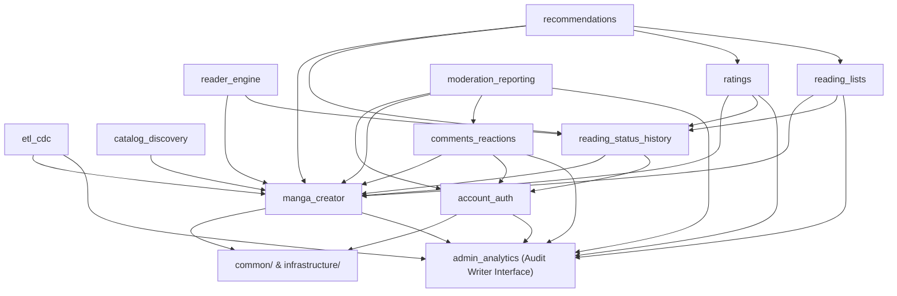

# Domain Module Boundaries & Ownership Map

> **Scope:** Authoritative ownership boundaries for the 12 domain modules required by the Manga Reader architecture (`apps/api/src/manga_reader/modules/`).  
> **Rule:** Zero circular dependencies between domain modules. Cross-module coordination flows strictly through explicit Application Service interfaces or Domain Events (via transactional outbox).

---

## 1. Module Inventory & Responsibility Matrix

| # | Module Package (`modules/<name>`) | Owned UC-IDs | Primary Owned Tables (Lab10 + ADRs) | Core Responsibility |
|---|---|---|---|---|
| 1 | `account_auth` | `UC-1.1..1.3`, `UC-6`, `UC-6.1..6.5` | `accounts`, `readers`, `admins`, `user_sessions`, `account_status_histories` | Registration (`PENDING_VERIFICATION`), OTP (Redis 120s), login/throttle, session rotation/revocation, RBAC resolution, profile/avatar/password, Admin lock/unlock. |
| 2 | `manga_creator` | `UC-2`, `UC-2.1..2.2`, `UC-2.4` | `mangas`, `manga_alt_titles`, `manga_links`, `manga_cover_arts`, `manga_stats`, `manga_stats_languages`, `manga_lineage`, `creators`, `creator_biographies`, `creator_links`, `manga_creators`, `tags`, `tag_names`, `manga_tags`, `chapters`, `chapter_pages`, `media_objects`, `manga_moderation_logs` | Canonical Manga/Creator/Tag/Chapter/Media aggregates, visibility lifecycle (`PUBLIC`/`HIDDEN`), safe local deletion + tombstone + `is_syncing` guard, stable chapter ordering (`chapter_numeric`, `language`, stable ID). |
| 3 | `catalog_discovery` | `UC-3`, `UC-3.1..3.6` | Read models / search index projections over `mangas`, `creators`, `tags`, `chapters` | Public catalogue listing, advanced tag/metadata filtering (`unknown` != `safe`), autocomplete (max 10), full-text/fuzzy title & creator search, Manga detail aggregation, Creator detail page. Enforces central `PUBLIC` scope. |
| 4 | `etl_cdc` | `UC-2.3` | `etl_jobs`, `etl_job_items`, `manga_sync_subscriptions`, `cdc_events` | `manga-reader-package:2.0` Draft 2020-12 contract validation, external-to-internal identity mapping, batch per-item atomic ETL, checksum/revision checks, CDC webhook intake, idempotency, retry & quarantine. |
| 5 | `reader_engine` | `UC-4`, `UC-4.1..4.6` | `reader_settings`, `reader_progress` (`M-001`) | Chapter open actions (`START`/`CONTINUE`/`SELECT`), ordered page manifest resolution, runtime media URL signing, display/direction/fit/preload settings, exact page progress persistence & revision fallback. |
| 6 | `reading_status_history` | `UC-3.10`, `UC-3.11` | `reading_status_records`, `reading_histories` | One-per-(reader, manga) reading status (`READING`/`PLAN_TO_READ`/`COMPLETED`/`ON_HOLD`/`DROPPED`), append-only chapter-open history, valid-view qualification & anti-refresh deduplication (`ADR-016`). |
| 7 | `ratings` | `UC-4.7`, `UC-4.8` | `ratings`, `rating_histories` | Score `1..10`, reading-history eligibility gate (`ADR-010`), single current rating upsert/soft-remove, append-only rating history, atomic `mangas.average_rating` synchronization. |
| 8 | `comments_reactions` | `UC-5`, `UC-5.1..5.6`, `UC-5.8` | `comments`, `comment_edit_histories`, `comment_reactions` | Manga/chapter comments (max 2,000 chars), one-level replies (`M-002`), edit history with spoiler snapshot (`M-003`), Admin spoiler lock, soft delete with reply placeholder, atomic desired-state `LIKE`/`DISLIKE` counters. |
| 9 | `moderation_reporting` | `UC-1.6`, `UC-1.7`, `UC-4.9`, `UC-5.7`, `UC-6.6` | `reports`, `account_reports`, `manga_reports`, `comment_reports`, `report_action_histories` | Reader report submission (with immutable target snapshots & anti-spam throttle), Admin moderation queue, missing-target auto-close (`CLOSED`, `ADR-020`), atomic resolve/ignore commands delegating target mutations to owning modules. |
| 10 | `reading_lists` | `UC-7`, `UC-7.1..7.6`, `UC-8`, `UC-8.1..8.5` | `reading_lists`, `list_items` | Private owner-only collections (`ADR-009`), normalized unique list names, clone/merge with dedupe & empty confirmation, desired-state membership sync, dynamic metadata stats (`visible_item_count` vs `item_count`, `ADR-014`). |
| 11 | `recommendations` | `UC-3.7`, `UC-3.8`, `UC-3.9` | `manga_content_vectors` (+ future offline item-similarity store) | Three distinct recommendation engines: Item-Based CF, Anonymized User-Based CF, Content-Based TF-IDF/embedding cosine similarity, plus deterministic cold-start fallbacks and `PUBLIC` filtering. |
| 12 | `admin_analytics` | `UC-1.4`, `UC-1.5`, `UC-2.5` | `activity_logs` (+ read-only analytical aggregations) | Immutable append-only audit/activity log ingestion & admin query, Reader behavior statistics, Manga interaction statistics (valid views, list adds, ratings, comments), counter reconciliation jobs. |

---

## 2. Allowed Dependency Graph (Acyclic)



### Explicit Anti-Cycle Rules
1. **`manga_creator` MUST NOT import `etl_cdc`, `catalog_discovery`, `reader_engine`, `ratings`, `comments_reactions`, `reading_lists`, `moderation_reporting`, or `recommendations`.** When a manga is hidden or deleted, `manga_creator` publishes domain events (`MANGA_HIDDEN`, `MANGA_SHOWN`, `MANGA_DELETED`) consumed by downstream modules (`reading_lists` membership cleanup, `comments_reactions` cleanup, `catalog_discovery` search index invalidation, `etl_cdc` CDC cancellation).
2. **`account_auth` MUST NOT import social or moderation modules.** `moderation_reporting` calls `account_auth`'s Lock/Unlock application command; `account_auth` never queries `reports`.
3. **`reading_status_history` MUST NOT import `reader_engine`.** `reader_engine` depends on `reading_status_history` to record chapter-open rows; `reading_status_history` never imports page-layout or media signing code.
4. **Audit Logging via Port:** Modules depend on the lightweight `AuditLogWriter` protocol in `common/audit.py` rather than importing `admin_analytics`'s repository implementation directly. `admin_analytics` provides the concrete implementation bound at app composition time.
5. **No `shared/utils` God-Folder:** Cross-cutting primitives in `common/` are strictly limited to domain-agnostic foundations (UTC clock, typed IDs, `AppError`, pagination/sort types, RBAC/audit/outbox protocols, secret redaction).

---

## 3. Standard Internal Layout of Each Module

Every directory in `apps/api/src/manga_reader/modules/<module_name>/` follows the same predictable sub-structure:

```text
modules/<module_name>/
├── __init__.py          # Public module contract exports ONLY
├── domain/              # Pure entities, enums, value objects, invariants
├── application/         # Commands, queries, use-case services, port protocols
├── infrastructure/      # SQLAlchemy repositories & external provider adapters
└── presentation/        # FastAPI APIRouter & transport request/response schemas (added per phase)
```

*(During Foundation Initialization, modules expose clean package boundaries and architectural docstrings; `etl_cdc` additionally implements the complete `manga-reader-package:2.0` contract validation and identity mapping layer required by Phase 4.)*
