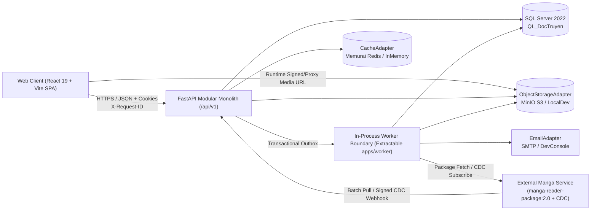

# System Architecture Overview

> **Architecture Style:** Layered Modular Monolith (Extractable Worker Boundary)  
> **Source Alignment:** `docs/agent-plan/Setup/00..14` & `docs/agent-plan/Design/00..08`, `docs/architecture/ADR-TECH-STACK.md`

---

## 1. High-Level Topology



---

## 2. Clean Layer Boundaries (Mandatory)

Every backend module enforces strict unidirectional dependency flow:

```text
Presentation / Transport Layer   (apps/api/src/manga_reader/api/v1/ & module presentation/)
        │  HTTP parsing, Pydantic request/response DTOs, status codes, auth dependencies
        ▼
Application Layer                (module application/ use-cases & commands/queries)
        │  Orchestration, transaction boundaries, authorization checks, audit/outbox dispatch
        ▼
Domain Layer                     (module domain/ entities, value objects, state machines, rules)
        │  Pure business invariants; ZERO FastAPI, SQLAlchemy, Redis, or HTTP imports
        ▲
Infrastructure / Persistence     (module infrastructure/ repositories + shared infrastructure/)
           SQLAlchemy models/queries, CacheAdapter, ObjectStorageAdapter, MediaUrlSigner, EmailAdapter
```

### Non-Negotiable Layer Rules
1. **No business logic in HTTP controllers or React UI components.** Controllers validate transport shape, delegate to Application services, and serialize envelopes.
2. **No SQL/ORM queries outside `infrastructure/` repositories.** Domain entities remain persistence-agnostic.
3. **No network I/O inside open database transactions.** External side effects (SMTP OTP/lock emails, upstream CDC webhook registration/cancellation, object storage GC, search index updates) are persisted to the transactional outbox inside the DB transaction and executed asynchronously by `workers/` after commit.
4. **No direct cross-module table joins or private imports.** Modules interact only through documented public Application services, shared `common/` primitives, or domain events.

---

## 3. Cross-Cutting Infrastructure Foundations

### 3.1 Request Lifecycle & Observability
Every HTTP request passes through:
1. **`CorrelationIdMiddleware`**: Reads inbound `X-Request-ID` (if safe/valid) or generates a UUIDv4; binds it to `contextvars` so all structured JSON logs, error responses (`meta.requestId`), and audit records share one trace ID.
2. **`StructuredAccessLogMiddleware`**: Emits structured JSON logs (method, path, status, duration_ms, request_id) while **strictly redacting** `Authorization`, `Cookie`, passwords, OTP codes, refresh tokens, and signed URL query strings.
3. **Centralized Exception Handlers**: Translates `AppError` subclasses, Pydantic `RequestValidationError`, and unhandled exceptions into the canonical error envelope (`10_API_CONTRACTS_AND_EVENTS.md` §1.2) without leaking stack traces, SQL errors, or secrets.
4. **Health & Readiness Endpoints**:
   - `GET /api/v1/health` — Liveness probe (always fast, zero external dependency calls, returns app metadata & UTC timestamp).
   - `GET /api/v1/health/ready` — Readiness probe checking configured adapters (Database, Cache, Object Storage) with clear `adapter_mode` (`production`/`dev-fallback`) reporting.

### 3.2 Identity Separation Invariant
The architecture enforces distinct typed identity wrappers (`common/identities.py`):
- **Internal Identities:** `AccountId` (UUID), `MangaId` (UUID), `ChapterId` (UUID), `MediaId` (int), `TagId` (int), `ListId` (UUID).
- **External Pool Identities:** `PoolMangaId` (`pm_...`), `PoolChapterId` (`pc_...`), `CreatorId` (canonical UUID/UUIDv5), `PageUid` (stable page string), `MediaObjectRef(bucket, object_key)`.
- `slug`, `title`, `chapter_number`, and runtime image URLs are **never** treated as primary keys.

### 3.3 Security & Authorization Foundation
- **Authentication Context (`SecurityPrincipal`)**: Resolves `account_id`, `session_id`, `role` (`ANONYMOUS` | `READER` | `ADMIN`), and `account_status` (`PENDING_VERIFICATION` | `ACTIVE` | `LOCKED`) server-side from verified JWT + active session check.
- **RBAC & Ownership Guards (`common/security.py`)**: Reusable dependency guards (`require_authenticated`, `require_active_reader`, `require_admin`, `assert_resource_owner`) ready for Phase 2+.
- **Secret-Safe Configuration (`config/settings.py`)**: Pydantic Settings validates all environment variables at startup, distinguishes missing source NFRs as configurable parameters (`NfrConfig`), and prevents secrets from appearing in serialized config dumps (`SecretStr`).

### 3.4 Media Delivery Architecture (`ADR-018`)
- Database (`media_objects`) stores ONLY `(bucket, object_key)` plus verified MIME, dimensions, size, MD5, and SHA-256.
- `MediaUrlSigner` generates runtime URLs on demand after verifying manga visibility (`PUBLIC`).
- `ObjectStorageAdapter` enforces bucket allowlists and rejects path-traversal keys (`..`, null bytes, leading slashes).

### 3.5 Development vs. Production Adapter Matrix

| Subsystem | Interface | Development Safe Default | Local Machine Live Option | Production Target |
|---|---|---|---|---|
| Database | `DatabaseManager` | SQLite (`aiosqlite`) for automated tests / MSSQL `QL_DocTruyen` for local dev | SQL Server 2022 `QL_DocTruyen` (`Trusted_Connection=yes`) | SQL Server / PostgreSQL managed DB |
| Cache / OTP / Throttle | `CacheAdapter` | `InMemoryCacheAdapter` (single-process, dev/test only) | Memurai Redis `127.0.0.1:6379/1` (`mreader:` prefix) | Managed Redis (TLS + Auth) |
| Object Storage | `ObjectStorageAdapter` | `LocalDevStorageAdapter` (`storage/local-dev/`) | MinIO `127.0.0.1:9010` (dedicated bucket `manga-reader-media`) | S3 / Cloudflare R2 / MinIO cluster |
| Media Delivery | `MediaUrlSigner` | Local signed proxy URL (`/api/v1/media/...`) | MinIO presigned or backend proxy | CloudFront / Cloudflare CDN signed URL |
| Email | `EmailAdapter` | `DevConsoleEmailAdapter` (redacts OTP in structured logs unless explicit dev debug flag) | SMTP (`smtp.gmail.com:587`) via `.env` | Transactional Email Provider (SES/Resend/Postmark) |
| Worker | `WorkerRunner` | In-process async runner (`apps/api/.../workers/`) | In-process async runner | Standalone `apps/worker` container(s) |

> **Transparency Rule:** Development adapters (`InMemoryCacheAdapter`, `LocalDevStorageAdapter`, `DevConsoleEmailAdapter`) explicitly report `"mode": "dev-fallback"` in readiness diagnostics and startup logs so a mock is never mistaken for a production integration.

---

## 4. Frontend Architecture (`apps/web`)

```text
apps/web/src/
├── app/           # App root, Providers (QueryClient, Theme, Auth), Route table (all 23 routes across 4 layouts)
├── layouts/       # PublicLayout, AuthenticatedLayout, AdminLayout, ReaderShellLayout
├── components/    # Design-system primitives + standardized states (Loading, Empty, Error, Forbidden, NotFound)
├── features/      # Domain-aligned feature modules (explore, search, manga, reader, creator, account, lists, admin)
├── hooks/         # Shared React hooks (useAuth, useTheme, useHealthStatus)
├── services/      # Typed ApiClient (correlation ID, envelope unwrapping, refresh-lock hook), AuthContext, env config
└── styles/        # tokens.css (design tokens, typography, light/dark themes), Tailwind CSS v4 entry
```

### Frontend Architectural Guarantees
- **Layout Isolation:** Public routes, Authenticated Reader routes (guarded with redirect/return-URL handling), Reader immersive shell, and Admin routes (role-guarded with explicit `ForbiddenState`) have distinct layout boundaries.
- **Standardized Frame States (`02_SCREEN_FRAME_EVENT_FLOWS.md` §3.3):** Every screen uses shared `LoadingState`, `EmptyState`, `ErrorState` (with retry), `ForbiddenState`, and `NotFoundState` components.
- **API Client Contract:** Single `apiClient` attaches `X-Request-ID`, unwraps `{data, meta}`, normalizes `{error: {code, message, details}}` into typed `ApiClientError`, and provides a single-flight concurrency lock hook for future `/api/v1/auth/refresh`.

---

## 5. Path to Future Service Extraction

When load or team size requires separating services (without rewriting domain code):
1. **Worker Extraction:** Move `apps/api/src/manga_reader/workers/` + `etl_cdc` / `recommendations` handlers into `apps/worker/` sharing the domain/repository package.
2. **Search Service Extraction:** Swap `SqlSearchIndexAdapter` for `OpenSearchAdapter` behind `SearchIndexAdapter`.
3. **Recommendation Service Extraction:** Run `recommendations` offline batch jobs against read replicas while keeping the API contract `/api/v1/manga/{id}/recommendations` unchanged.
