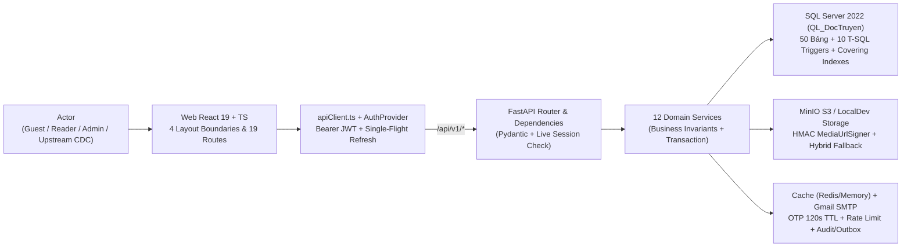

# Truy vết Use Case sang Code thực tế (`QL-DocTruyen`)

> **Dự án:** Hệ thống Đọc truyện Manga & Webtoon — Manga Reader (`QL-DocTruyen`)  
> **Khảo sát source:** ngày 23/11/2026 tại commit `3a52a2a` + bản cập nhật tab chi tiết manga (`MangaDetailPage.tsx`)  
> **Phạm vi:** Backend FastAPI (12 domain modules trong `apps/api/src/manga_reader/`), Web Frontend React 19 + TypeScript (19 routes trong `apps/web/src/`), Shared JSON Schema Contract v2.0 (`packages/contracts/`), và Cơ sở dữ liệu SQL Server 2022 (`QL_DocTruyen`, 50 bảng, 10 T-SQL triggers, hệ thống chỉ mục tối ưu hóa).  
> **Mục đích:** giúp người đọc lần thẳng từ từng use case nghiệp vụ (`UC-1` → `UC-8`) đến màn hình UI, API endpoint, service xử lý, bất biến nghiệp vụ (domain invariants), bảng dữ liệu/trigger và cấu hình vận hành đang chạy thực tế trong mã nguồn.

---

## Cách đọc và giới hạn kết luận

1. **Bộ khung Use Case chuẩn của dự án:** tài liệu sử dụng hệ thống đánh số chính tắc của `QL-DocTruyen` trong [01_PRODUCT_SCOPE_AND_REQUIREMENTS.md](../agent-plan/Setup/01_PRODUCT_SCOPE_AND_REQUIREMENTS.md#L110-L237) và [02_SCREEN_FRAME_EVENT_FLOWS.md](../agent-plan/Setup/02_SCREEN_FRAME_EVENT_FLOWS.md) gồm **8 nhóm Use Case cha** (`UC-1`..`UC-8`) và **50 Use Case con** (49 UC gốc trong Lab8/Lab9/Lab10 cộng thêm luồng mở rộng `UC-6.7` Quên mật khẩu OTP 3 bước & tích hợp Gmail SMTP thực).
2. **Thang đánh giá mức độ hiện thực hóa:**
   - **Có đường code chính:** đủ vòng UI → `apiClient` → FastAPI Router + Dependency Guard → Application Service → ORM/SQL Server (+ Activity Log / Outbox / MinIO / SMTP / Cache) với bộ kiểm thử tích hợp E2E đang chạy xanh (`pnpm check:all`).
   - **Có đường code chính (UI đang tạm giữ theo cờ cấu hình):** backend API, service, validator v2.0, webhook CDC và UI page đều đã viết hoàn chỉnh và có test; tuy nhiên cờ giao diện `VITE_EXTERNAL_ETL_ENABLED=false` đang tạm ẩn tab/wizard nhập nguồn ETL ngoài trên Admin Sidebar để ưu tiên kho truyện local 80 bộ thực tế (`import_local_mangalibrary.py`).
   - **Một phần / Ghi nhận khác biệt cấu hình:** có đường code chính nhưng cần lưu ý ranh giới môi trường (ví dụ cơ chế đọc trang Hybrid kết hợp MangaDex At-Home API + cache + ảnh demo WebP minh họa bằng Pillow; hoặc phần kiểm tra giới hạn tốc độ dùng In-Memory/Redis theo `.env`).
3. **Tính xác thực của tọa độ mã nguồn:** toàn bộ đường dẫn dạng `` `[file#Lstart-Lend](../../file#Lstart-Lend)` `` được trích xuất trực tiếp từ trạng thái source trên đĩa tại commit `3a52a2a` và truy vấn trực tiếp từ CSDL SQL Server `QL_DocTruyen`. Phần giao diện được tách chi tiết theo từng màn hình tại [WEB_UI_CODE_DICTIONARY.md](WEB_UI_CODE_DICTIONARY.md), còn danh mục toàn bộ REST API và lược đồ 47+3 bảng SQL Server nằm tại [BACKEND_API_AND_DATABASE_DICTIONARY.md](BACKEND_API_AND_DATABASE_DICTIONARY.md).

---

## Chỉ mục tên use case và chuỗi tìm kiếm

| Mã | Tên use case / chức năng chính xác | Chuỗi ký tự tìm liên quan (`Ctrl+F`) | Phần giải thích code |
|---|---|---|---|
| **UC-1** | Quản lý hoạt động độc giả | `AdminAccountsPage`, `AdminReportsPage`, `AdminAnalyticsService`, `activity_logs`, `reports` | [UC-1](#uc-1--quản-lý-hoạt-động-độc-giả) |
| UC-1.1 | Xem chi tiết tài khoản | `ProfilePage`, `getProfileByUsername`, `getAccountProfile`, `get_profile`, `isBirthDatePublic` | [UC-1.1](#uc-11--xem-chi-tiết-tài-khoản) |
| UC-1.2 | Khóa tài khoản | `Lock Account`, `adminLockAccount`, `admin_lock_account`, `ACCOUNT_LOCK`, `UserSessionModel`, `51010` | [UC-1.2](#uc-12--khóa-tài-khoản) |
| UC-1.3 | Mở khóa tài khoản | `Unlock Account`, `adminUnlockAccount`, `admin_unlock_account`, `ACCOUNT_UNLOCK` | [UC-1.3](#uc-13--mở-khóa-tài-khoản) |
| UC-1.4 | Xem nhật ký hoạt động (Activity Log) | `Accounts & Logs`, `formatActivityLogSummary`, `query_activity_logs`, `trg_activity_logs_immutable`, `51011` | [UC-1.4](#uc-14--xem-activity-log) |
| UC-1.5 | Thống kê hành vi độc giả | `My Reading Stats`, `inspectReaderStats`, `get_reader_statistics`, `validViews`, `topAuthors`, `topArtists` | [UC-1.5](#uc-15--thống-kê-hành-vi-độc-giả) |
| UC-1.6 | Xem danh sách & chi tiết báo cáo | `Moderation Reports Queue`, `adminListReports`, `adminGetReportDetail`, `ReportTargetCard`, `ADMIN` | [UC-1.6](#uc-16--xem-reports) |
| UC-1.7 | Xử lý báo cáo vi phạm | `Moderation Decision`, `adminResolveReport`, `admin_resolve_report`, `AUTO_CLOSE`, `report_action_histories` | [UC-1.7](#uc-17--xử-lý-report-vi-phạm) |
| **UC-2** | Quản lý truyện trên hệ thống | `AdminMangaPage`, `AdminEtlPage`, `MangaLifecycleService`, `EtlCdcService` | [UC-2](#uc-2--quản-lý-truyện-trên-hệ-thống) |
| UC-2.1 | Ẩn truyện | `Hide`, `adminHideManga`, `hide_manga`, `visibility_status = 'HIDDEN'`, `MANGA_HIDE` | [UC-2.1](#uc-21--ẩn-truyện) |
| UC-2.2 | Hiện truyện | `Show`, `adminShowManga`, `show_manga`, `visibility_status = 'PUBLIC'`, `isCdcEnabled` | [UC-2.2](#uc-22--hiện-truyện) |
| UC-2.3 | Chọn source tải truyện & bật CDC | `AdminEtlPage`, `PackageV2Validator`, `ingest_package_bytes`, `enable_manga_cdc`, `receive_cdc_webhook` | [UC-2.3](#uc-23--chọn-source-tải-truyện) |
| UC-2.4 | Xóa truyện an toàn & Tombstone | `Delete Permanently`, `adminDeleteManga`, `delete_manga`, `is_syncing`, `MangaDeletionTombstoneModel`, `51017` | [UC-2.4](#uc-24--xóa-truyện) |
| UC-2.5 | Thống kê tương tác & Reconcile | `AdminDashboardPage`, `adminMangaStatistics`, `adminReconcileCounters`, `get_manga_interaction_statistics` | [UC-2.5](#uc-25--thống-kê-tương-tác-truyện) |
| **UC-3** | Quản lý chọn truyện đọc / Discovery | `HomePage`, `ExplorePage`, `MangaDetailPage`, `AuthorDetailPage`, `CatalogDiscoveryService` | [UC-3](#uc-3--quản-lý-chọn-truyện-đọc--discovery) |
| UC-3.1 | Xem danh sách truyện | `Explore Catalog`, `listCatalog`, `list_catalog`, `UPDATED_DESC`, `CatalogPagination`, `IX_mangas_sort_` | [UC-3.1](#uc-31--xem-danh-sách-truyện) |
| UC-3.2 | Lọc danh sách nâng cao | `Advanced Manga Search`, `cycleTag`, `includeTags`, `excludeTags`, `tagMode`, `contentRating=safe` | [UC-3.2](#uc-32--lọc-danh-sách) |
| UC-3.3 | Tìm kiếm tên truyện & Autocomplete | `AppHeader`, `Ctrl K`, `autocomplete`, `search_manga`, `strip_accents`, `AltTitles` | [UC-3.3](#uc-33--tìm-kiếm-tên-truyện) |
| UC-3.4 | Tìm kiếm Tác giả / Họa sĩ | `Authors & Artists`, `CreatorPickerField`, `searchCreators`, `search_creators`, `MangaCreatorModel` | [UC-3.4](#uc-34--tìm-kiếm-tác-giả--họa-sĩ) |
| UC-3.5 | Xem chi tiết metadata truyện | `MangaDetailPage`, `getMangaDetail`, `get_manga_detail`, `Cover Art Gallery`, `Also Known As`, `Authors (Story)`, `Artists (Illustration)` | [UC-3.5](#uc-35--xem-chi-tiết-metadata-truyện) |
| UC-3.6 | Xem chi tiết Creator | `AuthorDetailPage`, `getCreatorDetail`, `listCreatorManga`, `FormattedMarkdownText`, `Works as Author`, `Works as Artist` | [UC-3.6](#uc-36--xem-chi-tiết-creator) |
| UC-3.7 | Gợi ý theo truyện (Item-based) | `Similar Manga`, `ITEM_BASED`, `recommend_item_based`, `_cosine_sparse` | [UC-3.7](#uc-37--gợi-ý-item-based) |
| UC-3.8 | Gợi ý theo độc giả (User-based) | `Recommended For You`, `getMyRecommendations`, `recommend_user_based`, `USER_BASED`, `POPULAR_FALLBACK` | [UC-3.8](#uc-38--gợi-ý-user-based) |
| UC-3.9 | Gợi ý theo nội dung (Content-based) | `Content Matches`, `CONTENT_BASED`, `recommend_content_based`, `MangaContentVectorModel`, `tfidf-v1` | [UC-3.9](#uc-39--gợi-ý-content-based) |
| UC-3.10 | Cập nhật trạng thái đọc | `Reading Status`, `LibraryPage`, `setReadingStatus`, `clearReadingStatus`, `ReadingStatusRecordModel` | [UC-3.10](#uc-310--cập-nhật-trạng-thái-đọc) |
| UC-3.11 | Xem lịch sử đọc cá nhân | `HistoryPage`, `getReadingHistory`, `get_history`, `mangaCoverUrl`, `Continue Reading` | [UC-3.11](#uc-311--lịch-sử-đọc-cá-nhân) |
| **UC-4** | Quản lý đọc truyện | `ChapterReaderPage`, `ReaderService`, `stream_signed_media`, `RatingService` | [UC-4](#uc-4--quản-lý-đọc-truyện) |
| UC-4.1 | Hiển thị danh sách chương | `Group by Volume`, `No Volume`, `listMangaChapters`, `chapter_numeric`, `IX_chapters_manga_volume` | [UC-4.1](#uc-41--hiển-thị-danh-sách-chương) |
| UC-4.2 | Lọc & sắp xếp chương | `Filter chapter volume`, `Filter chapter language`, `Jump to Ch. #`, `Chapter ranges`, `Chapter selector` | [UC-4.2](#uc-42--lọc--sắp-xếp-chương) |
| UC-4.3 | Chọn chương & tải trang ảnh | `openReader`, `stream_signed_media`, `MediaUrlSigner`, `_maybe_upgrade_mangadex_pages`, `render_manga_demo_page_webp` | [UC-4.3](#uc-43--chọn-chương--nạp-trang-ảnh) |
| UC-4.4 | Chế độ hiển thị trình đọc | `Reader Display & Controls`, `VERTICAL_WEBTOON`, `SINGLE_PAGE`, `DOUBLE_PAGE`, `LTR/RTL`, `updateReaderSettings` | [UC-4.4](#uc-44--chế-độ-hiển-thị-trình-đọc) |
| UC-4.5 | Đọc từ đầu (Read First) | `Start Reading`, `Read from Beginning`, `actionType=START`, `ReaderOpenAction.START` | [UC-4.5](#uc-45--đọc-từ-đầu) |
| UC-4.6 | Đọc tiếp & đồng bộ tiến độ/lượt xem | `Continue Reading`, `actionType=CONTINUE`, `saveProgress`, `completeViewSession`, `reader_progress`, `reading_histories`, `valid_view_threshold_seconds` | [UC-4.6](#uc-46--đọc-tiếp--đồng-bộ-tiến-độ) |
| UC-4.7 | Chấm điểm truyện (1–10) | `Your Rating`, `upsertRating`, `removeRating`, `RATING_REQUIRES_READING`, `trg_ratings_require_reading_history` | [UC-4.7](#uc-47--chấm-điểm-truyện) |
| UC-4.8 | Xem lịch sử chấm điểm | `Rating History`, `getMyRatingHistory`, `list_my_rating_history`, `RatingHistoryModel` | [UC-4.8](#uc-48--lịch-sử-chấm-điểm) |
| UC-4.9 | Báo cáo truyện / chương | `Report Issue`, `ReportModal`, `reportManga`, `submit_manga_report`, `ignore_all_reports` | [UC-4.9](#uc-49--báo-cáo-truyện--chương) |
| **UC-5** | Quản lý bình luận | `CommentsSection`, `CommentService`, `comments`, `comment_edit_histories`, `comment_reactions` | [UC-5](#uc-5--quản-lý-bình-luận) |
| UC-5.1 | Lọc & phân trang bình luận | `Filter comment scope`, `Filter spoiler comments`, `listComments`, `list_comments` | [UC-5.1](#uc-51--lọc-bình-luận) |
| UC-5.2 | Tạo bình luận & trả lời | `createComment`, `create_comment`, `MAX_COMMENT_LENGTH = 2000`, `parent_comment_id` | [UC-5.2](#uc-52--tạo-bình-luận--trả-lời) |
| UC-5.3 | Cờ Spoiler & Admin khóa Spoiler | `Mark as spoiler`, `FORCE_SPOILER`, `force_spoiler`, `is_spoiler_locked_by_admin`, `SPOILER_LOCKED_BY_ADMIN` | [UC-5.3](#uc-53--cờ-spoiler) |
| UC-5.4 | Chỉnh sửa bình luận | `editComment`, `edit_comment`, `CommentEditHistoryModel`, `previous_is_spoiler` | [UC-5.4](#uc-54--chỉnh-sửa-bình-luận) |
| UC-5.5 | Xem lịch sử chỉnh sửa bình luận | `Edited history`, `getCommentHistory`, `get_edit_history` | [UC-5.5](#uc-55--lịch-sử-chỉnh-sửa-bình-luận) |
| UC-5.6 | Xóa bình luận mềm | `Delete`, `deleteComment`, `soft_delete_comment`, `[Bình luận đã bị xóa]` | [UC-5.6](#uc-56--xóa-bình-luận) |
| UC-5.7 | Báo cáo bình luận | `Report`, `reportComment`, `submit_comment_report`, `51015`, `51016` | [UC-5.7](#uc-57--báo-cáo-bình-luận) |
| UC-5.8 | Thích / Không thích bình luận | `reactComment`, `set_reaction`, `CommentReactionModel`, `trg_comment_reactions_sync_counts` | [UC-5.8](#uc-58--thích--không-thích-bình-luận) |
| **UC-6** | Quản lý thông tin độc giả & Auth | `AuthPages`, `SettingsPage`, `AuthService`, `SmtpEmailAdapter` | [UC-6](#uc-6--quản-lý-thông-tin-độc-giả--auth) |
| UC-6.1 | Cập nhật Avatar | `uploadAvatar`, `update_avatar`, `Pillow`, `avatars/{account_id}/`, `S3CompatibleStorageAdapter` | [UC-6.1](#uc-61--cập-nhật-avatar) |
| UC-6.2 | Cập nhật hồ sơ hiển thị | `Profile & Avatar`, `updateProfile`, `update_profile`, `is_reserved_display_name`, `sanitize_user_text` | [UC-6.2](#uc-62--cập-nhật-hồ-sơ-hiển-thị) |
| UC-6.3 | Đổi mật khẩu & thu hồi phiên khác | `Password & Security`, `PasswordStrengthMeter`, `changePassword`, `change_password`, `PASSWORD_CHANGE` | [UC-6.3](#uc-63--đổi-mật-khẩu) |
| UC-6.4 | Đăng nhập & quản lý phiên JWT | `LoginPage`, `loginWithCredentials`, `login`, `refresh_session`, `mr_refresh_token`, `TOKEN_REUSE` | [UC-6.4](#uc-64--đăng-nhập) |
| UC-6.5 | Đăng ký & Xác thực Email OTP | `RegisterPage`, `VerifyEmailPage`, `register`, `verify_otp`, `resend_otp`, `SmtpEmailAdapter`, `120s` | [UC-6.5](#uc-65--xác-thực-email-otp) |
| UC-6.6 | Báo cáo tài khoản | `ProfilePage`, `Report User`, `reportAccount`, `submit_account_report`, `SELF_REPORT_FORBIDDEN`, `51014` | [UC-6.6](#uc-66--báo-cáo-tài-khoản) |
| UC-6.7 | Quên mật khẩu qua OTP 3 bước (Mở rộng) | `ForgotPasswordPage`, `forgotPassword`, `verifyResetOtp`, `resetPassword`, `request_password_reset` | [UC-6.7](#uc-67--quên-mật-khẩu-otp-3-bước-mở-rộng) |
| **UC-7** | Quản lý Reading List | `ReadingListsPage`, `ReadingListDetailPage`, `ReadingListService`, `reading_lists` | [UC-7](#uc-7--quản-lý-reading-list) |
| UC-7.1 | Tìm kiếm Reading List của tôi | `Search your lists`, `listMyLists`, `list_my_lists`, `owner_reader_account_id` | [UC-7.1](#uc-71--tìm-kiếm-reading-list) |
| UC-7.2 | Xem chi tiết Reading List riêng tư | `ReadingListDetailPage`, `getListDetail`, `get_list_detail`, `_require_owned_list`, `404` | [UC-7.2](#uc-72--xem-chi-tiết-reading-list) |
| UC-7.3 | Tạo Reading List mới | `Create New Private List`, `createList`, `create_list`, `normalize_list_name` | [UC-7.3](#uc-73--tạo-reading-list) |
| UC-7.4 | Chỉnh sửa Reading List | `updateList`, `update_list`, `DUPLICATE_RESOURCE` | [UC-7.4](#uc-74--chỉnh-sửa-reading-list) |
| UC-7.5 | Xóa Reading List | `Delete List`, `deleteList`, `delete_list`, `LIST_DELETED` | [UC-7.5](#uc-75--xóa-reading-list) |
| UC-7.6 | Sao chép / Gộp Reading Lists | `Clone or Merge Existing Lists`, `mergeCreateList`, `merge_create_list`, `confirmEmpty` | [UC-7.6](#uc-76--sao-chép--gộp-reading-list) |
| **UC-8** | Quản lý truyện trong Reading List | `ReadingListDetailPage`, `AddToListsModal`, `ListItemModel` | [UC-8](#uc-8--quản-lý-truyện-trong-reading-list) |
| UC-8.1 | Tìm kiếm truyện trong List | `Filter items in list`, `listItemsInList`, `list_items_filtered` (`q`) | [UC-8.1](#uc-81--tìm-kiếm-trong-list) |
| UC-8.2 | Lọc & sắp xếp truyện trong List | `Filter by publication status`, `Filter by my reading status`, `Sort reading list items` | [UC-8.2](#uc-82--lọc--sắp-xếp-trong-list) |
| UC-8.3 | Thêm truyện vào nhiều List | `AddToListsModal`, `syncMangaListMemberships`, `sync_manga_memberships`, `quickCreateList` | [UC-8.3](#uc-83--thêm-truyện-vào-list) |
| UC-8.4 | Gỡ truyện khỏi List | `Remove`, `removeItemFromList`, `remove_item_from_list`, `trg_list_items_sync_item_count` | [UC-8.4](#uc-84--xóa-truyện-khỏi-list) |
| UC-8.5 | Thống kê Metadata động của List | `Metadata & Stats`, `getListStats`, `get_metadata_stats`, `EMPTY_STATS_MESSAGE`, `InteractiveDonutChart`, `GenreRadarChart` | [UC-8.5](#uc-85--thống-kê-metadata-list) |

---

## Sơ đồ đọc luồng thực tế



Điểm cần nắm khi giải thích kiến trúc **Modular Monolith** của `QL-DocTruyen`:

1. Mọi thao tác trên Web React (`apps/web/src/features/**`) đi qua lớp bọc HTTP duy nhất `ApiClient` ([apiClient.ts#L89-L213](../../apps/web/src/services/apiClient.ts#L89-L213)), dùng `fetchWithLocalFallback()` ([apiClient.ts#L89-L121](../../apps/web/src/services/apiClient.ts#L89-L121)) fallback về `:8020` khi chạy localhost và trả mã `NETWORK_UNREACHABLE` có cấu trúc (trong khi [vite.config.ts#L5-L24](../../apps/web/vite.config.ts#L5-L24) cấu hình sẵn proxy `/api` cho cả `server` lẫn `preview`). Khi API trả về HTTP `401`, `ApiClient` dùng khóa đơn luồng `this.inflightRefresh` gọi `POST /api/v1/auth/refresh` (sử dụng cookie `HttpOnly` `mr_refresh_token` với `credentials: "include"`) trước khi phát lại request gốc một lần duy nhất ([apiClient.ts#L172-L187](../../apps/web/src/services/apiClient.ts#L172-L187)).
2. Mọi API FastAPI ([router.py#L25-L36](../../apps/api/src/manga_reader/api/v1/router.py#L25-L36)) kiểm tra xác thực **tức thời (live DB check)** tại hàm `get_current_principal()` ([dependencies.py#L37-L102](../../apps/api/src/manga_reader/api/v1/dependencies.py#L37-L102)): ngay cả khi JWT còn hạn 15 phút, hàm vẫn truy vấn `user_sessions` (`revoked_at IS NULL` & `expires_at > now`) và `accounts` (`status`). Do đó khi Admin khóa tài khoản (`LOCKED`) hoặc người dùng đổi/đặt lại mật khẩu, mọi phiên cũ bị vô hiệu hóa ngay lập tức ở request kế tiếp.
3. Toàn bộ truy vấn nghiệp vụ đặt trong khối `async with container.db.session() as db:` và tuân thủ ràng buộc cả ở tầng Application Service (Python) lẫn tầng T-SQL Trigger trên SQL Server (`QL_DocTruyen`). Các sự kiện quan trọng được ghi vào bảng bất biến `activity_logs` và bảng `outbox_events` trong cùng giao dịch trước khi gửi email/thu dọn media.

---

## Quyền actor khai báo trong source

Hệ thống phân định 4 nhóm Actor tại 2 lớp: **UI Layout Boundary** (`apps/web/src/layouts/*.tsx`) và **Backend Security Guard** (`apps/api/src/manga_reader/api/v1/dependencies.py`, `common/security.py`).

| Actor / Trạng thái | Cách nhận diện trong Source | Phạm vi trên Web UI (`router.tsx`) | Cổng kiểm soát Backend (`dependencies.py`) |
|---|---|---|---|
| **Guest (Khách vãng lai)** | `ANONYMOUS_PRINCIPAL` ([security.py#L46-L68](../../apps/api/src/manga_reader/common/security.py#L46-L68)); UI `isAuthenticated === false` | `PublicLayout` (`/`, `/explore`, `/search/advanced`, `/manga/:slug`, `/author/:id/:slug`, `/profile/:username`, `/login`, `/register`, `/forgot-password`, `/verify-email`) và `ReaderShellLayout` (`/manga/:slug/read`, `/manga/:slug/chapter/:chapterId`) | `get_current_principal` (không có header `Authorization`); các route cá nhân trả `401 AUTHENTICATION_REQUIRED`. |
| **Reader (`PENDING_VERIFICATION`)** | `AccountModel.status = 'PENDING_VERIFICATION'` | Không thể lấy JWT qua `login()` (bị chặn với `403 EMAIL_NOT_VERIFIED` kèm chuyển hướng nhập OTP ở `/verify-email` hoặc modal OTP ngay trên `LoginPage`) | `require_active_reader` ([security.py#L82-L87](../../apps/api/src/manga_reader/common/security.py#L82-L87)) từ chối mọi thao tác tương tác bằng `EmailNotVerifiedError` (`403`). |
| **Reader (`ACTIVE`)** | `role = 'READER'`, `status = 'ACTIVE'` | Mở thêm `AuthenticatedLayout` ([AuthenticatedLayout.tsx#L9-L66](../../apps/web/src/layouts/AuthenticatedLayout.tsx#L9-L66)): `/library`, `/history`, `/reading-lists`, `/reading-lists/:listId`, `/settings`, cùng các nút đánh giá, bình luận, reaction, report, reading status, add to list | `get_active_reader_principal` ([dependencies.py#L111-L114](../../apps/api/src/manga_reader/api/v1/dependencies.py#L111-L114)); mọi tài nguyên riêng tư (Reading List, History, Progress, Edit Comment) đều lấy `principal.account_id` từ JWT/Session, tuyệt đối không tin ID gửi từ client. |
| **Reader (`LOCKED`)** | `AccountModel.status = 'LOCKED'` | Nếu đang mở tab cũ sẽ bị `401`/`403` ở API kế tiếp; đăng nhập mới bị chặn bằng thông báo lý do khóa (`lockReason`) | `get_current_principal` + `require_authenticated` / `require_active_reader` ném `AccountLockedError` (`403 ACCOUNT_LOCKED`), toàn bộ session đã bị đánh dấu `revoked_at` với `revoke_reason = 'ACCOUNT_LOCK'`. |
| **Admin (`SUPER_ADMIN` / `MODERATOR`)** | Có bản ghi tương ứng trong bảng `admins` (`AdminModel`, `role_level`) và `status = 'ACTIVE'` | Mở thêm `AdminLayout` ([AdminLayout.tsx#L22-L75](../../apps/web/src/layouts/AdminLayout.tsx#L22-L75)): `/admin`, `/admin/accounts`, `/admin/manga`, `/admin/reports`, `/admin/etl` (ẩn menu khi `VITE_EXTERNAL_ETL_ENABLED=false`) | `get_admin_principal` ([dependencies.py#L117-L120](../../apps/api/src/manga_reader/api/v1/dependencies.py#L117-L120)) kiểm tra `principal.role == ADMIN` và `status == ACTIVE`; ngoài ra `require_active_reader` cũng cho phép `ADMIN` ACTIVE đọc truyện/thao tác Reader nếu cần. |
| **External Manga Service** | Webhook HMAC (`X-Webhook-Signature`) với `upstream_webhook_secret` | Không có UI riêng (tương tác qua endpoint hệ thống hoặc `AdminEtlPage`) | `/api/v1/webhooks/cdc` kiểm tra chữ ký HMAC-SHA256 trên raw body trong `EtlCdcService.receive_cdc_event()` ([etl_cdc/service.py#L880-L893](../../apps/api/src/manga_reader/modules/etl_cdc/application/service.py#L880-L893)). |

**Nhận xét đối chiếu về phân quyền:** hệ thống hiện thực nhất quán mô hình **Server-Side Authority**. Mọi guard ẩn hiện nút trên React UI (ví dụ `isAdmin` ở `AdminLayout.tsx`, `isAuthenticated` ở `MangaDetailPage.tsx`) chỉ phục vụ trải nghiệm người dùng; tầng Backend tự kiểm tra lại toàn bộ điều kiện sở hữu, trạng thái `PUBLIC/ACTIVE` của truyện, và vai trò quản trị trên từng API call. Riêng `admins.role_level` có lưu cột trong DB (`SUPER_ADMIN` / `MODERATOR`), hiện tại MVP cấp toàn quyền quản trị đồng đều tại `require_admin()` ([security.py#L90-L95](../../apps/api/src/manga_reader/common/security.py#L90-L95)), ngoại trừ bất biến cấm khóa tài khoản Admin khác tại `UC-1.2`.

---

## Bản đồ các nhóm Use Case cha

| Mã cha | Nhóm nghiệp vụ | Thành phần / UC con | Màn hình Web chính | Module Backend chính |
|---|---|---|---|---|
| **UC-1** | Quản lý hoạt động độc giả | `UC-1.1` → `UC-1.7` | `AdminAccountsPage`, `AdminReportsPage`, `ProfilePage`, `SettingsPage` | `account_auth`, `admin_analytics`, `moderation_reporting` |
| **UC-2** | Quản lý truyện trên hệ thống | `UC-2.1` → `UC-2.5` | `AdminDashboardPage`, `AdminMangaPage`, `AdminEtlPage` | `manga_creator`, `etl_cdc`, `admin_analytics` |
| **UC-3** | Quản lý chọn truyện đọc / Discovery | `UC-3.1` → `UC-3.11` | `HomePage`, `ExplorePage`, `MangaDetailPage`, `AuthorDetailPage`, `LibraryPage`, `HistoryPage`, `AppHeader` | `catalog_discovery`, `recommendations`, `reader_engine` |
| **UC-4** | Quản lý đọc truyện | `UC-4.1` → `UC-4.9` | `MangaDetailPage`, `ChapterReaderPage`, `SettingsPage`, `ReportModal` | `reader_engine`, `catalog_discovery`, `ratings`, `moderation_reporting` |
| **UC-5** | Quản lý bình luận | `UC-5.1` → `UC-5.8` | `CommentsSection` (nhúng trong `MangaDetailPage` & `ChapterReaderPage`) | `comments_reactions`, `moderation_reporting` |
| **UC-6** | Quản lý thông tin độc giả & Auth | `UC-6.1` → `UC-6.7` | `AuthPages`, `ProfilePage`, `SettingsPage`, `ReportModal` | `account_auth`, `moderation_reporting`, `infrastructure/email.py` |
| **UC-7** | Quản lý Reading List | `UC-7.1` → `UC-7.6` | `ReadingListsPage`, `ReadingListDetailPage` | `reading_lists` |
| **UC-8** | Quản lý truyện trong Reading List | `UC-8.1` → `UC-8.5` | `ReadingListDetailPage`, `AddToListsModal`, `DataStoryCharts` | `reading_lists` |

---

<a id="uc-1--quản-lý-hoạt-động-độc-giả"></a>
## UC-1 — Quản lý hoạt động độc giả

Nhóm chức năng giám sát, kiểm duyệt, khóa/mở khóa tài khoản và theo dõi nhật ký/thống kê hành vi độc giả.

<a id="uc-11--xem-chi-tiết-tài-khoản"></a>
### UC-1.1 — Xem chi tiết tài khoản

**Actor thiết kế:** Độc giả (xem công khai / tự xem mình), Admin. **Đánh giá:** Có đường code chính.

**Luồng code:**
1. Trên Web UI, khi truy cập `/profile/:username`, component `ProfilePage` ([ProfilePage.tsx#L10-L203](../../apps/web/src/features/account/ProfilePage.tsx#L10-L203)) gọi `apiClient.getProfileByUsername(username)` → `GET /api/v1/profiles/{username}` ([account_auth/router.py#L268-L277](../../apps/api/src/manga_reader/modules/account_auth/presentation/router.py#L268-L277)). Với chính người đang đăng nhập hoặc khi vào `/settings`, hệ thống dùng `GET /api/v1/account/me` ([account_auth/router.py#L245-L253](../../apps/api/src/manga_reader/modules/account_auth/presentation/router.py#L245-L253)), còn Admin có thêm `GET /api/v1/admin/accounts/{account_id}` ([account_auth/router.py#L367-L376](../../apps/api/src/manga_reader/modules/account_auth/presentation/router.py#L367-L376)) và màn hình tra cứu `AdminAccountsPage` ([AdminPages.tsx#L751-L1492](../../apps/web/src/features/admin/AdminPages.tsx#L751-L1492)).
2. Backend `AuthService.get_profile()` ([account_auth/service.py#L574-L625](../../apps/api/src/manga_reader/modules/account_auth/application/service.py#L574-L625)) truy vấn `accounts`, `readers` và `admins`, tính `is_self = (viewer.account_id == account.account_id)` và `is_privileged = is_self or viewer.is_admin`.
3. Các trường công khai (`displayName`, `avatarUrl` đã ký HMAC động, `bio`, `role`, `createdAt`) luôn trả về; riêng `birthDate` chỉ trả khi `reader.is_birth_date_public` đúng hoặc `is_privileged` đúng; các trường nhạy cảm (`email`, `lockReason`, `lockedAt`) chỉ được đính kèm khi `is_privileged == True`.

**Đối chiếu:** che giấu email và ngày sinh theo quyền riêng tư được thực thi ở server DTO ngay tại `AuthService.get_profile()`, không chỉ ẩn trên giao diện.

**Điểm mở source:**
- UI Profile: [ProfilePage.tsx#L10-L203](../../apps/web/src/features/account/ProfilePage.tsx#L10-L203)
- UI Admin Lookup & Modal Inspection: [AdminPages.tsx#L751-L1492](../../apps/web/src/features/admin/AdminPages.tsx#L751-L1492)
- Router Auth & Profile: [account_auth/router.py#L245-L277](../../apps/api/src/manga_reader/modules/account_auth/presentation/router.py#L245-L277), [account_auth/router.py#L336-L376](../../apps/api/src/manga_reader/modules/account_auth/presentation/router.py#L336-L376)
- Service `get_profile`: [account_auth/service.py#L574-L625](../../apps/api/src/manga_reader/modules/account_auth/application/service.py#L574-L625)
- ORM: `AccountModel`, `ReaderModel`, `AdminModel` ([models_auth.py#L26-L83](../../apps/api/src/manga_reader/infrastructure/orm/models_auth.py#L26-L83))

<a id="uc-12--khóa-tài-khoản"></a>
### UC-1.2 — Khóa tài khoản

**Actor thiết kế:** Admin. **Đánh giá:** Có đường code chính, bảo vệ kép ở cả tầng Python Service và T-SQL Trigger.

**Luồng code:**
1. Tại `AdminAccountsPage`, Admin nhập lý do kiểm duyệt vào ô `"Lock/Unlock audit reason..."` và bấm nút `"Lock Account"` ([AdminPages.tsx#L797-L812](../../apps/web/src/features/admin/AdminPages.tsx#L797-L812), [AdminPages.tsx#L985-L1020](../../apps/web/src/features/admin/AdminPages.tsx#L985-L1020)). Hoặc trong `AdminReportsPage`, Admin chọn quyết định `LOCK_ACCOUNT` khi xử lý report.
2. `apiClient.adminLockAccount(accountId, reason)` gửi `POST /api/v1/admin/accounts/{account_id}/lock` ([account_auth/router.py#L379-L396](../../apps/api/src/manga_reader/modules/account_auth/presentation/router.py#L379-L396)) qua dependency `get_admin_principal`.
3. `AuthService.admin_lock_account()` ([account_auth/service.py#L1086-L1182](../../apps/api/src/manga_reader/modules/account_auth/application/service.py#L1086-L1182)) thực hiện tuần tự:
   - Xác thực `reason` không rỗng (`1..500` ký tự).
   - Kiểm tra mục tiêu có tồn tại trong `admins` không; nếu có ném `ForbiddenError` (`403`) theo quy tắc không được khóa Admin qua luồng Reader moderation.
   - Kiểm tra trạng thái hiện tại là `ACTIVE`; chuyển `status = 'LOCKED'`, ghi `locked_at`, `locked_by_admin_account_id`, `lock_reason`.
   - Cập nhật hàng loạt `user_sessions` có `revoked_at IS NULL` thành `revoked_at = now`, `revoke_reason = 'ACCOUNT_LOCK'` để cắt toàn bộ phiên đang hoạt động ngay lập tức.
   - Ghi nhận đồng thời `AccountStatusHistoryModel` (`action_type='LOCK'`), `ActivityLogModel` (`ACCOUNT_LOCK`), `OutboxEventModel` (`ACCOUNT_LOCKED`) và gửi email thông báo tới địa chỉ của tài khoản bị khóa.
4. Ở tầng SQL Server, trigger `trg_account_status_histories_guard` (mã lỗi `51010`) trên bảng `account_status_histories` cũng chặn chèn bản ghi LOCK/UNLOCK nếu `target_account_id` nằm trong `admins`.

**Đối chiếu:** mọi bất biến trong đặc tả (Admin-only, cấm khóa Admin khác, bắt buộc lý do, thu hồi session tức thì, log lịch sử, gửi mail) đều được bảo chứng ở tầng Backend + DB.

**Điểm mở source:**
- UI: [AdminPages.tsx#L797-L812](../../apps/web/src/features/admin/AdminPages.tsx#L797-L812), [AdminPages.tsx#L985-L1020](../../apps/web/src/features/admin/AdminPages.tsx#L985-L1020)
- Router: [account_auth/router.py#L379-L396](../../apps/api/src/manga_reader/modules/account_auth/presentation/router.py#L379-L396)
- Service: [account_auth/service.py#L1086-L1182](../../apps/api/src/manga_reader/modules/account_auth/application/service.py#L1086-L1182) `admin_lock_account`
- Live Session Guard: [dependencies.py#L74-L102](../../apps/api/src/manga_reader/api/v1/dependencies.py#L74-L102)
- ORM & Trigger: `AccountStatusHistoryModel` ([models_auth.py#L104-L123](../../apps/api/src/manga_reader/infrastructure/orm/models_auth.py#L104-L123)), T-SQL `trg_account_status_histories_guard` (`51010`)

<a id="uc-13--mở-khóa-tài-khoản"></a>
### UC-1.3 — Mở khóa tài khoản

**Actor thiết kế:** Admin. **Đánh giá:** Có đường code chính; ghi chú cooldown 7 ngày được giữ ở trạng thái chủ động theo đúng ADR.

**Luồng code:**
1. Trên `AdminAccountsPage`, với tài khoản `LOCKED`, Admin nhập lý do và nhấn `"Unlock Account"` → `apiClient.adminUnlockAccount()` → `POST /api/v1/admin/accounts/{account_id}/unlock` ([account_auth/router.py#L399-L416](../../apps/api/src/manga_reader/modules/account_auth/presentation/router.py#L399-L416)).
2. `AuthService.admin_unlock_account()` ([account_auth/service.py#L1184-L1239](../../apps/api/src/manga_reader/modules/account_auth/application/service.py#L1184-L1239)) xác minh `reason` (1..500 ký tự), kiểm tra `target.status == 'LOCKED'`, khôi phục `status = 'ACTIVE'`, xóa `locked_at` / `locked_by_admin_account_id` / `lock_reason`, ghi `AccountStatusHistoryModel` (`UNLOCK`), `ActivityLogModel` (`ACCOUNT_UNLOCK`), commit và gửi email thông báo mở khóa.

**Đối chiếu:** đúng theo `01_PRODUCT_SCOPE_AND_REQUIREMENTS.md §4 UC-1.3`, schema không ép buộc khóa cứng cooldown 7 ngày một cách âm thầm mà cho phép Admin chủ động mở khóa kèm lý do lưu vết bất biến.

**Điểm mở source:**
- UI & API Client: [AdminPages.tsx#L797-L812](../../apps/web/src/features/admin/AdminPages.tsx#L797-L812), [apiClient.ts#L706-L711](../../apps/web/src/services/apiClient.ts#L706-L711)
- Router & Service: [account_auth/router.py#L399-L416](../../apps/api/src/manga_reader/modules/account_auth/presentation/router.py#L399-L416), [account_auth/service.py#L1184-L1239](../../apps/api/src/manga_reader/modules/account_auth/application/service.py#L1184-L1239)

<a id="uc-14--xem-activity-log"></a>
### UC-1.4 — Xem Activity Log

**Actor thiết kế:** Admin. **Đánh giá:** Có đường code chính, cải tiến UX hiển thị câu kể tiếng người kèm JSON kỹ thuật và bảo vệ bất biến bằng Trigger SQL Server.

**Luồng code:**
1. Trên `AdminAccountsPage`, khu vực dưới là bảng `"System Activity Logs"` (`AdminPages.tsx#L1048-L1140`), đồng thời khi bấm nút `"Logs & Stats"` cạnh một tài khoản sẽ mở modal `"Account Inspection & Logs"` gọi `GET /api/v1/admin/activity-logs?accountId=...&eventType=...` ([AdminPages.tsx#L787-L795](../../apps/web/src/features/admin/AdminPages.tsx#L787-L795), [AdminPages.tsx#L1143-L1488](../../apps/web/src/features/admin/AdminPages.tsx#L1143-L1488)).
2. Router `admin_list_all_activity_logs` và `admin_list_account_activity_logs` ([admin_analytics/router.py#L37-L89](../../apps/api/src/manga_reader/modules/admin_analytics/presentation/router.py#L37-L89)) bắt buộc `get_admin_principal`.
3. `AdminAnalyticsService.query_activity_logs()` ([admin_analytics/service.py#L36-L74](../../apps/api/src/manga_reader/modules/admin_analytics/application/service.py#L36-L74)) lọc theo `account_id`, `event_type`, sắp xếp `created_at DESC` (mới nhất trước), phân trang `offset/limit`.
4. Phía UI, hàm `formatActivityLogSummary()` ([AdminPages.tsx#L103-L162](../../apps/web/src/features/admin/AdminPages.tsx#L103-L162)) chuyển mã sự kiện kỹ thuật + `details` JSON thành câu mô tả dễ hiểu cho người không chuyên IT (ví dụ `"Account Locked — Lý do: ..."`), giữ phần JSON thô ở dạng thẻ mở rộng phụ.
5. Ở tầng dữ liệu, bảng `activity_logs` có T-SQL Trigger `trg_activity_logs_immutable` (`INSTEAD OF UPDATE, DELETE`, mã lỗi `51011`) cấm hoàn toàn mọi thao tác sửa hoặc xóa nhật ký. Khi ghi log qua `append_activity_log()` ([audit_outbox.py#L18-L45](../../apps/api/src/manga_reader/infrastructure/audit_outbox.py#L18-L45)), hàm `redact_mapping()` tự động che dấu các trường nhạy cảm (mật khẩu, token, OTP).

**Đối chiếu:** thỏa mãn 100% UC-1.4 về quyền Admin-only, sắp xếp mới nhất trước, phân trang, lọc theo sự kiện/tài khoản, bất biến chỉ đọc và an toàn dữ liệu.

**Điểm mở source:**
- UI & Formatter dễ hiểu: [AdminPages.tsx#L103-L162](../../apps/web/src/features/admin/AdminPages.tsx#L103-L162), [AdminPages.tsx#L787-L795](../../apps/web/src/features/admin/AdminPages.tsx#L787-L795), [AdminPages.tsx#L1048-L1488](../../apps/web/src/features/admin/AdminPages.tsx#L1048-L1488)
- Router & Service: [admin_analytics/router.py#L37-L89](../../apps/api/src/manga_reader/modules/admin_analytics/presentation/router.py#L37-L89), [admin_analytics/service.py#L36-L74](../../apps/api/src/manga_reader/modules/admin_analytics/application/service.py#L36-L74)
- Audit Redaction & SQL Trigger: [audit_outbox.py#L18-L45](../../apps/api/src/manga_reader/infrastructure/audit_outbox.py#L18-L45), [models_auth.py#L125-L143](../../apps/api/src/manga_reader/infrastructure/orm/models_auth.py#L125-L143), T-SQL `trg_activity_logs_immutable` (`51011`)

<a id="uc-15--thống-kê-hành-vi-độc-giả"></a>
### UC-1.5 — Thống kê hành vi độc giả

**Actor thiết kế:** Độc giả (tự xem mình), Admin (xem của độc giả bất kỳ). **Đánh giá:** Có đường code chính với dashboard biểu đồ SVG tương tác đa chiều.

**Luồng code:**
1. Độc giả mở tab `"My Reading Stats"` tại `/settings` ([SettingsPage.tsx#L155-L159](../../apps/web/src/features/account/SettingsPage.tsx#L155-L159), [SettingsPage.tsx#L1518-L1940](../../apps/web/src/features/account/SettingsPage.tsx#L1518-L1940)) → `GET /api/v1/account/me/reading-statistics`; Admin bấm `"Logs & Stats"` trong `AdminAccountsPage` → `inspectReaderStats()` ([AdminPages.tsx#L814-L833](../../apps/web/src/features/admin/AdminPages.tsx#L814-L833)) → `GET /api/v1/admin/accounts/{account_id}/reading-statistics`.
2. `AdminAnalyticsService.get_reader_statistics()` ([admin_analytics/service.py#L76-L181](../../apps/api/src/manga_reader/modules/admin_analytics/application/service.py#L76-L181)) tổng hợp tách biệt (ADR-016):
   - Từ `reading_histories`: `chapterOpens` (tổng số lần mở chương) vs `validViews` (số lần đọc đạt ngưỡng `is_valid_view = True`), `uniqueChaptersRead`, `uniqueMangasInteracted`.
   - Từ `reading_status_records`: `readingStatusBreakdown` (`READING`, `PLAN_TO_READ`, `COMPLETED`, `ON_HOLD`, `DROPPED`).
   - Từ `ratings`: `ratingsCount`, `averageRatingGiven` (loại trừ `is_removed=True`).
   - Từ `manga_tags` & `manga_creators`: `topTags` (Top 8 thẻ) và `topCreators` (Top 12 tác giả/họa sĩ kèm mảng `roles` để UI tách 2 bảng riêng `"Top Authors (Story)"` và `"Top Artists (Illustration)"`).
3. Phía UI, khi `hasData === false`, cả `SettingsPage` và `AdminAccountsPage` đều hiển thị Empty State thân thiện kèm nút kêu gọi hành động sang `/explore`. Khi có dữ liệu, trang dựng KPI Cards + `EngagementFunnelChart`, `InteractiveDonutChart`, `GenreRadarChart` và 2 bảng xếp hạng tách biệt Tác giả/Họa sĩ.

**Đối chiếu:** phân tách rõ lượt mở chương và lượt đọc hợp lệ; tôn trọng phạm vi tự xem (`get_authenticated_principal`) vs Admin xem (`get_admin_principal`); có empty state cho người dùng mới.

**Điểm mở source:**
- UI Reader Stats: [SettingsPage.tsx#L1518-L1940](../../apps/web/src/features/account/SettingsPage.tsx#L1518-L1940)
- UI Admin Stats Tab: [AdminPages.tsx#L814-L833](../../apps/web/src/features/admin/AdminPages.tsx#L814-L833), [AdminPages.tsx#L1200-L1417](../../apps/web/src/features/admin/AdminPages.tsx#L1200-L1417)
- Biểu đồ tương tác: [DataStoryCharts.tsx#L23-L781](../../apps/web/src/components/DataStoryCharts.tsx#L23-L781)
- Router & Service: [admin_analytics/router.py#L24-L34](../../apps/api/src/manga_reader/modules/admin_analytics/presentation/router.py#L24-L34), [admin_analytics/router.py#L92-L105](../../apps/api/src/manga_reader/modules/admin_analytics/presentation/router.py#L92-L105), [admin_analytics/service.py#L76-L181](../../apps/api/src/manga_reader/modules/admin_analytics/application/service.py#L76-L181)

<a id="uc-16--xem-reports"></a>
### UC-1.6 — Xem reports

**Actor thiết kế:** Admin. **Đánh giá:** Có đường code chính, kèm giao diện 2 cột `Moderation Workbench` chuyển toàn bộ snapshot sang thẻ dễ đọc cho người dùng phổ thông.

**Luồng code:**
1. Tại `/admin/reports`, `AdminReportsPage` ([AdminPages.tsx#L1741-L2424](../../apps/web/src/features/admin/AdminPages.tsx#L1741-L2424)) tải danh sách báo cáo mặc định `status="PENDING"` qua `GET /api/v1/admin/reports` ([moderation_reporting/router.py#L110-L137](../../apps/api/src/manga_reader/modules/moderation_reporting/presentation/router.py#L110-L137)), hỗ trợ lọc theo 3 loại (`COMMENT`, `MANGA`, `ACCOUNT`), 4 trạng thái (`PENDING`, `RESOLVED`, `IGNORED`, `CLOSED`), tìm kiếm nhanh trên hàng đợi và phân trang `CatalogPagination`.
2. Khi Admin chọn `"Inspect"` một báo cáo, `openReport(reportId)` gọi `GET /api/v1/admin/reports/{report_id}` ([moderation_reporting/router.py#L140-L148](../../apps/api/src/manga_reader/modules/moderation_reporting/presentation/router.py#L140-L148)).
3. `ModerationReportingService._inspect_target_state()` ([moderation_reporting/service.py#L266-L352](../../apps/api/src/manga_reader/modules/moderation_reporting/application/service.py#L266-L352)) truy xuất trực tiếp dữ liệu thật của thực thể mục tiêu (`commentAuthorUsername`, `mangaTitle`, `chapterNumber`, `snapshot`, `currentStatus`, `currentVisibility`) để `ReportTargetCard` ([AdminPages.tsx#L164-L386](../../apps/web/src/features/admin/AdminPages.tsx#L164-L386)) hiển thị trực quan bằng thẻ trích dẫn, liên kết dẫn thẳng tới truyện/tác giả/bình luận thay vì hiển thị JSON thô.
4. Theo quy tắc `ADR-020`, trong `admin_get_report_detail()` ([moderation_reporting/service.py#L416-L496](../../apps/api/src/manga_reader/modules/moderation_reporting/application/service.py#L416-L496)), nếu báo cáo đang `PENDING` nhưng đối tượng đã bị xóa/ẩn (`not target_exists`), hệ thống tự động chuyển sang `CLOSED` với `actor_type = 'SYSTEM'`, `action_taken = 'SYSTEM_AUTO_CLOSE_TARGET_MISSING'` và ghi `ReportActionHistoryModel` + `ActivityLogModel`.

**Đối chiếu:** Admin-only (`get_admin_principal`), mặc định hàng đợi `PENDING`, sắp xếp mới nhất trước, auto-close bằng `SYSTEM` khi target không còn tồn tại, giải nghĩa đầy đủ dữ liệu cho người không chuyên IT.

**Điểm mở source:**
- UI Workbench & Card: [AdminPages.tsx#L164-L386](../../apps/web/src/features/admin/AdminPages.tsx#L164-L386), [AdminPages.tsx#L1741-L2253](../../apps/web/src/features/admin/AdminPages.tsx#L1741-L2253)
- Router & Service: [moderation_reporting/router.py#L110-L148](../../apps/api/src/manga_reader/modules/moderation_reporting/presentation/router.py#L110-L148), [moderation_reporting/service.py#L266-L496](../../apps/api/src/manga_reader/modules/moderation_reporting/application/service.py#L266-L496)

<a id="uc-17--xử-lý-report-vi-phạm"></a>
### UC-1.7 — Xử lý report vi phạm

**Actor thiết kế:** Admin. **Đánh giá:** Có đường code chính; toàn bộ hệ quả nghiệp vụ + cập nhật trạng thái + lịch sử xử lý nằm trong cùng một Transaction DB.

**Luồng code:**
1. Trên Inspector Panel của `AdminReportsPage` ([AdminPages.tsx#L2255-L2415](../../apps/web/src/features/admin/AdminPages.tsx#L2255-L2415)), Admin chọn một hành động nằm trong `selected.allowedActions` do server trả về tương ứng từng loại report:
   - `ACCOUNT`: `LOCK_ACCOUNT`, `IGNORE`
   - `MANGA`: `HIDE_MANGA`, `DELETE_MANGA`, `IGNORE` (+ tùy chọn `ignoreFutureReports`)
   - `COMMENT`: `DELETE_COMMENT`, `FORCE_SPOILER`, `LOCK_ACCOUNT`, `IGNORE`
2. Bắt buộc nhập ghi chú xử lý (hoặc chọn nhanh từ `QUICK_NOTES` tại [AdminPages.tsx#L1846-L1852](../../apps/web/src/features/admin/AdminPages.tsx#L1846-L1852)) rồi nhấn `"Apply Resolution"` → `POST /api/v1/admin/reports/{report_id}/resolve` ([moderation_reporting/router.py#L151-L169](../../apps/api/src/manga_reader/modules/moderation_reporting/presentation/router.py#L151-L169)).
3. `ModerationReportingService.admin_resolve_report()` ([moderation_reporting/service.py#L498-L623](../../apps/api/src/manga_reader/modules/moderation_reporting/application/service.py#L498-L623)) kiểm tra `status == 'PENDING'`, kiểm tính hợp lệ của `actionType`, kiểm tra lại sự tồn tại của đối tượng mục tiêu; sau đó gọi trực tiếp service nghiệp vụ tương ứng với `commit=False`:
   - `AuthService.admin_lock_account(..., commit=False)`
   - `MangaLifecycleService.hide_manga(..., source_report_id=report.report_id, commit=False)` hoặc `.delete_manga(..., commit=False)`
   - `CommentService.soft_delete_comment(..., commit=False)` hoặc `.force_spoiler(..., commit=False)`
   - Nếu là `MANGA` và tick `ignoreFutureReports`, bật cờ `mangas.ignore_all_reports = True` (công tắc nguồn duy nhất theo `ADR-006`).
4. Cập nhật `ReportModel.status` (`RESOLVED` hoặc `IGNORED`), thêm dòng bất biến vào `ReportActionHistoryModel` và `ActivityLogModel`, sau đó `await session.commit()` duy nhất cho toàn bộ chuỗi tác vụ.

**Đối chiếu:** thỏa mãn nguyên tắc giao dịch nguyên tử (atomic command boundary) ở cả tầng Service và DB, đảm bảo không xảy ra tình trạng xử lý target xong nhưng report vẫn kẹt `PENDING`.

**Điểm mở source:**
- UI Resolution Form: [AdminPages.tsx#L1825-L1852](../../apps/web/src/features/admin/AdminPages.tsx#L1825-L1852), [AdminPages.tsx#L2255-L2415](../../apps/web/src/features/admin/AdminPages.tsx#L2255-L2415)
- Router & Service: [moderation_reporting/router.py#L151-L169](../../apps/api/src/manga_reader/modules/moderation_reporting/presentation/router.py#L151-L169), [moderation_reporting/service.py#L39-L44](../../apps/api/src/manga_reader/modules/moderation_reporting/application/service.py#L39-L44), [moderation_reporting/service.py#L498-L623](../../apps/api/src/manga_reader/modules/moderation_reporting/application/service.py#L498-L623)

---

<a id="uc-2--quản-lý-truyện-trên-hệ-thống"></a>
## UC-2 — Quản lý truyện trên hệ thống

Nhóm chức năng quản trị vòng đời truyện: ẩn/hiện hiển thị, nhập dữ liệu theo contract v2.0 & CDC, xóa cục bộ có bảo vệ tombstone và thống kê tương tác.

<a id="uc-21--ẩn-truyện"></a>
### UC-2.1 — Ẩn truyện

**Actor thiết kế:** Admin. **Đánh giá:** Có đường code chính.

**Luồng code:**
1. Tại `/admin/manga` (`AdminMangaPage` — [AdminPages.tsx#L1493-L1740](../../apps/web/src/features/admin/AdminPages.tsx#L1493-L1740)), Admin tìm truyện, nhập lý do và bấm `"Hide"` (`apiClient.adminHideManga()`) → `POST /api/v1/admin/manga/{manga_id}/hide` ([etl_cdc/router.py#L181-L194](../../apps/api/src/manga_reader/modules/etl_cdc/presentation/router.py#L181-L194)).
2. `MangaLifecycleService.hide_manga()` ([manga_creator/service.py#L92-L148](../../apps/api/src/manga_reader/modules/manga_creator/application/service.py#L92-L148)) bắt buộc lý do không rỗng, đổi `visibility_status = 'HIDDEN'`, giữ nguyên toàn bộ chương/bình luận/lịch sử/đánh giá, ghi `MangaModerationLogModel` (`HIDE`), `ActivityLogModel` (`MANGA_HIDE`) và `OutboxEventModel` (`MANGA_HIDDEN`).

**Đối chiếu:** toàn bộ truy vấn public (`list_catalog`, `autocomplete`, `search_manga`, `list_creator_manga`, `open_reader`, `get_manga_detail`, `recommend_*`, `get_metadata_stats`) đều có mệnh đề `WHERE visibility_status = 'PUBLIC' AND deletion_status = 'ACTIVE'` nên truyện bị ẩn biến mất tức thì khỏi giao diện độc giả.

**Điểm mở source:**
- UI: [AdminPages.tsx#L1653-L1668](../../apps/web/src/features/admin/AdminPages.tsx#L1653-L1668)
- Router & Service: [etl_cdc/router.py#L181-L194](../../apps/api/src/manga_reader/modules/etl_cdc/presentation/router.py#L181-L194), [manga_creator/service.py#L92-L148](../../apps/api/src/manga_reader/modules/manga_creator/application/service.py#L92-L148)

<a id="uc-22--hiện-truyện"></a>
### UC-2.2 — Hiện truyện

**Actor thiết kế:** Admin. **Đánh giá:** Có đường code chính.

**Luồng code:**
1. Tại `AdminMangaPage`, truyện có `visibilityStatus === "HIDDEN"` hiển thị nút `"Show"` → `apiClient.adminShowManga()` → `POST /api/v1/admin/manga/{manga_id}/show` ([etl_cdc/router.py#L197-L213](../../apps/api/src/manga_reader/modules/etl_cdc/presentation/router.py#L197-L213)).
2. `MangaLifecycleService.show_manga()` ([manga_creator/service.py#L150-L193](../../apps/api/src/manga_reader/modules/manga_creator/application/service.py#L150-L193)) khôi phục `visibility_status = 'PUBLIC'` và **chủ ý KHÔNG tự động bật lại CDC** (`# Explicitly NEVER auto-enables CDC (UC-2.2)`), ghi `MangaModerationLogModel` (`SHOW`) và `ActivityLogModel` (`MANGA_SHOW`).

**Điểm mở source:** [AdminPages.tsx#L1669-L1683](../../apps/web/src/features/admin/AdminPages.tsx#L1669-L1683), [etl_cdc/router.py#L197-L213](../../apps/api/src/manga_reader/modules/etl_cdc/presentation/router.py#L197-L213), [manga_creator/service.py#L150-L193](../../apps/api/src/manga_reader/modules/manga_creator/application/service.py#L150-L193)

<a id="uc-23--chọn-source-tải-truyện"></a>
### UC-2.3 — Chọn source tải truyện

**Actor thiết kế:** Admin, External Manga Service. **Đánh giá:** Có đường code chính (UI đang tạm giữ ở trạng thái `"External ETL & CDC Integration Paused"` khi `VITE_EXTERNAL_ETL_ENABLED=false`).

**Luồng code:**
1. Backend triển khai đầy đủ pipeline contract `manga-reader-package` v2.0 Draft 2020-12 ([manga-reader-package.v2.0.schema.json](../../packages/contracts/schemas/manga-reader-package.v2.0.schema.json)):
   - `GET /api/v1/admin/external-sources` ([etl_cdc/router.py#L42-L48](../../apps/api/src/manga_reader/modules/etl_cdc/presentation/router.py#L42-L48)): liệt kê các package sẵn sàng ETL.
   - `POST /api/v1/admin/etl-sync` ([etl_cdc/router.py#L51-L63](../../apps/api/src/manga_reader/modules/etl_cdc/presentation/router.py#L51-L63)): tiếp nhận danh sách truyện kèm cờ `enableCdc` riêng từng truyện (`per-manga CDC`). `EtlCdcService.create_and_execute_batch_job()` ([etl_cdc/service.py#L605-L727](../../apps/api/src/manga_reader/modules/etl_cdc/application/service.py#L605-L727)) tạo `EtlJobModel` + từng `EtlJobItemModel`, mở savepoint riêng (`item_db.begin_nested()`) cho từng truyện để nếu 1 truyện lỗi checksum/schema sẽ chỉ rollback đúng truyện đó và đánh dấu job `PARTIAL_FAILED`.
   - `PackageV2Validator.validate_bytes()` ([etl_cdc/contracts/validator.py#L67-L225](../../apps/api/src/manga_reader/modules/etl_cdc/contracts/validator.py#L67-L225)) kiểm tra giới hạn kích thước (`etl_max_package_bytes = 52_428_800`), SHA-256, JSON Schema Draft 2020-12 (`additionalProperties: false`), `is_metadata_only` (`ADR-012`), đánh số trang liên tục `1..N`, bucket/key an toàn và URL liên kết hợp lệ.
   - `EtlCdcService.ingest_package_bytes()` ([etl_cdc/service.py#L214-L584](../../apps/api/src/manga_reader/modules/etl_cdc/application/service.py#L214-L584)) upsert toàn bộ `mangas`, `manga_alt_titles`, `creators`, `manga_creators`, `tags`, `manga_tags`, `manga_cover_arts`, `chapters`, `chapter_pages`, `media_objects`, `manga_stats`, `manga_stats_languages`, `manga_lineage`, và tự động tính vector TF-IDF vào `manga_content_vectors`.
   - `POST /api/v1/webhooks/cdc` ([etl_cdc/router.py#L142-L152](../../apps/api/src/manga_reader/modules/etl_cdc/presentation/router.py#L142-L152)) nhận sự kiện thay đổi liên tục (`receive_cdc_event()`), khử trùng lặp `external_event_id`, kiểm tra tombstone (`MangaDeletionTombstoneModel`), chống cập nhật lùi `pool_revision` và hỗ trợ `CHAPTER_DELETED`.
2. Trên Web UI, `AdminEtlPage` ([AdminPages.tsx#L2425-L2730](../../apps/web/src/features/admin/AdminPages.tsx#L2425-L2730)) kiểm tra `frontendConfig.externalEtlEnabled` ([config.ts#L7-L11](../../apps/web/src/services/config.ts#L7-L11)): khi bằng `false` sẽ hiển thị màn hình thông báo tạm ngưng và ẩn mục sidebar; khi bật `true` sẽ mở đầy đủ bảng chọn source, checkbox bật CDC từng truyện, ô dán JSON package v2.0 và bảng lịch sử job kèm nút `"Retry Failed Item"`. Dữ liệu thực tế trong môi trường local được nạp qua script `database/seeds/import_local_mangalibrary.py`.

**Đối chiếu:** tuân thủ 100% thiết kế cô lập lỗi batch ETL, kiểm schema v2.0 + checksum và khử trùng lặp CDC; việc tạm ẩn menu UI chỉ là công tắc cấu hình cho chế độ đọc dữ liệu cục bộ.

**Điểm mở source:**
- UI ETL: [AdminPages.tsx#L2425-L2730](../../apps/web/src/features/admin/AdminPages.tsx#L2425-L2730), [AdminLayout.tsx#L14-L16](../../apps/web/src/layouts/AdminLayout.tsx#L14-L16), [config.ts#L1-L11](../../apps/web/src/services/config.ts#L1-L11)
- Router & Service: [etl_cdc/router.py#L42-L152](../../apps/api/src/manga_reader/modules/etl_cdc/presentation/router.py#L42-L152), [etl_cdc/service.py#L214-L1024](../../apps/api/src/manga_reader/modules/etl_cdc/application/service.py#L214-L1024)
- Validator & Mapper v2.0: [etl_cdc/contracts/validator.py#L60-L225](../../apps/api/src/manga_reader/modules/etl_cdc/contracts/validator.py#L60-L225), [etl_cdc/contracts/mapper.py#L177-L289](../../apps/api/src/manga_reader/modules/etl_cdc/contracts/mapper.py#L177-L289)

<a id="uc-24--xóa-truyện"></a>
### UC-2.4 — Xóa truyện

**Actor thiết kế:** Admin. **Đánh giá:** Có đường code chính, bảo vệ đồng bộ 2 lớp và không tác động nguồn upstream (`ADR-011`).

**Luồng code:**
1. Trên `AdminMangaPage`, nút `"Delete Permanently"` bị vô hiệu hóa ngay nếu `m.isSyncing` đúng (`AdminPages.tsx#L1685-L1705`). Khi nhấn xóa, UI yêu cầu xác nhận hộp thoại kèm lý do và gọi `POST /api/v1/admin/manga/{manga_id}/delete` ([etl_cdc/router.py#L216-L229](../../apps/api/src/manga_reader/modules/etl_cdc/presentation/router.py#L216-L229)).
2. `MangaLifecycleService.delete_manga()` ([manga_creator/service.py#L195-L381](../../apps/api/src/manga_reader/modules/manga_creator/application/service.py#L195-L381)) thực thi đúng 8 bước trong transaction:
   1. Kiểm tra `manga.is_syncing`: nếu đang đồng bộ trả `409 MANGA_IS_SYNCING`.
   2. Hủy đăng ký CDC (`MangaSyncSubscriptionModel.status = 'CANCELLED'`).
   3. Ghi bản ghi **tombstone** vào `manga_deletion_tombstones` (`MangaDeletionTombstoneModel`) theo `pool_manga_id` để các sự kiện CDC đến trễ không bao giờ tái tạo lại truyện đã xóa.
   4. Bảo tồn dữ liệu báo cáo bằng cách đặt `MangaReportModel.target_manga_id = NULL`, giữ nguyên `target_manga_snapshot`.
   5. Gỡ tham chiếu `ListItemModel` trong Reading List và tính lại `ReadingListModel.item_count` cho các danh sách bị ảnh hưởng.
   6. Thu thập ID các media object không còn được tham chiếu bởi truyện/chương/bìa khác và chuyển `MediaObjectModel.gc_status = 'PENDING_GC'` (thu dọn bất đồng bộ, không xóa ngay ảnh dùng chung).
   7. Xóa `ReaderProgressModel`, xóa cây `CommentModel` (xóa reply trước root), rồi xóa `MangaModel` (cascade `chapters`, `chapter_pages`, `ratings`, `reading_status_records`).
   8. Lưu `MangaModerationLogModel` (`DELETE`), `ActivityLogModel` (`MANGA_DELETE`) và `OutboxEventModel` (`MANGA_DELETED`).
3. Trên SQL Server còn có trigger `trg_mangas_cleanup_before_delete` (`INSTEAD OF DELETE`, mã lỗi `51017`) làm chốt chặn phòng thủ sâu ở tầng DB.

**Đối chiếu:** đảm bảo hoàn toàn nguyên tắc xóa cục bộ không đụng dữ liệu upstream, không hỏng báo cáo lịch sử, đồng bộ lại bộ đếm Reading List và chống tái sinh từ CDC.

**Điểm mở source:**
- UI: [AdminPages.tsx#L1516-L1528](../../apps/web/src/features/admin/AdminPages.tsx#L1516-L1528), [AdminPages.tsx#L1698-L1723](../../apps/web/src/features/admin/AdminPages.tsx#L1698-L1723)
- Router & Service: [etl_cdc/router.py#L216-L229](../../apps/api/src/manga_reader/modules/etl_cdc/presentation/router.py#L216-L229), [manga_creator/service.py#L195-L381](../../apps/api/src/manga_reader/modules/manga_creator/application/service.py#L195-L381)
- Trigger DB: `trg_mangas_cleanup_before_delete` (`51017`)

<a id="uc-25--thống-kê-tương-tác-truyện"></a>
### UC-2.5 — Thống kê tương tác truyện

**Actor thiết kế:** Admin. **Đánh giá:** Có đường code chính, kèm nút `"Reconcile Denormalized Counters"` đối soát bộ đếm.

**Luồng code:**
1. Tại `/admin` (`AdminDashboardPage` — [AdminPages.tsx#L390-L750](../../apps/web/src/features/admin/AdminPages.tsx#L390-L750)), UI gọi `GET /api/v1/admin/manga/statistics` ([admin_analytics/router.py#L108-L119](../../apps/api/src/manga_reader/modules/admin_analytics/presentation/router.py#L108-L119)).
2. `AdminAnalyticsService.get_manga_interaction_statistics()` ([admin_analytics/service.py#L183-L311](../../apps/api/src/manga_reader/modules/admin_analytics/application/service.py#L183-L311)) hỗ trợ lọc `tag` / `mangaId` và tính tổng hợp bằng câu truy vấn SQL tối ưu (tránh N+1): `totalMangas`, `totalValidViews` (tổng `mangas.total_views`), `totalListAdditions` (`list_items`), `totalComments` (chưa bị xóa), `pendingReports`, và Top 100 truyện kèm `ratingsCount` & `averageRating`.
3. Giao diện vẽ 5 KPI cards + 2 biểu đồ tương tác (`InteractiveTrendChart` cho phép chuyển đổi 4 chỉ số Views/List Saves/Comments/Avg Rating; `InteractiveDonutChart` tỷ lệ `PUBLIC` vs `HIDDEN`) + bảng có lọc, tìm kiếm, sắp xếp và phân trang 20 dòng/trang.
4. Nút `"Reconcile Denormalized Counters"` gọi `POST /api/v1/admin/reconcile` → `reconcile_counters()` ([admin_analytics/service.py#L313-L400](../../apps/api/src/manga_reader/modules/admin_analytics/application/service.py#L313-L400)) đối soát và sửa lệch số liệu `reading_lists.item_count`, `comments.like_count/dislike_count`, `mangas.average_rating`.

**Điểm mở source:** [AdminPages.tsx#L390-L750](../../apps/web/src/features/admin/AdminPages.tsx#L390-L750), [admin_analytics/router.py#L108-L129](../../apps/api/src/manga_reader/modules/admin_analytics/presentation/router.py#L108-L129), [admin_analytics/service.py#L183-L400](../../apps/api/src/manga_reader/modules/admin_analytics/application/service.py#L183-L400)

---

<a id="uc-3--quản-lý-chọn-truyện-đọc--discovery"></a>
## UC-3 — Quản lý chọn truyện đọc / Discovery

Toàn bộ dữ liệu công khai tại nhóm UC này bắt buộc lọc `visibility_status = 'PUBLIC'` và `deletion_status = 'ACTIVE'`.

<a id="uc-31--xem-danh-sách-truyện"></a>
### UC-3.1 — Xem danh sách truyện

**Actor thiết kế:** Khách vãng lai, Độc giả. **Đánh giá:** Có đường code chính, tối ưu truy vấn 2 pha (`two-phase pagination`) và 5 covering index trên SQL Server.

**Luồng code:**
1. Trên `HomePage` ([HomePage.tsx#L12-L369](../../apps/web/src/features/discovery/HomePage.tsx#L12-L369)) hiển thị các dải `"Latest Chapter Updates"` (có phân trang 24 bộ/trang), `"Recently Added"`, `"Top Rated"` và `"Continue Reading"` (nếu đã đăng nhập). Tại `ExplorePage` ([ExplorePage.tsx#L174-L1802](../../apps/web/src/features/discovery/ExplorePage.tsx#L174-L1802)), danh sách hỗ trợ 3 chế độ hiển thị (`Grid`, `Compact`, `List` lưu `localStorage`), 10 kiểu sắp xếp (`UPDATED_DESC`, `RELEVANCE`, `VIEWS_DESC`, `RATING_DESC`, `CREATED_DESC`, `CHAPTERS_DESC`, `YEAR_DESC`, `YEAR_ASC`, `TITLE_ASC`, `TITLE_DESC`) và thanh phân trang `CatalogPagination`.
2. Backend `CatalogDiscoveryService.list_catalog()` ([catalog_discovery/service.py#L359-L675](../../apps/api/src/manga_reader/modules/catalog_discovery/application/service.py#L359-L675)) không join rộng ngay từ đầu mà lấy ID phân trang (`page_ids`) theo đúng thứ tự `order_map`, tận dụng 5 covering index (`IX_mangas_sort_updated`, `IX_mangas_sort_views`, `IX_mangas_sort_rating`, `IX_mangas_sort_created`, `IX_mangas_sort_title`), sau đó mới chạy `build_manga_cards()` ([catalog_discovery/service.py#L104-L255](../../apps/api/src/manga_reader/modules/catalog_discovery/application/service.py#L104-L255)) gộp batch cover, creators (`authors` + `artists`), tags, stats, và chapter mới nhất — triệt tiêu hoàn toàn lỗi query N+1.

**Điểm mở source:**
- UI: [HomePage.tsx#L12-L369](../../apps/web/src/features/discovery/HomePage.tsx#L12-L369), [ExplorePage.tsx#L755-L847](../../apps/web/src/features/discovery/ExplorePage.tsx#L755-L847), [MangaCard.tsx#L17-L372](../../apps/web/src/components/MangaCard.tsx#L17-L372), [CatalogPagination.tsx#L22-L143](../../apps/web/src/components/CatalogPagination.tsx#L22-L143)
- Router & Service: [catalog_discovery/router.py#L34-L109](../../apps/api/src/manga_reader/modules/catalog_discovery/presentation/router.py#L34-L109), [catalog_discovery/service.py#L104-L255](../../apps/api/src/manga_reader/modules/catalog_discovery/application/service.py#L104-L255), [catalog_discovery/service.py#L653-L675](../../apps/api/src/manga_reader/modules/catalog_discovery/application/service.py#L653-L675)

<a id="uc-32--lọc-danh-sách"></a>
### UC-3.2 — Lọc danh sách

**Actor thiết kế:** Khách vãng lai, Độc giả. **Đánh giá:** Có đường code chính; gộp thống nhất `/explore`, `/search/advanced` và `/search` thành một màn hình lọc hợp nhất không thừa tab.

**Luồng code:**
1. Trên `ExplorePage`, người dùng cấu hình bộ lọc bản nháp trong panel `"Advanced filters"` (`ExplorePage.tsx#L1049-L1750`):
   - **Tag 3 trạng thái (`cycleTag`, `L435-L445`):** bấm lần 1 → `Include` (xanh lá), bấm lần 2 → `Exclude` (đỏ), bấm lần 3 → bỏ chọn; chia 4 nhóm (`Genre`, `Theme`, `Format`, `Content`) + ô lọc tag nội bộ + chế độ kết hợp `tagMode` (`GROUP_OR` — OR trong cùng nhóm/AND khác nhóm, `ALL_AND` — bắt buộc đủ mọi tag chọn, `ANY_OR` — chỉ cần khớp 1 tag).
   - **Các chiều lọc khác:** `author`, `artist` (mỗi ô có `CreatorPickerField` gợi ý realtime), `demographic`, `status`, `contentRating`, `originalLanguage` (kèm mã ISO tùy chọn), `chapterLanguage`, khoảng `yearFrom..yearTo`, khoảng `chaptersMin..chaptersMax`, `ratingMin` + `includeUnrated`, `viewsMin`, `addedDays`, và 2 bộ lọc cá nhân khi đăng nhập (`hideInStatus`, `hideInLists`).
2. Khi nhấn Apply (`applyFilters`, `L472-L526`), toàn bộ tham số được đồng bộ vào `URLSearchParams` (chia sẻ URL hoặc F5 giữ nguyên kết quả) và gửi lên `GET /api/v1/manga`.
3. Backend `list_catalog()` kiểm tra xung đột `set(inc) & set(exc)` (ném `400 INVALID_FILTER`), kiểm tra `contentRating` nghiêm ngặt (**`safe` tuyệt đối không bao gồm `unknown`** theo `CAT-019` tại `L470-L471`), dùng `MangaStatsLanguageModel` (`IX_manga_stats_languages_lang`) để lọc ngôn ngữ chương tốc độ cao (`L455-L463`), và loại bỏ truyện đã nằm trong `reading_status_records`/`list_items` nếu user bật bộ lọc cá nhân.

**Đối chiếu:** đáp ứng toàn bộ yêu cầu Advanced Search ban đầu (bao gồm Include/Exclude tag 3 trạng thái, `safe != unknown`, Quick Presets, Saved Active Filter Chips).

**Điểm mở source:**
- UI: [ExplorePage.tsx#L409-L605](../../apps/web/src/features/discovery/ExplorePage.tsx#L409-L605), [ExplorePage.tsx#L954-L1750](../../apps/web/src/features/discovery/ExplorePage.tsx#L954-L1750), [SearchPage.tsx#L1-L5](../../apps/web/src/features/discovery/SearchPage.tsx#L1-L5)
- Router & Service: [catalog_discovery/router.py#L34-L109](../../apps/api/src/manga_reader/modules/catalog_discovery/presentation/router.py#L34-L109), [catalog_discovery/service.py#L389-L600](../../apps/api/src/manga_reader/modules/catalog_discovery/application/service.py#L389-L600)

<a id="uc-33--tìm-kiếm-tên-truyện"></a>
### UC-3.3 — Tìm kiếm tên truyện

**Actor thiết kế:** Khách vãng lai, Độc giả. **Đánh giá:** Có đường code chính; tìm kiếm cả tên chính lẫn `manga_alt_titles`, không phân biệt hoa/thường và dấu tiếng Việt/nhật Latin hóa.

**Luồng code:**
1. **Thanh tìm kiếm toàn cục (`AppHeader`):** phím tắt `Ctrl+K` / `Cmd+K` focus nhanh vào ô tìm kiếm (`AppHeader.tsx#L21-L38`). Khi người dùng gõ, `useEffect` debounce `200ms` kèm `AbortController` hủy request cũ để tránh race condition, gọi `GET /api/v1/manga/autocomplete?q=...` ([AppHeader.tsx#L40-L64](../../apps/web/src/components/AppHeader.tsx#L40-L64)). Dropdown tách rõ 2 nhóm `"Manga Titles"` và `"Authors & Artists"`, hỗ trợ phím `ArrowUp/ArrowDown/Enter/Escape`. Khi nhấn Enter sẽ điều hướng tới `/search/advanced?q=...`.
2. **Live search trên trang kết quả (`ExplorePage`):** ô tìm kiếm debounce `300ms` cập nhật URL param `q` và chuyển `sort=RELEVANCE` ([ExplorePage.tsx#L271-L292](../../apps/web/src/features/discovery/ExplorePage.tsx#L271-L292)).
3. Backend `autocomplete()` ([catalog_discovery/service.py#L676-L795](../../apps/api/src/manga_reader/modules/catalog_discovery/application/service.py#L676-L795)) và `list_catalog()` / `search_manga()` ([catalog_discovery/service.py#L601-L651](../../apps/api/src/manga_reader/modules/catalog_discovery/application/service.py#L601-L651), `L797-L870`) chuẩn hóa chuỗi qua `normalize_search_text()` (khử dấu Unicode via `strip_accents`, hạ chữ thường — [text.py#L29-L41](../../apps/api/src/manga_reader/common/text.py#L29-L41)), tìm ứng viên trên cả `MangaModel.title`, `MangaModel.slug`, và `MangaAltTitleModel.alternative_title` rồi chấm điểm ưu tiên bằng `_score_title_match()` ([catalog_discovery/service.py#L298-L321](../../apps/api/src/manga_reader/modules/catalog_discovery/application/service.py#L298-L321)). Giới hạn gợi ý autocomplete tối đa `autocomplete_max_results = 10` (mặc định Lab9).

**Điểm mở source:**
- UI Header & Explore: [AppHeader.tsx#L21-L126](../../apps/web/src/components/AppHeader.tsx#L21-L126), [AppHeader.tsx#L193-L352](../../apps/web/src/components/AppHeader.tsx#L193-L352), [ExplorePage.tsx#L270-L293](../../apps/web/src/features/discovery/ExplorePage.tsx#L270-L293)
- Router & Service: [catalog_discovery/router.py#L112-L146](../../apps/api/src/manga_reader/modules/catalog_discovery/presentation/router.py#L112-L146), [catalog_discovery/service.py#L298-L321](../../apps/api/src/manga_reader/modules/catalog_discovery/application/service.py#L298-L321), [catalog_discovery/service.py#L601-L870](../../apps/api/src/manga_reader/modules/catalog_discovery/application/service.py#L601-L870)
- Normalization helper: [text.py#L29-L41](../../apps/api/src/manga_reader/common/text.py#L29-L41)

<a id="uc-34--tìm-kiếm-tác-giả--họa-sĩ"></a>
### UC-3.4 — Tìm kiếm Tác giả / Họa sĩ

**Actor thiết kế:** Khách vãng lai, Độc giả. **Đánh giá:** Có đường code chính, hỗ trợ lọc tách biệt vai trò `Author` và `Artist`.

**Luồng code:**
1. Trên `ExplorePage`, chuyển sang tab `"Authors & Artists"` (`tab=creators`, [ExplorePage.tsx#L848-L923](../../apps/web/src/features/discovery/ExplorePage.tsx#L848-L923)) để tìm trực tiếp Creator theo tên và lọc theo vai trò (`All roles`, `Author`, `Artist`), hoặc dùng ô gợi ý `CreatorPickerField` ([ExplorePage.tsx#L88-L172](../../apps/web/src/features/discovery/ExplorePage.tsx#L88-L172)) trong bộ lọc nâng cao để lọc riêng Manga theo `Author` hoặc `Artist`.
2. Backend `search_creators()` ([catalog_discovery/service.py#L872-L942](../../apps/api/src/manga_reader/modules/catalog_discovery/application/service.py#L872-L942)) chuẩn hóa từ khóa, lọc `CreatorModel.name`, nối `MangaCreatorModel` + `MangaModel` (`PUBLIC`/`ACTIVE`), trả về `roles` và `publicWorkCount` thực tế.

**Điểm mở source:** [ExplorePage.tsx#L88-L172](../../apps/web/src/features/discovery/ExplorePage.tsx#L88-L172), [ExplorePage.tsx#L331-L345](../../apps/web/src/features/discovery/ExplorePage.tsx#L331-L345), [catalog_discovery/router.py#L149-L157](../../apps/api/src/manga_reader/modules/catalog_discovery/presentation/router.py#L149-L157), [catalog_discovery/service.py#L872-L942](../../apps/api/src/manga_reader/modules/catalog_discovery/application/service.py#L872-L942)

<a id="uc-35--xem-chi-tiết-metadata-truyện"></a>
### UC-3.5 — Xem chi tiết metadata truyện

**Actor thiết kế:** Khách vãng lai, Độc giả. **Đánh giá:** Có đường code chính, đã nâng cấp đầy đủ Gallery Cover Art lọc theo locale, Also Known As kèm quốc kỳ và tách riêng Authors (Story) / Artists (Illustration).

**Luồng code:**
1. Truy cập `/manga/:slug`, `MangaDetailPage` ([MangaDetailPage.tsx#L49-L1992](../../apps/web/src/features/manga/MangaDetailPage.tsx#L49-L1992)) gọi song song `GET /api/v1/manga/{slug}`, `GET /api/v1/manga/{slug}/chapters`, 2 dải gợi ý (`ITEM_BASED`, `CONTENT_BASED`) và `commentsCountQuery` (`GET /api/v1/comments`), đồng thời tổ chức vùng dưới Hero Card thành **4 tab chuyển mượt** (`Chapters`, `Cover Art`, `Recommendations`, `Comments` — đồng bộ query `?tab=` với animation `.mr-tab-panel-enter` trong [index.css#L34-L47](../../apps/web/src/styles/index.css#L34-L47)).
2. `CatalogDiscoveryService.get_manga_detail()` ([catalog_discovery/service.py#L944-L1110](../../apps/api/src/manga_reader/modules/catalog_discovery/application/service.py#L944-L1110)) dùng `_resolve_public_manga()` (trả `404 MANGA_NOT_FOUND` nếu ẩn hoặc đã xóa — không làm lộ tiêu đề truyện ẩn), tổng hợp:
   - `coverUrl` + danh sách `coverArts` (mỗi bìa gắn `volume`, `locale`, `url` đã ký HMAC).
   - `altTitleEntries` (tên thay thế + `languageCode`) để UI dựng box `"Also Known As"` kèm cờ/màu sắc ngôn ngữ (`resolveLocaleBadge()` trong [localization.ts#L291-L320](../../apps/web/src/utils/localization.ts#L291-L320)).
   - `creators` khử trùng lặp khi một người kiêm hai vai trò (`ADR-017`), phía UI tách render thành 2 card riêng biệt: **`Authors (Story)`** và **`Artists (Illustration)`** ([MangaDetailPage.tsx#L862-L942](../../apps/web/src/features/manga/MangaDetailPage.tsx#L862-L942)).
   - Bộ sưu tập **`Cover Art Gallery`** nằm gọn trong tab `"Cover Art"` ([MangaDetailPage.tsx#L1693-L1805](../../apps/web/src/features/manga/MangaDetailPage.tsx#L1693-L1805)) có tab lọc theo `locale`, sắp xếp tăng/giảm theo tập và modal Lightbox phóng to.
   - Tóm tắt nội dung qua `FormattedMarkdownText`, thẻ phân loại (`tags`), thống kê (`exportedChapterCount`, `ratingCount`, `totalViews`) và `viewerState` cá nhân nếu đã đăng nhập.

**Điểm mở source:**
- UI: [MangaDetailPage.tsx#L635-L1240](../../apps/web/src/features/manga/MangaDetailPage.tsx#L635-L1240), [MangaDetailPage.tsx#L1693-L1805](../../apps/web/src/features/manga/MangaDetailPage.tsx#L1693-L1805), [localization.ts#L10-L372](../../apps/web/src/utils/localization.ts#L10-L372)
- Router & Service: [catalog_discovery/router.py#L208-L218](../../apps/api/src/manga_reader/modules/catalog_discovery/presentation/router.py#L208-L218), [catalog_discovery/service.py#L944-L1110](../../apps/api/src/manga_reader/modules/catalog_discovery/application/service.py#L944-L1110)

<a id="uc-36--xem-chi-tiết-creator"></a>
### UC-3.6 — Xem chi tiết Creator

**Actor thiết kế:** Khách vãng lai, Độc giả. **Đánh giá:** Có đường code chính, xử lý định dạng tiểu sử Markdown và tách 2 vùng tác phẩm `Works as Author` / `Works as Artist`.

**Luồng code:**
1. Truy cập `/author/:creatorId/:slug`, `AuthorDetailPage` ([AuthorDetailPage.tsx#L10-L343](../../apps/web/src/features/creator/AuthorDetailPage.tsx#L10-L343)) tải `GET /api/v1/creators/{id}` và `GET /api/v1/creators/{id}/manga`.
2. Backend `get_creator_detail()` & `list_creator_manga()` ([catalog_discovery/service.py#L1161-L1258](../../apps/api/src/manga_reader/modules/catalog_discovery/application/service.py#L1161-L1258)) trả tiểu sử đa ngôn ngữ (`localizedBiographies`), liên kết mạng xã hội (`creator_links`), danh sách tác phẩm `PUBLIC` kèm `creatorRoles` của tác giả trên từng truyện, hỗ trợ lọc tag/status/sort/page không reload trang (AJAX via TanStack Query).
3. UI hiển thị tiểu sử qua `<FormattedMarkdownText>` (khắc phục lỗi hiển thị thô `**Native Name:** ...`), có bộ chọn ngôn ngữ tiểu sử, bộ lọc `Filter works by role` (`All Roles`, `Author (Story)`, `Artist (Illustration)`), và tự động tách 2 lưới riêng **`Works as Author (Story)`** và **`Works as Artist (Illustration)`** ([AuthorDetailPage.tsx#L278-L328](../../apps/web/src/features/creator/AuthorDetailPage.tsx#L278-L328)).

**Điểm mở source:**
- UI & Markdown Renderer: [AuthorDetailPage.tsx#L10-L343](../../apps/web/src/features/creator/AuthorDetailPage.tsx#L10-L343), [FormattedMarkdownText.tsx#L96-L238](../../apps/web/src/components/FormattedMarkdownText.tsx#L96-L238)
- Router & Service: [catalog_discovery/router.py#L160-L205](../../apps/api/src/manga_reader/modules/catalog_discovery/presentation/router.py#L160-L205), [catalog_discovery/service.py#L1161-L1258](../../apps/api/src/manga_reader/modules/catalog_discovery/application/service.py#L1161-L1258)

<a id="uc-37--gợi-ý-item-based"></a>
### UC-3.7 — Gợi ý Item-based Collaborative Filtering

**Actor thiết kế:** Khách vãng lai, Độc giả. **Đánh giá:** Có đường code chính kèm cold-start fallback 2 tầng.

**Luồng code:**
1. Trên `MangaDetailPage` (`L118-L122`, tab `"Recommendations"`), UI gọi `GET /api/v1/manga/{mangaId}/recommendations?type=ITEM_BASED`.
2. `RecommendationService.recommend_item_based()` ([recommendations/service.py#L264-L305](../../apps/api/src/manga_reader/modules/recommendations/application/service.py#L264-L305)) dựng ma trận tương tác thưa (`_build_interaction_matrix`, `L109-L165`) từ đọc (`+1.0`), lưu list (`+2.0`) và điểm rating (`score / 2.0`), tính độ tương đồng Cosine giữa vector người dùng của truyện hiện tại và các truyện `PUBLIC` khác. Nếu chưa đủ dữ liệu tương tác (cold-start), hệ thống tự động hạ tầng sang `recommend_content_based()` rồi `POPULAR_FALLBACK` với `fallbackReason = "SPARSE_ITEM_INTERACTIONS"`.

**Điểm mở source:** [MangaDetailPage.tsx#L118-L122](../../apps/web/src/features/manga/MangaDetailPage.tsx#L118-L122), [MangaDetailPage.tsx#L1815-L1842](../../apps/web/src/features/manga/MangaDetailPage.tsx#L1815-L1842), [recommendations/router.py#L19-L32](../../apps/api/src/manga_reader/modules/recommendations/presentation/router.py#L19-L32), [recommendations/service.py#L109-L165](../../apps/api/src/manga_reader/modules/recommendations/application/service.py#L109-L165), [recommendations/service.py#L264-L305](../../apps/api/src/manga_reader/modules/recommendations/application/service.py#L264-L305)

<a id="uc-38--gợi-ý-user-based"></a>
### UC-3.8 — Gợi ý User-based Collaborative Filtering

**Actor thiết kế:** Độc giả đã đăng nhập. **Đánh giá:** Có đường code chính, bảo đảm ẩn danh hồ sơ láng giềng và loại trừ truyện đã đọc xong/bỏ dở.

**Luồng code:**
1. Trên `HomePage` (`L36-L41`), khi `isAuthenticated` đúng, UI gọi `GET /api/v1/recommendations/me` ([recommendations/router.py#L35-L45](../../apps/api/src/manga_reader/modules/recommendations/presentation/router.py#L35-L45), yêu cầu `get_active_reader_principal`).
2. `RecommendationService.recommend_user_based()` ([recommendations/service.py#L307-L371](../../apps/api/src/manga_reader/modules/recommendations/application/service.py#L307-L371)) loại trừ mọi truyện người dùng đã đánh dấu `COMPLETED`/`DROPPED` hoặc đã có trong vector tương tác cá nhân (`exclude_ids`), tìm độ tương đồng Cosine với các độc giả ẩn danh khác để cộng trọng số dự đoán (tuyệt đối không trả ID người dùng láng giềng ra API). Nếu là độc giả mới chưa có lịch sử, tự động chuyển `POPULAR_FALLBACK`.

**Điểm mở source:** [HomePage.tsx#L36-L41](../../apps/web/src/features/discovery/HomePage.tsx#L36-L41), [HomePage.tsx#L228-L246](../../apps/web/src/features/discovery/HomePage.tsx#L228-L246), [recommendations/router.py#L35-L45](../../apps/api/src/manga_reader/modules/recommendations/presentation/router.py#L35-L45), [recommendations/service.py#L307-L371](../../apps/api/src/manga_reader/modules/recommendations/application/service.py#L307-L371)

<a id="uc-39--gợi-ý-content-based"></a>
### UC-3.9 — Gợi ý Content-based Filtering

**Actor thiết kế:** Khách vãng lai, Độc giả. **Đánh giá:** Có đường code chính, vector đặc trưng được tính trước khi ETL hoặc tính on-the-fly fallback.

**Luồng code:**
1. Trên `MangaDetailPage` (`L124-L128`, tab `"Recommendations"`), UI gọi `GET /api/v1/manga/{mangaId}/recommendations?type=CONTENT_BASED`.
2. `RecommendationService.recommend_content_based()` ([recommendations/service.py#L167-L262](../../apps/api/src/manga_reader/modules/recommendations/application/service.py#L167-L262)) đọc `MangaContentVectorModel` (`model_version='tfidf-v1'`, gồm trọng số tag, creator, demographic, từ khóa tiêu đề/mô tả tính qua `compute_content_feature_vector` ở [etl_cdc/service.py#L77-L103](../../apps/api/src/manga_reader/modules/etl_cdc/application/service.py#L77-L103)), lọc các bộ có độ tương đồng Cosine > `0.05`, loại trừ truyện ẩn/hiện tại và fallback sang `POPULAR_FALLBACK` nếu độ tương đồng thấp.

**Điểm mở source:** [MangaDetailPage.tsx#L124-L128](../../apps/web/src/features/manga/MangaDetailPage.tsx#L124-L128), [MangaDetailPage.tsx#L1844-L1871](../../apps/web/src/features/manga/MangaDetailPage.tsx#L1844-L1871), [recommendations/service.py#L167-L262](../../apps/api/src/manga_reader/modules/recommendations/application/service.py#L167-L262)

<a id="uc-310--cập-nhật-trạng-thái-đọc"></a>
### UC-3.10 — Cập nhật trạng thái đọc

**Actor thiết kế:** Độc giả (`ACTIVE`). **Đánh giá:** Có đường code chính; mỗi độc giả có tối đa 1 bản ghi trạng thái hiện hành cho mỗi truyện (`UQ_reading_status_reader_manga`).

**Luồng code:**
1. Độc giả chọn trạng thái (`READING`, `PLAN_TO_READ`, `COMPLETED`, `ON_HOLD`, `DROPPED`, hoặc xóa bỏ `-- Not set --`) từ dropdown `"Reading status"` trên `MangaDetailPage` ([MangaDetailPage.tsx#L499-L517](../../apps/web/src/features/manga/MangaDetailPage.tsx#L499-L517), `L1001-L1017`) hoặc trực tiếp trong `/library` (`LibraryPage` — [LibraryPage.tsx#L102-L120](../../apps/web/src/features/account/LibraryPage.tsx#L102-L120)).
2. `PUT /api/v1/manga/{manga_id}/reading-status` / `DELETE /api/v1/manga/{manga_id}/reading-status` ([reader_engine/router.py#L198-L235](../../apps/api/src/manga_reader/modules/reader_engine/presentation/router.py#L198-L235)) qua `ReaderService.set_reading_status()` / `clear_reading_status()` ([reader_engine/service.py#L803-L931](../../apps/api/src/manga_reader/modules/reader_engine/application/service.py#L803-L931)) upsert hoặc xóa `ReadingStatusRecordModel` và ghi `READING_STATUS_CHANGED` vào `activity_logs`.

**Điểm mở source:** [MangaDetailPage.tsx#L499-L517](../../apps/web/src/features/manga/MangaDetailPage.tsx#L499-L517), [LibraryPage.tsx#L26-L400](../../apps/web/src/features/account/LibraryPage.tsx#L26-L400), [reader_engine/router.py#L198-L235](../../apps/api/src/manga_reader/modules/reader_engine/presentation/router.py#L198-L235), [reader_engine/service.py#L803-L931](../../apps/api/src/manga_reader/modules/reader_engine/application/service.py#L803-L931)

<a id="uc-311--lịch-sử-đọc-cá-nhân"></a>
### UC-3.11 — Lịch sử đọc cá nhân

**Actor thiết kế:** Độc giả (`ACTIVE`). **Đánh giá:** Có đường code chính, đã bổ sung ảnh bìa (`Cover Art`), gom nhóm theo ngày (`Today`, `Yesterday`, ...) và lọc phân trang.

**Luồng code:**
1. Tại `/history`, `HistoryPage` ([HistoryPage.tsx#L20-L283](../../apps/web/src/features/account/HistoryPage.tsx#L20-L283)) gọi `GET /api/v1/reader/history` ([reader_engine/router.py#L174-L195](../../apps/api/src/manga_reader/modules/reader_engine/presentation/router.py#L174-L195)).
2. `ReaderService.get_history()` ([reader_engine/service.py#L716-L801](../../apps/api/src/manga_reader/modules/reader_engine/application/service.py#L716-L801)) join `reading_histories` với `chapters`, `mangas` (`PUBLIC`/`ACTIVE`), lấy hàng loạt `MediaObjectModel` ảnh bìa ký HMAC (`mangaCoverUrl`) và `ReaderProgressModel` để trả kèm `resumeChapterId` & `resumePageNumber`.
3. UI hiển thị thumbnail bìa truyện bên cạnh mỗi dòng phiên đọc, gắn nhãn `"Valid View"` / `"Quick Open"`, nhóm theo ngày và gắn nút `"Continue Reading"`.

**Điểm mở source:** [HistoryPage.tsx#L20-L283](../../apps/web/src/features/account/HistoryPage.tsx#L20-L283), [reader_engine/router.py#L174-L195](../../apps/api/src/manga_reader/modules/reader_engine/presentation/router.py#L174-L195), [reader_engine/service.py#L716-L801](../../apps/api/src/manga_reader/modules/reader_engine/application/service.py#L716-L801)

---

<a id="uc-4--quản-lý-đọc-truyện"></a>
## UC-4 — Quản lý đọc truyện

Quản trị toàn bộ luồng đọc chương, tùy biến trình đọc, lưu tiến độ trang chính xác (`reader_progress`), đếm lượt đọc hợp lệ (`reading_histories`), chấm điểm và báo lỗi chương.

<a id="uc-41--hiển-thị-danh-sách-chương"></a>
### UC-4.1 — Hiển thị danh sách chương

**Actor thiết kế:** Khách vãng lai, Độc giả. **Đánh giá:** Có đường code chính; đặt trong tab riêng `"Chapters"` với phân trang cả 2 chế độ, tách Volume / Unassigned · No Volume trực quan và đánh dấu chương đang đọc dở.

**Luồng code:**
1. `MangaDetailPage` gọi `GET /api/v1/manga/{slug}/chapters` ([catalog_discovery/router.py#L221-L241](../../apps/api/src/manga_reader/modules/catalog_discovery/presentation/router.py#L221-L241)).
2. `CatalogDiscoveryService.list_manga_chapters()` ([catalog_discovery/service.py#L1112-L1159](../../apps/api/src/manga_reader/modules/catalog_discovery/application/service.py#L1112-L1159)) sắp xếp tất định theo `(chapter_numeric, language, pool_chapter_id)` (quy tắc `ADR-013`, không bao giờ sắp xếp chuỗi `"10" < "2"`), sử dụng index `IX_chapters_canonical_order` / `IX_chapters_manga_volume`.
3. Phía UI, tab `"Chapters"` ([MangaDetailPage.tsx#L392-L419](../../apps/web/src/features/manga/MangaDetailPage.tsx#L392-L419), [MangaDetailPage.tsx#L1241-L1691](../../apps/web/src/features/manga/MangaDetailPage.tsx#L1241-L1691)) mặc định phân trang `25` chương/trang (lựa chọn `15/25/50/100`), gom `pagedChapters` thành `pagedVolumeGroups` theo **Volume**, tách riêng chương không có tập vào nhóm **`"Unassigned · No Volume"`** bằng `compareVolumeKeys()` ([localization.ts#L344-L372](../../apps/web/src/utils/localization.ts#L344-L372)), hỗ trợ đóng/mở tập hoặc `"Expand All Volumes"` / `"Collapse All"`, hiển thị badge `"Resume Page X"` và nút `"Locate Resume Ch."` để nhảy thẳng tới trang chứa chương đang đọc dở.

**Điểm mở source:** [MangaDetailPage.tsx#L387-L453](../../apps/web/src/features/manga/MangaDetailPage.tsx#L387-L453), [MangaDetailPage.tsx#L1241-L1691](../../apps/web/src/features/manga/MangaDetailPage.tsx#L1241-L1691), [catalog_discovery/service.py#L1112-L1159](../../apps/api/src/manga_reader/modules/catalog_discovery/application/service.py#L1112-L1159)

<a id="uc-42--lọc--sắp-xếp-chương"></a>
### UC-4.2 — Lọc & sắp xếp chương

**Actor thiết kế:** Khách vãng lai, Độc giả. **Đánh giá:** Có đường code chính, bổ sung đầy đủ lọc nhóm dịch, sắp xếp đa tiêu chí, nhảy số chương, chia nhóm 50 chương và `CatalogPagination` ở cả chế độ `Group by Volume` lẫn `Flat List`.

**Luồng code:**
1. Trên `MangaDetailPage` (tab `"Chapters"`), thanh điều khiển hỗ trợ: chuyển chế độ `Group by Volume` / `Flat List`, tìm nhanh `"Search ch., vol., or group..."`, nhảy nhanh `"Jump to Ch. #"` (`handleJumpToChapter`, `L454-L470`), lọc theo `Volume` (`__NONE__`), `Language`, **Nhóm dịch (`Filter scanlation group`)**, **4 kiểu sắp xếp (`Ch. Ascending`, `Ch. Descending`, `Most Viewed`, `Recently Published`)**, đổi số dòng `15/25/50/100 / page`, nút `"Reset Filters"`, thanh chọn dải 50 chương (`Chapter ranges`, `L1496-L1539`) và `CatalogPagination` cho cả 2 chế độ.
2. Bên trong `ChapterReaderPage`, ngoài dropdown chọn nhanh còn có modal `"Chapter selector"` ([ChapterReaderPage.tsx#L428-L492](../../apps/web/src/features/reader/ChapterReaderPage.tsx#L428-L492), `L991-L1150`) hỗ trợ tìm kiếm, lọc Volume, lọc cụm 50 chương và phân trang 25 chương/trang.

**Điểm mở source:** [MangaDetailPage.tsx#L300-L470](../../apps/web/src/features/manga/MangaDetailPage.tsx#L300-L470), [MangaDetailPage.tsx#L1248-L1543](../../apps/web/src/features/manga/MangaDetailPage.tsx#L1248-L1543), [ChapterReaderPage.tsx#L428-L492](../../apps/web/src/features/reader/ChapterReaderPage.tsx#L428-L492), [ChapterReaderPage.tsx#L991-L1150](../../apps/web/src/features/reader/ChapterReaderPage.tsx#L991-L1150)

<a id="uc-43--chọn-chương--nạp-trang-ảnh"></a>
### UC-4.3 — Chọn chương & nạp trang ảnh

**Actor thiết kế:** Khách vãng lai, Độc giả. **Đánh giá:** Có đường code chính; vận hành theo kiến trúc URL ký HMAC `ADR-018` và cơ chế nạp ảnh Hybrid thông minh.

**Luồng code:**
1. Chọn một chương mở route `/manga/:slug/chapter/:chapterId` → `ChapterReaderPage` gọi `GET /api/v1/reader/open?mangaId=...&actionType=SELECT&chapterId=...` ([reader_engine/router.py#L60-L77](../../apps/api/src/manga_reader/modules/reader_engine/presentation/router.py#L60-L77)).
2. `ReaderService.open_reader()` ([reader_engine/service.py#L299-L470](../../apps/api/src/manga_reader/modules/reader_engine/application/service.py#L299-L470)) kiểm tra truyện `PUBLIC/ACTIVE` và chương thuộc đúng truyện, sau đó dựng page manifest tại `_build_page_manifest()` ([reader_engine/service.py#L192-L281](../../apps/api/src/manga_reader/modules/reader_engine/application/service.py#L192-L281)):
   - Kiểm tra dãy `page_number` liên tục `1..N` và khớp `chapter.page_count`.
   - Ký động từng đường dẫn ảnh qua `MediaUrlSigner.build_signed_proxy_url()` (`ADR-018`) kèm `exp` (`300s`), `rev` (`pages_revision`) và `sig` (HMAC-SHA256).
3. Trình duyệt tải ảnh từ `GET /api/v1/media/{bucket}/{object_key}?exp=...&sig=...` (`stream_signed_media`, [reader_engine/router.py#L378-L416](../../apps/api/src/manga_reader/modules/reader_engine/presentation/router.py#L378-L416)). Endpoint xác thực HMAC trước khi đọc byte từ MinIO/LocalStorage; nếu object mang prefix `mangadex-cache/` hoặc `demo-pages/` chưa có sẵn trên đĩa, `_resolve_lazy_chapter_page()` ([reader_engine/router.py#L293-L375](../../apps/api/src/manga_reader/modules/reader_engine/presentation/router.py#L293-L375)) tự động gọi MangaDex At-Home proxy (khi bật `mangadex_fallback_enabled`) hoặc dựng ảnh WebP minh họa sắc nét bằng Pillow (`render_manga_demo_page_webp`).
4. Component `PageImage` ([ChapterReaderPage.tsx#L78-L135](../../apps/web/src/features/reader/ChapterReaderPage.tsx#L78-L135)) hiển thị spinner tải từng trang, bắt lỗi ảnh hỏng với nút `"Retry Page"` (gắn `&retry=...` để bỏ qua cache trình duyệt) và nút `"Report Broken Page"`.

**Điểm mở source:**
- UI Image Loader & Error Recovery: [ChapterReaderPage.tsx#L78-L135](../../apps/web/src/features/reader/ChapterReaderPage.tsx#L78-L135)
- Router Open & Signed Media Stream: [reader_engine/router.py#L60-L77](../../apps/api/src/manga_reader/modules/reader_engine/presentation/router.py#L60-L77), [reader_engine/router.py#L293-L416](../../apps/api/src/manga_reader/modules/reader_engine/presentation/router.py#L293-L416)
- Service & Fallback: [reader_engine/service.py#L93-L281](../../apps/api/src/manga_reader/modules/reader_engine/application/service.py#L93-L281), [mangadex_fallback.py#L42-L253](../../apps/api/src/manga_reader/modules/reader_engine/infrastructure/mangadex_fallback.py#L42-L253)

<a id="uc-44--chế-độ-hiển-thị-trình-đọc"></a>
### UC-4.4 — Chế độ hiển thị trình đọc

**Actor thiết kế:** Khách vãng lai, Độc giả. **Đánh giá:** Có đường code chính; áp dụng tức thì không tải lại trang và bảo toàn vị trí trang hiện tại.

**Luồng code:**
1. Mở ngăn kéo `"⚙ Settings"` ngay trong thanh công cụ trình đọc (`drawerOpen`, [ChapterReaderPage.tsx#L593-L793](../../apps/web/src/features/reader/ChapterReaderPage.tsx#L593-L793)) hoặc cấu hình mặc định tại tab `"Reader Preferences"` trên `/settings` ([SettingsPage.tsx#L797-L1385](../../apps/web/src/features/account/SettingsPage.tsx#L797-L1385)).
2. Các tham số chính thức đồng bộ lên server qua `PUT /api/v1/reader/settings`:
   - `displayMode`: `VERTICAL_WEBTOON`, `SINGLE_PAGE`, `DOUBLE_PAGE` (trên màn hình hẹp `<768px`, `effectiveDouble` tự động fallback sang single-page mà vẫn giữ nguyên cấu hình đã lưu, [ChapterReaderPage.tsx#L296](../../apps/web/src/features/reader/ChapterReaderPage.tsx#L296), `L803-L807`).
   - `readingDirection`: `LTR` / `RTL` (đảo thứ tự phím mũi tên & ghép cặp trang đôi).
   - `fitMode`: `FIT_WIDTH` / `FIT_HEIGHT` / `ORIGINAL`.
   - `preloadPageCount`: `0..10` (mặc định `3`), prefetch ảnh trước bằng `new Image()`.
   - Tùy chọn UI bổ sung lưu `localStorage`: màu nền canvas (`Pure Black`, `Midnight Slate`, `Warm Sepia`), khoảng cách ảnh Webtoon (`none`, `compact`, `wide`), và ghép bìa đơn (`soloCover`).
3. Khi thay đổi chế độ ở `updateSettings()` ([ChapterReaderPage.tsx#L357-L374](../../apps/web/src/features/reader/ChapterReaderPage.tsx#L357-L374)), state `activePage` được giữ nguyên trước và sau khi re-layout (`scrollIntoView` lại đúng `pageRefs.get(activePage)` nếu chuyển về Webtoon); nếu đã đăng nhập sẽ lưu lên `ReaderSettingsModel`, còn khách vãng lai lưu vào `localStorage` khóa `mr_guest_reader_settings`.

**Điểm mở source:**
- UI Reader Drawer & Settings Studio: [ChapterReaderPage.tsx#L295-L426](../../apps/web/src/features/reader/ChapterReaderPage.tsx#L295-L426), [ChapterReaderPage.tsx#L593-L880](../../apps/web/src/features/reader/ChapterReaderPage.tsx#L593-L880), [SettingsPage.tsx#L797-L1385](../../apps/web/src/features/account/SettingsPage.tsx#L797-L1385)
- Router & Service: [reader_engine/router.py#L145-L171](../../apps/api/src/manga_reader/modules/reader_engine/presentation/router.py#L145-L171), [reader_engine/service.py#L658-L714](../../apps/api/src/manga_reader/modules/reader_engine/application/service.py#L658-L714)

<a id="uc-45--đọc-từ-đầu"></a>
### UC-4.5 — Đọc từ đầu

**Actor thiết kế:** Khách vãng lai, Độc giả. **Đánh giá:** Có đường code chính.

**Luồng code:**
1. Trên `MangaDetailPage`, nếu truyện chưa có tiến độ sẽ hiện nút `"Start Reading"`, nếu đã đọc dở hiện nút `"Read from Beginning"` trỏ tới `/manga/:slug/read?action=START` ([MangaDetailPage.tsx#L976-L994](../../apps/web/src/features/manga/MangaDetailPage.tsx#L976-L994)); nếu truyện không có chương nào (`!hasChapters`), hiển thị badge `"Metadata-only entry (0 exported chapters)"`.
2. `ReaderService.open_reader(..., action_type="START")` ([reader_engine/service.py#L314-L330](../../apps/api/src/manga_reader/modules/reader_engine/application/service.py#L314-L330)) chọn `chapters[0]` theo thứ tự chuẩn (`chapter_numeric ASC`, gồm cả Prologue `0`/`0.5`), đặt `initial_page = 1`, nếu chưa có chương trả `404 NO_CHAPTERS`.

**Điểm mở source:** [MangaDetailPage.tsx#L965-L1002](../../apps/web/src/features/manga/MangaDetailPage.tsx#L965-L1002), [reader_engine/service.py#L314-L330](../../apps/api/src/manga_reader/modules/reader_engine/application/service.py#L314-L330)

<a id="uc-46--đọc-tiếp--đồng-bộ-tiến-độ"></a>
### UC-4.6 — Đọc tiếp & đồng bộ tiến độ / Valid View

**Actor thiết kế:** Độc giả (`ACTIVE`). **Đánh giá:** Có đường code chính; tách biệt kiến trúc giữa bảng tiến độ trang (`reader_progress`) và bảng lịch sử phiên đọc (`reading_histories`) theo `ADR-001 / M-001` & `ADR-016`.

**Luồng code:**
1. Bấm `"Continue Reading"` trên `MangaDetailPage`, `HomePage`, `LibraryPage` hoặc `HistoryPage` sẽ mở `/manga/:slug/read?action=CONTINUE` hoặc thẳng chapter đang lưu.
2. `open_reader(..., action_type="CONTINUE")` ([reader_engine/service.py#L330-L430](../../apps/api/src/manga_reader/modules/reader_engine/application/service.py#L330-L430)) đọc `ReaderProgressModel` khóa chính `(reader_account_id, manga_id)`, khôi phục vị trí chính xác qua `page_uid` trước rồi mới fallback `page_number` (nếu chương vừa cập nhật lại số trang, trả `resumeNote = "Chapter pages were revised; resumed at nearest page."`).
3. Đồng thời nếu người dùng là Reader `ACTIVE`, `open_reader()` chèn 1 dòng mới vào `ReadingHistoryModel` (`is_valid_view=False`, ghi log `CHAPTER_OPENED`) và trả về `historyId`.
4. **Cập nhật trang đơn điệu (`PUT /api/v1/reader/progress`):** khi chuyển trang hoặc cuộn `IntersectionObserver`, `ChapterReaderPage` ([ChapterReaderPage.tsx#L243-L263](../../apps/web/src/features/reader/ChapterReaderPage.tsx#L243-L263)) debounce `350ms` và gửi `clientSequence` tăng dần lên `ReaderService.upsert_progress()` ([reader_engine/service.py#L491-L564](../../apps/api/src/manga_reader/modules/reader_engine/application/service.py#L491-L564)). Nếu request cũ đến trễ (`prog.client_sequence > client_sequence` cùng chapter), server từ chối bằng `409 PROGRESS_CONFLICT`. Thao tác lưu trang tuyệt đối **không** sinh thêm bản ghi `reading_histories`.
5. **Ghi nhận lượt đọc hợp lệ (`POST /api/v1/reader/view-session/{history_id}/complete`):** sau tối thiểu ngưỡng thời gian đọc (timer client kích hoạt tại ngưỡng `valid_view_threshold_seconds` cấu hình mặc định `15s` — [ChapterReaderPage.tsx#L232-L241](../../apps/web/src/features/reader/ChapterReaderPage.tsx#L232-L241)), `complete_view_session()` ([reader_engine/service.py#L582-L656](../../apps/api/src/manga_reader/modules/reader_engine/application/service.py#L582-L656)) kiểm tra ngưỡng thời gian (`15s`) và cửa sổ chống spam F5 (`valid_view_dedupe_window_seconds = 300s`). Nếu hợp lệ, đặt `is_valid_view = True`; trên SQL Server, trigger `trg_reading_histories_count_valid_views` tự động cộng `+1` vào `chapters.view_count` và `mangas.total_views` (tránh cộng trùng với Python khi `db.backend == "mssql"`).

**Điểm mở source:**
- UI Tracker: [ChapterReaderPage.tsx#L232-L294](../../apps/web/src/features/reader/ChapterReaderPage.tsx#L232-L294)
- Router & Service: [reader_engine/router.py#L90-L143](../../apps/api/src/manga_reader/modules/reader_engine/presentation/router.py#L90-L143), [reader_engine/service.py#L330-L656](../../apps/api/src/manga_reader/modules/reader_engine/application/service.py#L330-L656)
- ORM & Trigger: `ReaderProgressModel`, `ReadingHistoryModel` ([models_reader_social.py#L53-L120](../../apps/api/src/manga_reader/infrastructure/orm/models_reader_social.py#L53-L120)), T-SQL `trg_reading_histories_count_valid_views`

<a id="uc-47--chấm-điểm-truyện"></a>
### UC-4.7 — Chấm điểm truyện

**Actor thiết kế:** Độc giả (`ACTIVE`). **Đánh giá:** Có đường code chính, bảo vệ kép điều kiện đã mở đọc chương ở cả Python Service và T-SQL Trigger.

**Luồng code:**
1. Trên `MangaDetailPage`, thanh chọn điểm `1–10` ([MangaDetailPage.tsx#L519-L551](../../apps/web/src/features/manga/MangaDetailPage.tsx#L519-L551), `L1049-L1093`) kiểm tra cờ `viewerState.canRate` (khóa bấm và hiện thông báo `"Open at least one chapter of this manga before submitting a rating"` nếu chưa đọc).
2. Khi nhấn điểm → `PUT /api/v1/manga/{manga_id}/rating` hoặc nút gỡ điểm → `DELETE /api/v1/manga/{manga_id}/rating` ([ratings/router.py#L42-L68](../../apps/api/src/manga_reader/modules/ratings/presentation/router.py#L42-L68)).
3. `RatingService.upsert_rating()` ([ratings/service.py#L113-L214](../../apps/api/src/manga_reader/modules/ratings/application/service.py#L113-L214)) kiểm tra điểm `1..10`, đếm bản ghi trong `reading_histories` join `chapters` của truyện đó (nếu `== 0` ném `422 RATING_REQUIRES_READING`), upsert dòng duy nhất trên `ratings` (`UQ_ratings_reader_manga`), chèn sự kiện `CREATE`/`UPDATE` vào `rating_histories`, tính lại `mangas.average_rating` loại trừ `is_removed=True` và ghi `activity_logs`. Khi xóa (`remove_rating()`, `L216-L272`), đánh dấu `is_removed=True` và chèn sự kiện `REMOVE`.
4. Trên SQL Server, cặp trigger `trg_ratings_require_reading_history` (mã `51012`) và `trg_ratings_recalculate_average` tự động bảo vệ quy tắc ở mức DB.

**Điểm mở source:**
- UI Rating Bar: [MangaDetailPage.tsx#L519-L551](../../apps/web/src/features/manga/MangaDetailPage.tsx#L519-L551), [MangaDetailPage.tsx#L1049-L1093](../../apps/web/src/features/manga/MangaDetailPage.tsx#L1049-L1093)
- Router & Service: [ratings/router.py#L29-L68](../../apps/api/src/manga_reader/modules/ratings/presentation/router.py#L29-L68), [ratings/service.py#L39-L272](../../apps/api/src/manga_reader/modules/ratings/application/service.py#L39-L272)
- Triggers DB: `trg_ratings_require_reading_history` (`51012`), `trg_ratings_recalculate_average`

<a id="uc-48--lịch-sử-chấm-điểm"></a>
### UC-4.8 — Lịch sử chấm điểm

**Actor thiết kế:** Độc giả (`ACTIVE`). **Đánh giá:** Có đường code chính.

**Luồng code:**
1. Tại tab `"Rating History"` của `/settings` ([SettingsPage.tsx#L139-L154](../../apps/web/src/features/account/SettingsPage.tsx#L139-L154), `L1402-L1516`), UI gọi `GET /api/v1/account/me/rating-history` ([ratings/router.py#L71-L92](../../apps/api/src/manga_reader/modules/ratings/presentation/router.py#L71-L92)).
2. `RatingService.list_my_rating_history()` ([ratings/service.py#L274-L339](../../apps/api/src/manga_reader/modules/ratings/application/service.py#L274-L339)) đọc `RatingHistoryModel` join `RatingModel` & `MangaModel`, sắp xếp theo `recorded_at DESC`, trả `previousScore`, `newScore`, `actionType` (`CREATE`/`UPDATE`/`REMOVE`). Phía UI hỗ trợ lọc theo loại hành động, tìm kiếm tên truyện (chuẩn hóa `NFC`) và phân trang.

**Điểm mở source:** [SettingsPage.tsx#L1402-L1516](../../apps/web/src/features/account/SettingsPage.tsx#L1402-L1516), [ratings/router.py#L71-L92](../../apps/api/src/manga_reader/modules/ratings/presentation/router.py#L71-L92), [ratings/service.py#L274-L339](../../apps/api/src/manga_reader/modules/ratings/application/service.py#L274-L339)

<a id="uc-49--báo-cáo-truyện--chương"></a>
### UC-4.9 — Báo cáo truyện / chương

**Actor thiết kế:** Độc giả (`ACTIVE`). **Đánh giá:** Có đường code chính, có chống spam rate-limit và hỗ trợ cờ `mangas.ignore_all_reports`.

**Luồng code:**
1. Nhấn `"Report Issue"` trên `MangaDetailPage` hoặc `"Report"` / `"Report Broken Page"` trên `ChapterReaderPage` mở modal tái sử dụng `ReportModal` ([ReportModal.tsx#L31-L207](../../apps/web/src/components/ReportModal.tsx#L31-L207)) kèm danh mục lý do (`BROKEN_IMAGES`, `MISSING_PAGES`, `WRONG_METADATA`, `COPYRIGHT`, `INAPPROPRIATE_CONTENT`, `OTHER`).
2. Submit gọi `POST /api/v1/reports/manga` ([moderation_reporting/router.py#L71-L88](../../apps/api/src/manga_reader/modules/moderation_reporting/presentation/router.py#L71-L88)) với `targetMangaId` và `targetChapterId` (tùy chọn).
3. `ModerationReportingService.submit_manga_report()` ([moderation_reporting/service.py#L117-L198](../../apps/api/src/manga_reader/modules/moderation_reporting/application/service.py#L117-L198)) kiểm tra rate-limit (`20` report / `300s`), xác minh manga đang `ACTIVE`, tạo `ReportModel` + `MangaReportModel` lưu `target_manga_snapshot` & `target_chapter_snapshot`. Nếu manga đã được Admin bật `ignore_all_reports = True`, báo cáo vẫn được lưu minh bạch với `status = 'IGNORED'` và dòng lịch sử `SYSTEM: AUTO_IGNORE_FUTURE_REPORTS_DISABLED` thay vì ném lỗi.

**Điểm mở source:** [ReportModal.tsx#L9-L207](../../apps/web/src/components/ReportModal.tsx#L9-L207), [moderation_reporting/router.py#L71-L88](../../apps/api/src/manga_reader/modules/moderation_reporting/presentation/router.py#L71-L88), [moderation_reporting/service.py#L52-L63](../../apps/api/src/manga_reader/modules/moderation_reporting/application/service.py#L52-L63), [moderation_reporting/service.py#L117-L198](../../apps/api/src/manga_reader/modules/moderation_reporting/application/service.py#L117-L198)

---

<a id="uc-5--quản-lý-bình-luận"></a>
## UC-5 — Quản lý bình luận

Hỗ trợ bình luận ở cấp truyện hoặc cấp chương trong `CommentsSection.tsx`, được nhúng ở cả cuối `MangaDetailPage` lẫn ngăn kéo trượt `Chapter comments drawer` của `ChapterReaderPage`.

<a id="uc-51--lọc-bình-luận"></a>
### UC-5.1 — Lọc bình luận

**Actor thiết kế:** Khách vãng lai, Độc giả. **Đánh giá:** Có đường code chính.

**Luồng code:**
1. `CommentsSection` ([CommentsSection.tsx#L462-L729](../../apps/web/src/features/manga/CommentsSection.tsx#L462-L729)) cho phép chọn phạm vi (`scope`: `ALL`, `MANGA_ONLY`, hoặc theo `chapterId`), sắp xếp (`NEWEST`, `OLDEST`, `MOST_LIKED`), lọc spoiler trên client (`All Comments`, `Hide Spoilers`, `Spoilers Only`), tìm nhanh theo nội dung/tác giả và phân trang `CatalogPagination`.
2. `CommentService.list_comments()` ([comments_reactions/service.py#L94-L222](../../apps/api/src/manga_reader/modules/comments_reactions/application/service.py#L94-L222)) nạp các comment gốc, gán `replies` (1 cấp), che nội dung bình luận đã xóa mềm, kiểm tra reaction của người xem hiện tại và trả danh sách.

**Điểm mở source:** [CommentsSection.tsx#L462-L613](../../apps/web/src/features/manga/CommentsSection.tsx#L462-L613), [comments_reactions/router.py#L43-L75](../../apps/api/src/manga_reader/modules/comments_reactions/presentation/router.py#L43-L75), [comments_reactions/service.py#L94-L222](../../apps/api/src/manga_reader/modules/comments_reactions/application/service.py#L94-L222)

<a id="uc-52--tạo-bình-luận--trả-lời"></a>
### UC-5.2 — Tạo bình luận & trả lời

**Actor thiết kế:** Độc giả (`ACTIVE`). **Đánh giá:** Có đường code chính; giới hạn tối đa 2.000 ký tự và cây trả lời tối đa 1 cấp (`ADR-008`).

**Luồng code:**
1. `CommentsSection` đếm ký tự realtime (`0 / 2000`), có checkbox `"Contains spoiler"` (`isSpoiler`), gửi `POST /api/v1/comments` ([comments_reactions/router.py#L78-L96](../../apps/api/src/manga_reader/modules/comments_reactions/presentation/router.py#L78-L96)).
2. `CommentService.create_comment()` ([comments_reactions/service.py#L224-L319](../../apps/api/src/manga_reader/modules/comments_reactions/application/service.py#L224-L319)) xác nhận độ dài `1..2000` ký tự, truyện `PUBLIC/ACTIVE`, `chapter_id` thuộc đúng truyện, nếu có `parent_comment_id` phải không bị xóa, phải là root comment (`parent.parent_comment_id IS NULL`) và cùng ngữ cảnh truyện/chương; chuẩn hóa Unicode `NFC` & gỡ thẻ nguy hiểm (không mã hóa kép `&` thành `&amp;`) qua `sanitize_user_text()` ([text.py#L66-L75](../../apps/api/src/manga_reader/common/text.py#L66-L75)), kết hợp `use_setinputsizes=False` ([database.py#L68-L82](../../apps/api/src/manga_reader/infrastructure/database.py#L68-L82)) + cột `UnicodeText` trên MSSQL để bảo toàn dấu tiếng Việt nguyên vẹn, lưu `CommentModel` và ghi log `COMMENT`.

**Điểm mở source:** [CommentsSection.tsx#L59-L82](../../apps/web/src/features/manga/CommentsSection.tsx#L59-L82), [CommentsSection.tsx#L518-L663](../../apps/web/src/features/manga/CommentsSection.tsx#L518-L663), [comments_reactions/router.py#L78-L96](../../apps/api/src/manga_reader/modules/comments_reactions/presentation/router.py#L78-L96), [comments_reactions/service.py#L224-L319](../../apps/api/src/manga_reader/modules/comments_reactions/application/service.py#L224-L319)

<a id="uc-53--cờ-spoiler"></a>
### UC-5.3 — Cờ Spoiler

**Actor thiết kế:** Độc giả (tự gắn cờ), Admin (cưỡng chế & khóa cờ). **Đánh giá:** Có đường code chính + ràng buộc `CHECK (is_spoiler_locked_by_admin = 0 OR is_spoiler = 1)` ở tầng DB.

**Luồng code:**
1. Bình luận có `isSpoiler=true` bị che dưới lớp phủ cảnh báo trong `CommentCard` ([CommentsSection.tsx#L131-L150](../../apps/web/src/features/manga/CommentsSection.tsx#L131-L150), `L239-L295`), chỉ hiện khi bấm `"Reveal Spoiler"`.
2. Nếu Admin chọn hành động `FORCE_SPOILER` khi xử lý report comment, `CommentService.force_spoiler()` ([comments_reactions/service.py#L442-L469](../../apps/api/src/manga_reader/modules/comments_reactions/application/service.py#L442-L469)) đặt `is_spoiler = True` và `is_spoiler_locked_by_admin = True`. Khi chủ bình luận mở form Edit, checkbox spoiler bị vô hiệu hóa với chú thích khóa bởi Admin, và server sẽ ném `422 SPOILER_LOCKED_BY_ADMIN` nếu cố tình gửi `isSpoiler: false`.

**Điểm mở source:** [CommentsSection.tsx#L131-L301](../../apps/web/src/features/manga/CommentsSection.tsx#L131-L301), [comments_reactions/service.py#L347-L353](../../apps/api/src/manga_reader/modules/comments_reactions/application/service.py#L347-L353), [comments_reactions/service.py#L442-L469](../../apps/api/src/manga_reader/modules/comments_reactions/application/service.py#L442-L469), [models_reader_social.py#L164-L167](../../apps/api/src/manga_reader/infrastructure/orm/models_reader_social.py#L164-L167)

<a id="uc-54--chỉnh-sửa-bình-luận"></a>
### UC-5.4 — Chỉnh sửa bình luận

**Actor thiết kế:** Độc giả (chính chủ bình luận). **Đánh giá:** Có đường code chính; bảo tồn nguyên bản `created_at` và trạng thái spoiler cũ trong `comment_edit_histories`.

**Luồng code:**
1. Chỉ chính chủ (`isOwner`) thấy nút `"Edit"` trên `CommentCard` ([CommentsSection.tsx#L83-L100](../../apps/web/src/features/manga/CommentsSection.tsx#L83-L100), `L185-L231`), submit gọi `PUT /api/v1/comments/{comment_id}` ([comments_reactions/router.py#L99-L116](../../apps/api/src/manga_reader/modules/comments_reactions/presentation/router.py#L99-L116)).
2. `CommentService.edit_comment()` ([comments_reactions/service.py#L321-L386](../../apps/api/src/manga_reader/modules/comments_reactions/application/service.py#L321-L386)) xác minh sở hữu và chưa bị xóa mềm, chèn ảnh chụp trước khi sửa (`previous_content`, `previous_is_spoiler`) vào `CommentEditHistoryModel` (theo `M-003`), cập nhật nội dung mới đã sanitize, đặt `is_edited = True`, `updated_at = now` và giữ nguyên `created_at`.

**Điểm mở source:** [CommentsSection.tsx#L83-L100](../../apps/web/src/features/manga/CommentsSection.tsx#L83-L100), [CommentsSection.tsx#L195-L243](../../apps/web/src/features/manga/CommentsSection.tsx#L195-L243), [comments_reactions/service.py#L321-L386](../../apps/api/src/manga_reader/modules/comments_reactions/application/service.py#L321-L386)

<a id="uc-55--lịch-sử-chỉnh-sửa-bình-luận"></a>
### UC-5.5 — Lịch sử chỉnh sửa bình luận

**Actor thiết kế:** Khách vãng lai, Độc giả, Admin. **Đánh giá:** Có đường code chính (chỉ đọc, bất biến).

**Luồng code:**
1. Bình luận có `isEdited === true` hiển thị nút `"Edited history"` ([CommentsSection.tsx#L114-L129](../../apps/web/src/features/manga/CommentsSection.tsx#L114-L129), `L365-L390`), bấm vào gọi `GET /api/v1/comments/{comment_id}/history` ([comments_reactions/router.py#L119-L126](../../apps/api/src/manga_reader/modules/comments_reactions/presentation/router.py#L119-L126)).
2. `CommentService.get_edit_history()` ([comments_reactions/service.py#L388-L409](../../apps/api/src/manga_reader/modules/comments_reactions/application/service.py#L388-L409)) trả các phiên bản cũ theo `edited_at DESC`, không có route PUT/DELETE cho bảng lịch sử sửa bình luận.

**Điểm mở source:** [CommentsSection.tsx#L114-L129](../../apps/web/src/features/manga/CommentsSection.tsx#L114-L129), [CommentsSection.tsx#L371-L398](../../apps/web/src/features/manga/CommentsSection.tsx#L371-L398), [comments_reactions/service.py#L388-L409](../../apps/api/src/manga_reader/modules/comments_reactions/application/service.py#L388-L409)

<a id="uc-56--xóa-bình-luận"></a>
### UC-5.6 — Xóa bình luận

**Actor thiết kế:** Độc giả (chính chủ), Admin (qua Moderation). **Đánh giá:** Có đường code chính.

**Luồng code:**
1. Bấm `"Delete"` (có confirm) → `DELETE /api/v1/comments/{comment_id}` ([comments_reactions/router.py#L129-L139](../../apps/api/src/manga_reader/modules/comments_reactions/presentation/router.py#L129-L139)).
2. `CommentService.soft_delete_comment()` ([comments_reactions/service.py#L411-L440](../../apps/api/src/manga_reader/modules/comments_reactions/application/service.py#L411-L440)) kiểm tra quyền chính chủ hoặc Admin, đặt `is_deleted = True` và ghi `COMMENT_DELETED`.
3. Khi truy vấn danh sách trong `_serialize_comment()` / `list_comments()`, bình luận gốc đã xóa nếu **có reply** vẫn được giữ khung luồng thảo luận kèm nội dung thay thế **`"[Bình luận đã bị xóa]"`**, còn nếu không có reply sẽ được lọc ẩn.

**Điểm mở source:** [CommentsSection.tsx#L101-L112](../../apps/web/src/features/manga/CommentsSection.tsx#L101-L112), [comments_reactions/service.py#L53-L222](../../apps/api/src/manga_reader/modules/comments_reactions/application/service.py#L53-L222), [comments_reactions/service.py#L411-L440](../../apps/api/src/manga_reader/modules/comments_reactions/application/service.py#L411-L440)

<a id="uc-57--báo-cáo-bình-luận"></a>
### UC-5.7 — Báo cáo bình luận

**Actor thiết kế:** Độc giả (`ACTIVE`). **Đánh giá:** Có đường code chính + T-SQL Trigger chặn tự report & report lặp (`51015`, `51016`).

**Luồng code:**
1. Nút `"Report"` (hiển thị cho bình luận chưa xóa của người khác) mở `ReportModal` (`kind: "COMMENT"`) → `POST /api/v1/reports/comment` ([moderation_reporting/router.py#L91-L107](../../apps/api/src/manga_reader/modules/moderation_reporting/presentation/router.py#L91-L107)).
2. `ModerationReportingService.submit_comment_report()` ([moderation_reporting/service.py#L200-L264](../../apps/api/src/manga_reader/modules/moderation_reporting/application/service.py#L200-L264)) chặn tự report comment mình (`422 SELF_REPORT_FORBIDDEN`), chặn report lặp khi đã có report `PENDING` (`409 DUPLICATE_REPORT`), chụp `target_comment_snapshot` và ghi `CommentReportModel`. Tầng DB trigger `trg_comment_reports_guard` tiếp tục bảo vệ kép hai quy tắc này.

**Điểm mở source:** [CommentsSection.tsx#L356-L370](../../apps/web/src/features/manga/CommentsSection.tsx#L356-L370), [moderation_reporting/router.py#L91-L107](../../apps/api/src/manga_reader/modules/moderation_reporting/presentation/router.py#L91-L107), [moderation_reporting/service.py#L200-L264](../../apps/api/src/manga_reader/modules/moderation_reporting/application/service.py#L200-L264), Trigger `trg_comment_reports_guard` (`51015`, `51016`)

<a id="uc-58--thích--không-thích-bình-luận"></a>
### UC-5.8 — Thích / Không thích bình luận

**Actor thiết kế:** Độc giả (`ACTIVE`). **Đánh giá:** Có đường code chính; gửi trạng thái mong muốn idempotent (`LIKE` / `DISLIKE` / `null`) và đồng bộ đếm trên DB.

**Luồng code:**
1. Bấm nút `Like` hoặc `Dislike` trên `CommentCard` → `handleReact()` ([CommentsSection.tsx#L47-L58](../../apps/web/src/features/manga/CommentsSection.tsx#L47-L58)): nếu bấm lại đúng loại reaction đang có sẽ truyền `null` để gỡ reaction; nếu bấm ngược loại sẽ chuyển đổi atomic qua `PUT /api/v1/comments/{comment_id}/reaction` ([comments_reactions/router.py#L142-L158](../../apps/api/src/manga_reader/modules/comments_reactions/presentation/router.py#L142-L158)).
2. `CommentService.set_reaction()` ([comments_reactions/service.py#L471-L547](../../apps/api/src/manga_reader/modules/comments_reactions/application/service.py#L471-L547)) cập nhật/xóa `CommentReactionModel` (`UQ_comment_reactions_unique`) và tính lại `like_count` / `dislike_count` nhất quán (hỗ trợ đồng thời bởi trigger SQL Server `trg_comment_reactions_sync_counts` và job đối soát `adminReconcileCounters`).

**Điểm mở source:** [CommentsSection.tsx#L47-L58](../../apps/web/src/features/manga/CommentsSection.tsx#L47-L58), [comments_reactions/router.py#L142-L158](../../apps/api/src/manga_reader/modules/comments_reactions/presentation/router.py#L142-L158), [comments_reactions/service.py#L471-L547](../../apps/api/src/manga_reader/modules/comments_reactions/application/service.py#L471-L547), Trigger `trg_comment_reactions_sync_counts`

---

<a id="uc-6--quản-lý-thông-tin-độc-giả--auth"></a>
## UC-6 — Quản lý thông tin độc giả & Auth

Nhóm xác thực, OTP 120s gửi qua Gmail SMTP thực, bảo mật phiên JWT/Refresh Token, quản lý hồ sơ, tải ảnh đại diện và khôi phục mật khẩu.

<a id="uc-61--cập-nhật-avatar"></a>
### UC-6.1 — Cập nhật Avatar

**Actor thiết kế:** Độc giả / Admin đã đăng nhập. **Đánh giá:** Có đường code chính; hỗ trợ upload file thật (`multipart/form-data`), giải mã lại qua Pillow để xóa EXIF và lưu vào MinIO/Storage.

**Luồng code:**
1. Người dùng chọn ảnh `.jpg`, `.jpeg`, `.png`, `.webp` từ nút chọn tệp ở tab `"Profile & Avatar"` trong `SettingsPage` ([SettingsPage.tsx#L181-L216](../../apps/web/src/features/account/SettingsPage.tsx#L181-L216), `L407-L535`) hoặc click trực tiếp ảnh đại diện trên `ProfilePage` ([ProfilePage.tsx#L45-L68](../../apps/web/src/features/account/ProfilePage.tsx#L45-L68), `L95-L120`). UI kiểm tra định dạng & dung lượng (<= 5MB), dựng bản xem trước local qua `URL.createObjectURL` và gửi `POST /api/v1/account/avatar` ([account_auth/router.py#L301-L314](../../apps/api/src/manga_reader/modules/account_auth/presentation/router.py#L301-L314)).
2. `AuthService.update_avatar()` ([account_auth/service.py#L712-L776](../../apps/api/src/manga_reader/modules/account_auth/application/service.py#L712-L776)) kiểm giới hạn `avatar_max_bytes` (`5,242,880` bytes — trả `413 UPLOAD_TOO_LARGE` nếu vượt), mở ảnh bằng `Pillow` (`img.verify()` + `img2.thumbnail((512, 512))`) và re-encode lại byte mới để loại bỏ hoàn toàn EXIF/payload độc hại. Nếu định dạng không nằm trong JPG/PNG/WebP trả `415 UNSUPPORTED_MEDIA_TYPE`.
3. Lưu tệp vào `avatars/{account_id}/{uuid4().hex}.{ext}` thông qua `self._container.storage.put_bytes()`, cập nhật `reader.avatar_bucket` & `reader.avatar_object_key` (theo `ADR-018`, không lưu URL cứng), ghi `AVATAR_UPDATE` vào `activity_logs` và trả URL mới đã ký HMAC cho UI tự động cập nhật `AuthContext`.

**Điểm mở source:**
- UI: [SettingsPage.tsx#L181-L216](../../apps/web/src/features/account/SettingsPage.tsx#L181-L216), [SettingsPage.tsx#L407-L535](../../apps/web/src/features/account/SettingsPage.tsx#L407-L535), [ProfilePage.tsx#L45-L68](../../apps/web/src/features/account/ProfilePage.tsx#L45-L68)
- Router & Service: [account_auth/router.py#L301-L314](../../apps/api/src/manga_reader/modules/account_auth/presentation/router.py#L301-L314), [account_auth/service.py#L712-L776](../../apps/api/src/manga_reader/modules/account_auth/application/service.py#L712-L776)

<a id="uc-62--cập-nhật-hồ-sơ-hiển-thị"></a>
### UC-6.2 — Cập nhật hồ sơ hiển thị

**Actor thiết kế:** Độc giả / Admin đã đăng nhập. **Đánh giá:** Có đường code chính.

**Luồng code:**
1. Tab `"Profile & Avatar"` của `SettingsPage` ([SettingsPage.tsx#L161-L180](../../apps/web/src/features/account/SettingsPage.tsx#L161-L180), `L328-L405`) gửi `PATCH /api/v1/account/profile` ([account_auth/router.py#L280-L298](../../apps/api/src/manga_reader/modules/account_auth/presentation/router.py#L280-L298)) với `displayName`, `bio`, `birthDate`, `isBirthDatePublic`.
2. `AuthService.update_profile()` ([account_auth/service.py#L652-L710](../../apps/api/src/manga_reader/modules/account_auth/application/service.py#L652-L710)):
   - Chặn tên mạo danh quản trị (`Admin`, `Moderator`, `System`, `Quản trị`, ...) qua `is_reserved_display_name()` ([text.py#L54-L63](../../apps/api/src/manga_reader/common/text.py#L54-L63)) cho tài khoản Reader.
   - Làm sạch XSS trong `display_name` & `bio` (tối đa 2.000 ký tự, bảo toàn NFC Unicode) qua `sanitize_user_text()` ([text.py#L66-L75](../../apps/api/src/manga_reader/common/text.py#L66-L75)).
   - Kiểm tra `birth_date` không ở tương lai và >= năm `1900`, lưu `is_birth_date_public` và ghi `PROFILE_UPDATE`.

**Điểm mở source:** [SettingsPage.tsx#L161-L180](../../apps/web/src/features/account/SettingsPage.tsx#L161-L180), [SettingsPage.tsx#L328-L405](../../apps/web/src/features/account/SettingsPage.tsx#L328-L405), [account_auth/router.py#L280-L298](../../apps/api/src/manga_reader/modules/account_auth/presentation/router.py#L280-L298), [account_auth/service.py#L652-L710](../../apps/api/src/manga_reader/modules/account_auth/application/service.py#L652-L710)

<a id="uc-63--đổi-mật-khẩu"></a>
### UC-6.3 — Đổi mật khẩu

**Actor thiết kế:** Tài khoản `ACTIVE`. **Đánh giá:** Có đường code chính; đã nâng cấp thành `Security Center` 2 cột chuyên nghiệp kèm bộ đo độ mạnh `PasswordStrengthMeter` và xác nhận khớp mật khẩu.

**Luồng code:**
1. Tab `"Password & Security"` của `SettingsPage` ([SettingsPage.tsx#L217-L246](../../apps/web/src/features/account/SettingsPage.tsx#L217-L246), `L543-L795`) hiển thị ô mật khẩu hiện tại, mật khẩu mới, xác nhận mật khẩu mới (`Confirm New Password`), nút bật/tắt hiện chữ `Show/Hide` cho cả 3 ô, thanh đo 4 mức `PasswordStrengthMeter` ([PasswordStrengthMeter.tsx#L8-L123](../../apps/web/src/components/PasswordStrengthMeter.tsx#L8-L123)) với 6 quy tắc trực tiếp, cột bên phải hiển thị trạng thái xác thực tài khoản và nút chuyển nhanh tới `/forgot-password` & `/verify-email`.
2. Submit gọi `PUT /api/v1/account/password` ([account_auth/router.py#L317-L333](../../apps/api/src/manga_reader/modules/account_auth/presentation/router.py#L317-L333)).
3. `AuthService.change_password()` ([account_auth/service.py#L778-L833](../../apps/api/src/manga_reader/modules/account_auth/application/service.py#L778-L833)) xác minh mật khẩu hiện tại qua `Argon2PasswordHasher.verify()`, kiểm tra độ dài tối thiểu (`8` ký tự) và không trùng mật khẩu cũ, băm Argon2id lưu lại và **thu hồi toàn bộ các `UserSessionModel` khác (`session_id != principal.session_id`) với `revoke_reason = 'PASSWORD_CHANGE'`**, ghi `PASSWORD_CHANGE` vào `activity_logs`.

**Điểm mở source:** [SettingsPage.tsx#L543-L795](../../apps/web/src/features/account/SettingsPage.tsx#L543-L795), [PasswordStrengthMeter.tsx#L8-L123](../../apps/web/src/components/PasswordStrengthMeter.tsx#L8-L123), [account_auth/router.py#L317-L333](../../apps/api/src/manga_reader/modules/account_auth/presentation/router.py#L317-L333), [account_auth/service.py#L778-L833](../../apps/api/src/manga_reader/modules/account_auth/application/service.py#L778-L833)

<a id="uc-64--đăng-nhập"></a>
### UC-6.4 — Đăng nhập

**Actor thiết kế:** Khách vãng lai → Độc giả / Admin. **Đánh giá:** Có đường code chính với bộ đếm giới hạn tốc độ brute-force, phát hành JWT ngắn hạn + Refresh Cookie xoay vòng có phát hiện tái sử dụng token.

**Luồng code:**
1. Trên `LoginPage` (`/login`, [AuthPages.tsx#L13-L336](../../apps/web/src/features/auth/AuthPages.tsx#L13-L336)), người dùng nhập email hoặc username + password và nhấn đăng nhập (có link sang `/forgot-password`, `/verify-email` và các nút demo dev). `AuthProvider.loginWithCredentials()` ([authContext.tsx#L74-L81](../../apps/web/src/services/authContext.tsx#L74-L81)) gọi `POST /api/v1/auth/login` ([account_auth/router.py#L188-L205](../../apps/api/src/manga_reader/modules/account_auth/presentation/router.py#L188-L205)).
2. `AuthService.login()` ([account_auth/service.py#L397-L500](../../apps/api/src/manga_reader/modules/account_auth/application/service.py#L397-L500)):
   - Kiểm tra rate-limit trước khi xác minh Argon2id (`10` lần / `300s` theo cặp `ip:identifier`, ném `429 RATE_LIMITED`).
   - Nếu sai tài khoản hoặc sai mật khẩu: trả cùng thông báo chung `"Invalid username/email or password."` chống dò tên người dùng (`401 INVALID_CREDENTIALS`) và tăng `failed_login_attempts`.
   - Nếu `LOCKED`: từ chối bằng `403 ACCOUNT_LOCKED` kèm `lockReason`.
   - Nếu `PENDING_VERIFICATION`: tự động phát sinh OTP mới qua Gmail SMTP (nếu đã hết cooldown & cache cũ) và trả `403 EMAIL_NOT_VERIFIED` — lúc này `LoginPage` mở ngay hộp nhập mã OTP 6 số + đếm ngược resend ngay tại chỗ mà không bị kẹt.
   - Nếu `ACTIVE`: reset `failed_login_attempts`, tạo bản ghi `UserSessionModel` lưu hash của `refreshToken`, trả về JWT Access Token (TTL `15` phút) và đặt `HttpOnly` cookie `mr_refresh_token` (`SameSite=Lax`, TTL `14` ngày), ghi `LOGIN` vào `activity_logs`.
3. Cơ chế xoay vòng token ở `refresh_session()` ([account_auth/service.py#L502-L563](../../apps/api/src/manga_reader/modules/account_auth/application/service.py#L502-L563)): mỗi lần `POST /api/v1/auth/refresh` sẽ tạo refresh token mới; nếu phát hiện refresh token đã thu hồi bị dùng lại (`user_session.revoked_at is not None`), toàn bộ phiên của tài khoản lập tức bị thu hồi với `revoke_reason = 'TOKEN_REUSE'`.

**Điểm mở source:** [AuthPages.tsx#L13-L336](../../apps/web/src/features/auth/AuthPages.tsx#L13-L336), [authContext.tsx#L29-L123](../../apps/web/src/services/authContext.tsx#L29-L123), [account_auth/router.py#L188-L242](../../apps/api/src/manga_reader/modules/account_auth/presentation/router.py#L188-L242), [account_auth/service.py#L397-L572](../../apps/api/src/manga_reader/modules/account_auth/application/service.py#L397-L572)

<a id="uc-65--xác-thực-email-otp"></a>
### UC-6.5 — Xác thực Email OTP

**Actor thiết kế:** Khách vãng lai / Tài khoản chờ xác thực (`PENDING_VERIFICATION`). **Đánh giá:** Có đường code chính; gửi email OTP thật qua Gmail SMTP STARTTLS (`smtp.gmail.com:587`) và tuyệt đối không lộ mã OTP về client (`ADR-004`).

**Luồng code:**
1. Trên `RegisterPage` (`/register`, [AuthPages.tsx#L338-L588](../../apps/web/src/features/auth/AuthPages.tsx#L338-L588)) hoặc trang độc lập `VerifyEmailPage` (`/verify-email`, [AuthPages.tsx#L937-L1087](../../apps/web/src/features/auth/AuthPages.tsx#L937-L1087)) hoặc luồng kích hoạt tại `LoginPage`:
   - `POST /api/v1/auth/register` ([account_auth/router.py#L101-L117](../../apps/api/src/manga_reader/modules/account_auth/presentation/router.py#L101-L117)) gọi `AuthService.register()` ([account_auth/service.py#L139-L259](../../apps/api/src/manga_reader/modules/account_auth/application/service.py#L139-L259)): tạo `AccountModel` trạng thái `PENDING_VERIFICATION` + `ReaderModel` + `ReaderSettingsModel` + `activity_logs` + `outbox_events`. (Nếu email đã đăng ký trước đó nhưng vẫn `PENDING_VERIFICATION`, hệ thống cập nhật mật khẩu mới và phát hành lại OTP).
2. `_create_and_dispatch_otp()` ([account_auth/service.py#L109-L137](../../apps/api/src/manga_reader/modules/account_auth/application/service.py#L109-L137)) sinh mã 6 chữ số an toàn bằng `secrets.randbelow`, băm cùng secret pepper và lưu **chỉ trong Cache/Redis** với TTL `120s` (không lưu OTP vào SQL), đồng thời gọi `SmtpEmailAdapter.send()` ([email.py#L101-L168](../../apps/api/src/manga_reader/infrastructure/email.py#L101-L168)) gửi email HTML + text qua `smtp.gmail.com:587` (cấu hình trong `settings.py#L99-L111` đọc được cả `SMTP_HOST`/`SMTP_SERVER` và `SMTP_USERNAME`/`SMTP_ACCOUNT` qua Pydantic `AliasChoices`). Phản hồi `_build_register_response()` không trả mã OTP về JSON client.
3. Khi nhập mã OTP → `POST /api/v1/auth/verify-otp` → `AuthService.verify_otp()` ([account_auth/service.py#L261-L336](../../apps/api/src/manga_reader/modules/account_auth/application/service.py#L261-L336)): giới hạn tối đa `otp_max_attempts = 5` lần nhập sai, so khớp constant-time hash (`verify_secret_hash`), tiêu hủy nguyên tử một lần dùng qua `cache.pop(cache_key)` chống phát lại (replay), chuyển tài khoản sang `ACTIVE` và ghi log `EMAIL_VERIFICATION_SUCCEEDED`. Gửi lại mã dùng `POST /api/v1/auth/resend-otp` với cooldown `60s`.

**Đối chiếu:** tuân thủ trọn vẹn chuỗi đăng ký/OTP Lab9 và ADR-004 (120s cache-only, gửi Gmail SMTP thật, ẩn hoàn toàn OTP khỏi API response & UI).

**Điểm mở source:**
- UI: [AuthPages.tsx#L338-L588](../../apps/web/src/features/auth/AuthPages.tsx#L338-L588), [AuthPages.tsx#L937-L1087](../../apps/web/src/features/auth/AuthPages.tsx#L937-L1087)
- Router & Service: [account_auth/router.py#L101-L142](../../apps/api/src/manga_reader/modules/account_auth/presentation/router.py#L101-L142), [account_auth/service.py#L109-L362](../../apps/api/src/manga_reader/modules/account_auth/application/service.py#L109-L362)
- SMTP Adapter & Config: [email.py#L26-L168](../../apps/api/src/manga_reader/infrastructure/email.py#L26-L168), [settings.py#L98-L112](../../apps/api/src/manga_reader/config/settings.py#L98-L112), [container.py#L48-L65](../../apps/api/src/manga_reader/infrastructure/container.py#L48-L65)

<a id="uc-66--báo-cáo-tài-khoản"></a>
### UC-6.6 — Báo cáo tài khoản

**Actor thiết kế:** Độc giả (`ACTIVE`). **Đánh giá:** Có đường code chính + Trigger DB `51014` chống tự report chính mình.

**Luồng code:**
1. Trên trang `ProfilePage` của người khác (`!isOwnProfile`, [ProfilePage.tsx#L186-L200](../../apps/web/src/features/account/ProfilePage.tsx#L186-L200)), nút `"Report User"` mở `ReportModal` (`kind: "ACCOUNT"`) → `POST /api/v1/reports/account` ([moderation_reporting/router.py#L52-L68](../../apps/api/src/manga_reader/modules/moderation_reporting/presentation/router.py#L52-L68)).
2. `ModerationReportingService.submit_account_report()` ([moderation_reporting/service.py#L64-L115](../../apps/api/src/manga_reader/modules/moderation_reporting/application/service.py#L64-L115)) chặn `target_account_id == principal.account_id` (`422 SELF_REPORT_FORBIDDEN`), kiểm tra rate-limit, lưu snapshot tên người dùng vào `AccountReportModel` và log `REPORT`.

**Điểm mở source:** [ProfilePage.tsx#L186-L200](../../apps/web/src/features/account/ProfilePage.tsx#L186-L200), [moderation_reporting/router.py#L52-L68](../../apps/api/src/manga_reader/modules/moderation_reporting/presentation/router.py#L52-L68), [moderation_reporting/service.py#L64-L115](../../apps/api/src/manga_reader/modules/moderation_reporting/application/service.py#L64-L115), Trigger `trg_account_reports_guard` (`51014`)

<a id="uc-67--quên-mật-khẩu-otp-3-bước-mở-rộng"></a>
### UC-6.7 — Quên mật khẩu & Đặt lại mật khẩu 3 bước qua Email OTP (Mở rộng hoàn thiện nghiệp vụ)

**Actor thiết kế:** Khách vãng lai / Tài khoản bị quên mật khẩu. **Đánh giá:** Có đường code chính (bổ sung hoàn chỉnh giao diện & backend recovery bảo mật).

**Luồng code:**
1. `ForgotPasswordPage` (`/forgot-password`, [AuthPages.tsx#L590-L935](../../apps/web/src/features/auth/AuthPages.tsx#L590-L935)) vận hành theo quy trình 3 bước rõ ràng (`1. Account` → `2. Email OTP` → `3. New Password`):
   - **Bước 1 (`handleRequestReset`):** nhập Email hoặc Username → `POST /api/v1/auth/forgot-password` ([account_auth/router.py#L145-L156](../../apps/api/src/manga_reader/modules/account_auth/presentation/router.py#L145-L156)) → `AuthService.request_password_reset()` ([account_auth/service.py#L835-L920](../../apps/api/src/manga_reader/modules/account_auth/application/service.py#L835-L920)). Từ chối nếu tài khoản đang `LOCKED`; kiểm cooldown 60s; lưu hash OTP trong cache (`_reset_otp_cache_key`, TTL 120s); gửi email HTML OTP qua Gmail SMTP và ghi log `PASSWORD_RESET_REQUESTED` (**tuyệt đối không gửi OTP trong JSON response**).
   - **Bước 2 (`handleVerifyResetOtp`):** nhập mã 6 chữ số → `POST /api/v1/auth/verify-reset-otp` ([account_auth/router.py#L159-L167](../../apps/api/src/manga_reader/modules/account_auth/presentation/router.py#L159-L167)) → `verify_password_reset_otp()` xác thực mã trước (`consume=False`) để mở sang Bước 3.
   - **Bước 3 (`handleConfirmReset`):** nhập mật khẩu mới + xác nhận + `PasswordStrengthMeter` → `POST /api/v1/auth/reset-password` ([account_auth/router.py#L170-L185](../../apps/api/src/manga_reader/modules/account_auth/presentation/router.py#L170-L185)) → `confirm_password_reset()` ([account_auth/service.py#L987-L1045](../../apps/api/src/manga_reader/modules/account_auth/application/service.py#L987-L1045)) tiêu hủy OTP một lần dùng (`consume=True`), băm Argon2id, reset số lần sai đăng nhập, thu hồi **toàn bộ** `UserSessionModel` đang hoạt động với `revoke_reason = 'PASSWORD_RESET'` và ghi log `PASSWORD_RESET_COMPLETED`.

**Điểm mở source:** [AuthPages.tsx#L590-L935](../../apps/web/src/features/auth/AuthPages.tsx#L590-L935), [account_auth/router.py#L145-L185](../../apps/api/src/manga_reader/modules/account_auth/presentation/router.py#L145-L185), [account_auth/service.py#L835-L1045](../../apps/api/src/manga_reader/modules/account_auth/application/service.py#L835-L1045)

---

<a id="uc-7--quản-lý-reading-list"></a>
## UC-7 — Quản lý Reading List

Các danh sách đọc cá nhân tuân thủ mô hình **riêng tư tuyệt đối (`ADR-009`)**: mọi thao tác xác định chủ sở hữu từ session và trả `404` nếu truy cập danh sách của người khác để không rò rỉ sự tồn tại của `listId`.

<a id="uc-71--tìm-kiếm-reading-list"></a>
### UC-7.1 — Tìm kiếm Reading List

**Actor thiết kế:** Độc giả (`ACTIVE`). **Đánh giá:** Có đường code chính.

**Luồng code:**
1. Trên `/reading-lists`, `ReadingListsPage` ([ReadingListsPage.tsx#L12-L434](../../apps/web/src/features/lists/ReadingListsPage.tsx#L12-L434)) dùng `useDebouncedValue(search, 250)` gọi `GET /api/v1/lists/my?q=...` ([reading_lists/router.py#L42-L50](../../apps/api/src/manga_reader/modules/reading_lists/presentation/router.py#L42-L50)), hiển thị lưới thẻ kèm `<ReadingListCover />` ([ReadingListCover.tsx#L11-L187](../../apps/web/src/components/ReadingListCover.tsx#L11-L187), collage 1–4 ảnh bìa từ truyện trong list hoặc ảnh SVG `"Empty List"` mặc định), sắp xếp và phân trang 12 danh sách/trang.
2. `ReadingListService.list_my_lists()` ([reading_lists/service.py#L144-L167](../../apps/api/src/manga_reader/modules/reading_lists/application/service.py#L144-L167)) luôn lọc `WHERE owner_reader_account_id == principal.account_id`, nạp batch tối đa 4 `previewCovers` / `coverUrl` qua `_fetch_list_cover_map()` ([reading_lists/service.py#L80-L119](../../apps/api/src/manga_reader/modules/reading_lists/application/service.py#L80-L119)), và so khớp không dấu qua `normalize_search_text`.

**Điểm mở source:** [ReadingListsPage.tsx#L12-L196](../../apps/web/src/features/lists/ReadingListsPage.tsx#L12-L196), [ReadingListCover.tsx#L11-L187](../../apps/web/src/components/ReadingListCover.tsx#L11-L187), [reading_lists/router.py#L42-L50](../../apps/api/src/manga_reader/modules/reading_lists/presentation/router.py#L42-L50), [reading_lists/service.py#L80-L167](../../apps/api/src/manga_reader/modules/reading_lists/application/service.py#L80-L167)

<a id="uc-72--xem-chi-tiết-reading-list"></a>
### UC-7.2 — Xem chi tiết Reading List

**Actor thiết kế:** Độc giả (chỉ chủ sở hữu). **Đánh giá:** Có đường code chính.

**Luồng code:**
1. Route `/reading-lists/:listId` → `ReadingListDetailPage` ([ReadingListDetailPage.tsx#L16-L648](../../apps/web/src/features/lists/ReadingListDetailPage.tsx#L16-L648)) hiển thị `<ReadingListCover variant="detail" />` ở header và gọi `GET /api/v1/lists/{list_id}`, `GET /api/v1/lists/{list_id}/manga`, `GET /api/v1/lists/{list_id}/metadata-stats`.
2. `ReadingListService._require_owned_list()` ([reading_lists/service.py#L52-L59](../../apps/api/src/manga_reader/modules/reading_lists/application/service.py#L52-L59)) truy vấn và kiểm tra `lst.owner_reader_account_id == owner_id`; nếu sai chủ ném `ResourceNotFoundError` (`404`) chống dò ID. Danh sách items chỉ trả truyện `PUBLIC`/`ACTIVE`.

**Điểm mở source:** [ReadingListDetailPage.tsx#L16-L166](../../apps/web/src/features/lists/ReadingListDetailPage.tsx#L16-L166), [reading_lists/router.py#L103-L113](../../apps/api/src/manga_reader/modules/reading_lists/presentation/router.py#L103-L113), [reading_lists/service.py#L52-L59](../../apps/api/src/manga_reader/modules/reading_lists/application/service.py#L52-L59), [reading_lists/service.py#L213-L240](../../apps/api/src/manga_reader/modules/reading_lists/application/service.py#L213-L240)

<a id="uc-73--tạo-reading-list"></a>
### UC-7.3 — Tạo Reading List

**Actor thiết kế:** Độc giả (`ACTIVE`). **Đánh giá:** Có đường code chính; chống trùng tên đã chuẩn hóa per-owner (`UQ_reading_lists_owner_name`).

**Luồng code:**
1. Form `"Create New Private List"` trên `ReadingListsPage` ([ReadingListsPage.tsx#L42-L61](../../apps/web/src/features/lists/ReadingListsPage.tsx#L42-L61), `L208-L260`) hoặc tạo nhanh từ modal `AddToListsModal` ([AddToListsModal.tsx#L69-L95](../../apps/web/src/components/AddToListsModal.tsx#L69-L95)) gọi `POST /api/v1/lists` hoặc `/lists/quick-create`.
2. `ReadingListService.create_list()` ([reading_lists/service.py#L169-L211](../../apps/api/src/manga_reader/modules/reading_lists/application/service.py#L169-L211)) chuẩn hóa tên qua `normalize_list_name()`, kiểm trùng `normalized_name` trong phạm vi chủ sở hữu (`409 DUPLICATE_RESOURCE`), lưu `ReadingListModel` và log `LIST_CREATED`.

**Điểm mở source:** [ReadingListsPage.tsx#L42-L61](../../apps/web/src/features/lists/ReadingListsPage.tsx#L42-L61), [reading_lists/router.py#L53-L80](../../apps/api/src/manga_reader/modules/reading_lists/presentation/router.py#L53-L80), [reading_lists/service.py#L61-L78](../../apps/api/src/manga_reader/modules/reading_lists/application/service.py#L61-L78), [reading_lists/service.py#L169-L211](../../apps/api/src/manga_reader/modules/reading_lists/application/service.py#L169-L211)

<a id="uc-74--chỉnh-sửa-reading-list"></a>
### UC-7.4 — Chỉnh sửa Reading List

**Actor thiết kế:** Độc giả (chủ sở hữu). **Đánh giá:** Có đường code chính.

**Luồng code:** nút edit trên `ReadingListDetailPage` (`handleSaveEdit`, `L82-L93`) gửi `PATCH /api/v1/lists/{list_id}` → `ReadingListService.update_list()` ([reading_lists/service.py#L242-L277](../../apps/api/src/manga_reader/modules/reading_lists/application/service.py#L242-L277)) kiểm ownership và trùng `normalized_name` (loại trừ chính `list_id` đang sửa), giữ nguyên toàn bộ `list_items`.

**Điểm mở source:** [ReadingListDetailPage.tsx#L82-L93](../../apps/web/src/features/lists/ReadingListDetailPage.tsx#L82-L93), [reading_lists/router.py#L116-L133](../../apps/api/src/manga_reader/modules/reading_lists/presentation/router.py#L116-L133), [reading_lists/service.py#L242-L277](../../apps/api/src/manga_reader/modules/reading_lists/application/service.py#L242-L277)

<a id="uc-75--xóa-reading-list"></a>
### UC-7.5 — Xóa Reading List

**Actor thiết kế:** Độc giả (chủ sở hữu). **Đánh giá:** Có đường code chính.

**Luồng code:** bấm `"Delete List"` (có bước confirm) gọi `DELETE /api/v1/lists/{list_id}` → `ReadingListService.delete_list()` ([reading_lists/service.py#L279-L297](../../apps/api/src/manga_reader/modules/reading_lists/application/service.py#L279-L297)) chỉ xóa `ListItemModel` & `ReadingListModel`, tuyệt đối giữ nguyên truyện, lịch sử đọc, đánh giá và bình luận của người dùng.

**Điểm mở source:** [ReadingListDetailPage.tsx#L94-L103](../../apps/web/src/features/lists/ReadingListDetailPage.tsx#L94-L103), [reading_lists/router.py#L136-L144](../../apps/api/src/manga_reader/modules/reading_lists/presentation/router.py#L136-L144), [reading_lists/service.py#L279-L297](../../apps/api/src/manga_reader/modules/reading_lists/application/service.py#L279-L297)

<a id="uc-76--sao-chép--gộp-reading-list"></a>
### UC-7.6 — Sao chép / Gộp Reading List

**Actor thiết kế:** Độc giả (chủ sở hữu). **Đánh giá:** Có đường code chính, khử trùng lặp, bảo toàn danh sách nguồn và chặn tạo list rỗng nếu chưa xác nhận `confirmEmpty`.

**Luồng code:**
1. Card `"Clone or Merge Existing Lists (UC-8.2)"` trên `ReadingListsPage` ([ReadingListsPage.tsx#L62-L99](../../apps/web/src/features/lists/ReadingListsPage.tsx#L62-L99), `L275-L357`) cho phép tích chọn 1 hoặc nhiều danh sách nguồn và nhập tên list mới → `POST /api/v1/lists/merge-create` ([reading_lists/router.py#L83-L100](../../apps/api/src/manga_reader/modules/reading_lists/presentation/router.py#L83-L100)).
2. `ReadingListService.merge_create_list()` ([reading_lists/service.py#L299-L386](../../apps/api/src/manga_reader/modules/reading_lists/application/service.py#L299-L386)) kiểm ownership toàn bộ `sourceListIds`, kiểm trùng tên mới, gom và khử trùng lặp các `manga_id` đang `PUBLIC/ACTIVE`; nếu tập hợp rỗng và `!confirmEmpty` trả `409 EMPTY_SOURCE_LISTS_CONFIRMATION_REQUIRED` (UI lập tức hiện checkbox cảnh báo `"Confirm creating empty merged list"` để người dùng xác nhận lại); cuối cùng chèn `ReadingListModel` mới + `ListItemModel` trong 1 transaction và log `LIST_CLONED`.

**Điểm mở source:** [ReadingListsPage.tsx#L62-L99](../../apps/web/src/features/lists/ReadingListsPage.tsx#L62-L99), [ReadingListsPage.tsx#L275-L357](../../apps/web/src/features/lists/ReadingListsPage.tsx#L275-L357), [reading_lists/router.py#L83-L100](../../apps/api/src/manga_reader/modules/reading_lists/presentation/router.py#L83-L100), [reading_lists/service.py#L299-L386](../../apps/api/src/manga_reader/modules/reading_lists/application/service.py#L299-L386)

---

<a id="uc-8--quản-lý-truyện-trong-reading-list"></a>
## UC-8 — Quản lý truyện trong Reading List

<a id="uc-81--tìm-kiếm-trong-list"></a>
### UC-8.1 — Tìm kiếm trong Reading List

**Actor thiết kế:** Độc giả (chủ sở hữu). **Đánh giá:** Có đường code chính.

**Luồng code:** trong tab `"Manga Titles"` của `ReadingListDetailPage` ([ReadingListDetailPage.tsx#L23-L59](../../apps/web/src/features/lists/ReadingListDetailPage.tsx#L23-L59), `L287-L301`), ô `"Filter items in list..."` debounce `280ms` gọi `GET /api/v1/lists/{list_id}/manga?q=...`. `ReadingListService.list_items_filtered()` ([reading_lists/service.py#L541-L647](../../apps/api/src/manga_reader/modules/reading_lists/application/service.py#L541-L647)) lọc chỉ trong các truyện thuộc danh sách đang mở, đối chiếu cả tên truyện lẫn tên tác giả/họa sĩ không dấu.

**Điểm mở source:** [ReadingListDetailPage.tsx#L23-L59](../../apps/web/src/features/lists/ReadingListDetailPage.tsx#L23-L59), [reading_lists/router.py#L147-L183](../../apps/api/src/manga_reader/modules/reading_lists/presentation/router.py#L147-L183), [reading_lists/service.py#L541-L647](../../apps/api/src/manga_reader/modules/reading_lists/application/service.py#L541-L647)

<a id="uc-82--lọc--sắp-xếp-trong-list"></a>
### UC-8.2 — Lọc & sắp xếp trong Reading List

**Actor thiết kế:** Độc giả (chủ sở hữu). **Đánh giá:** Có đường code chính.

**Luồng code:** các bộ chọn trên `ReadingListDetailPage` (`status`, `readingStatus`, `tag`, `sort` = `ADDED_DESC` / `RATING_DESC` / `TITLE_ASC` + `CatalogPagination`) truyền trực tiếp xuống `list_items_filtered()`, tách biệt hoàn toàn với catalog công khai.

**Điểm mở source:** [ReadingListDetailPage.tsx#L302-L376](../../apps/web/src/features/lists/ReadingListDetailPage.tsx#L302-L376), [reading_lists/service.py#L541-L647](../../apps/api/src/manga_reader/modules/reading_lists/application/service.py#L541-L647)

<a id="uc-83--thêm-truyện-vào-list"></a>
### UC-8.3 — Thêm truyện vào nhiều Reading List

**Actor thiết kế:** Độc giả (`ACTIVE`). **Đánh giá:** Có đường code chính; gửi **desired-state set** idempotent thay vì cộng dồn mơ hồ.

**Luồng code:**
1. Bấm `"+ Reading Lists"` trên `MangaDetailPage` mở modal `AddToListsModal` ([AddToListsModal.tsx#L13-L268](../../apps/web/src/components/AddToListsModal.tsx#L13-L268)), tải checklist qua `GET /api/v1/manga/{manga_id}/my-list-memberships` ([reading_lists/router.py#L219-L228](../../apps/api/src/manga_reader/modules/reading_lists/presentation/router.py#L219-L228)), hỗ trợ tạo nhanh list mới ngay trong modal (`POST /api/v1/lists/quick-create`).
2. Khi nhấn Save, modal cảnh báo nếu người dùng bỏ chọn một list cũ và gửi toàn bộ mảng `selectedListIds` qua `PUT /api/v1/manga/{manga_id}/my-list-memberships` ([reading_lists/router.py#L235-L250](../../apps/api/src/manga_reader/modules/reading_lists/presentation/router.py#L235-L250)).
3. `ReadingListService.sync_manga_memberships()` ([reading_lists/service.py#L429-L506](../../apps/api/src/manga_reader/modules/reading_lists/application/service.py#L429-L506)) tính tập hợp sai khác `to_add = desired - existing_ids`, `to_remove = existing_ids - desired`, kiểm tra toàn bộ danh sách thuộc chính chủ và cập nhật `item_count` nguyên tử trong cùng transaction.

**Điểm mở source:** [AddToListsModal.tsx#L13-L268](../../apps/web/src/components/AddToListsModal.tsx#L13-L268), [reading_lists/router.py#L219-L250](../../apps/api/src/manga_reader/modules/reading_lists/presentation/router.py#L219-L250), [reading_lists/service.py#L388-L506](../../apps/api/src/manga_reader/modules/reading_lists/application/service.py#L388-L506)

<a id="uc-84--xóa-truyện-khỏi-list"></a>
### UC-8.4 — Xóa truyện khỏi Reading List

**Actor thiết kế:** Độc giả (chủ sở hữu). **Đánh giá:** Có đường code chính + Trigger DB `trg_list_items_sync_item_count` tự động trừ bộ đếm `item_count`.

**Luồng code:** bấm nút `"Remove"` trên thẻ truyện trong `ReadingListDetailPage` (`handleRemoveItem`, `L104-L116`) gọi `DELETE /api/v1/lists/{list_id}/manga/{manga_id}` ([reading_lists/router.py#L186-L199](../../apps/api/src/manga_reader/modules/reading_lists/presentation/router.py#L186-L199)) → `remove_item_from_list()` ([reading_lists/service.py#L508-L539](../../apps/api/src/manga_reader/modules/reading_lists/application/service.py#L508-L539)) chỉ xóa `ListItemModel`, giữ nguyên reading history, rating và comments của độc giả.

**Điểm mở source:** [ReadingListDetailPage.tsx#L104-L116](../../apps/web/src/features/lists/ReadingListDetailPage.tsx#L104-L116), [reading_lists/router.py#L186-L199](../../apps/api/src/manga_reader/modules/reading_lists/presentation/router.py#L186-L199), [reading_lists/service.py#L508-L539](../../apps/api/src/manga_reader/modules/reading_lists/application/service.py#L508-L539)

<a id="uc-85--thống-kê-metadata-list"></a>
### UC-8.5 — Thống kê Metadata động của List

**Actor thiết kế:** Độc giả (chủ sở hữu). **Đánh giá:** Có đường code chính; tính động từ dữ liệu hiện tại, trả đúng thông điệp chuẩn khi rỗng và trực quan hóa biểu đồ tách riêng Tác giả/Họa sĩ.

**Luồng code:**
1. Chuyển sang tab `"Dynamic Metadata Statistics"` trên `ReadingListDetailPage` ([ReadingListDetailPage.tsx#L427-L645](../../apps/web/src/features/lists/ReadingListDetailPage.tsx#L427-L645)) → `GET /api/v1/lists/{list_id}/metadata-stats` ([reading_lists/router.py#L202-L212](../../apps/api/src/manga_reader/modules/reading_lists/presentation/router.py#L202-L212)).
2. `ReadingListService.get_metadata_stats()` ([reading_lists/service.py#L649-L793](../../apps/api/src/manga_reader/modules/reading_lists/application/service.py#L649-L793)) lọc chỉ truyện `PUBLIC/ACTIVE`:
   - Nếu danh sách chưa có truyện công khai nào, trả `empty: True` và đúng chuỗi quy định **`"Danh sách chưa có truyện nào để thống kê"`**.
   - Nếu có truyện, tính `totalMangas`, `totalExportedChapters` (tổng từ `MangaStatsModel.chapter_count`), `tagDistribution` (% trên tổng số truyện), `publicationStatusDistribution`, `averageListRating` (trung bình của các bộ đã có đánh giá) và `topCreators` (kèm `roles` để UI tách render `"Top Authors in This List"` và `"Top Artists in This List"` cạnh các biểu đồ `InteractiveDonutChart` & `GenreRadarChart`).

**Điểm mở source:** [ReadingListDetailPage.tsx#L427-L645](../../apps/web/src/features/lists/ReadingListDetailPage.tsx#L427-L645), [reading_lists/router.py#L202-L212](../../apps/api/src/manga_reader/modules/reading_lists/presentation/router.py#L202-L212), [reading_lists/service.py#L649-L793](../../apps/api/src/manga_reader/modules/reading_lists/application/service.py#L649-L793)

---

## Các đoạn code nên trình bày khi vấn đáp

### 1. Live Session & Role Guard trên từng Request (`dependencies.py`)

```python
async with container.db.session() as db:
    user_session = await db.get(UserSessionModel, session_uuid)
    if (
        user_session is None
        or user_session.account_id != account_uuid
        or user_session.revoked_at is not None
        or user_session.expires_at <= utc_now()
    ):
        raise AuthenticationRequiredError("Session has been revoked or expired.", error_code="SESSION_EXPIRED")
    account = await db.get(AccountModel, account_uuid)
    ...
    admin = await db.get(AdminModel, account_uuid)
```

Dù Access JWT có thời hạn 15 phút, mọi request qua `get_current_principal()` đều truy vấn sống trạng thái phiên (`revoked_at`) và trạng thái tài khoản (`ACTIVE`/`LOCKED`/`PENDING_VERIFICATION`). Do đó Admin vừa bấm khóa tài khoản hoặc user vừa đổi/đặt lại mật khẩu là các thiết bị cũ bị đẩy ra ngay. **Vị trí:** [dependencies.py#L74-L102](../../apps/api/src/manga_reader/api/v1/dependencies.py#L74-L102).

### 2. OTP 120s Cache-Only, Replay-Safe & Gmail SMTP (`account_auth/service.py`)

```python
challenge_payload = json.dumps({
    "account_id": str(account_id),
    "otp_hash": hash_secret_token(raw_code, pepper=self._pepper),
    "attempts": 0,
})
await self._container.cache.set(self._otp_cache_key(normalized_email), challenge_payload, ttl_seconds=120)
await self._container.email.send(EmailMessage(..., body_html=build_otp_email_html(...), contains_sensitive_secret=True))
```

OTP chỉ được lưu dạng hash trong Cache/Redis với TTL đúng `120s`, gửi thẳng qua `SmtpEmailAdapter` (`smtp.gmail.com:587`), bị xóa nguyên tử bằng `cache.pop()` ngay lần xác nhận đúng và không bao giờ xuất hiện trong payload HTTP trả về trình duyệt. **Vị trí:** [account_auth/service.py#L109-L137](../../apps/api/src/manga_reader/modules/account_auth/application/service.py#L109-L137), [account_auth/service.py#L290-L309](../../apps/api/src/manga_reader/modules/account_auth/application/service.py#L290-L309), [email.py#L101-L168](../../apps/api/src/manga_reader/infrastructure/email.py#L101-L168).

### 3. Two-Phase Pagination + Lọc `safe != unknown` (`catalog_discovery/service.py`)

```python
if ratings_filter:
    # Strict inclusion: `safe` NEVER includes `unknown` (CAT-019)
    stmt = stmt.where(MangaModel.content_rating.in_(ratings_filter))
...
page_ids = list((await session.scalars(
    stmt.with_only_columns(MangaModel.manga_id)
    .order_by(*order_clauses)
    .offset((page - 1) * page_size)
    .limit(page_size)
)).all())
fetched = (await session.scalars(select(MangaModel).where(MangaModel.manga_id.in_(page_ids)))).all()
```

Truy vấn danh mục tách làm 2 pha để SQL Server chỉ quét đúng 24 `manga_id` trên covering index `IX_mangas_sort_*` rồi mới tải thẻ truyện (`build_manga_cards`) theo lô, loại bỏ N+1 và giữ tốc độ mượt ngay cả khi kho có hàng nghìn đầu truyện. **Vị trí:** [catalog_discovery/service.py#L469-L674](../../apps/api/src/manga_reader/modules/catalog_discovery/application/service.py#L469-L674).

### 4. Tách biệt `reader_progress` (đơn điệu) và `reading_histories` (chống F5 spam view)

```python
if prog.chapter_id == chapter_id and client_sequence > 0 and prog.client_sequence > client_sequence:
    raise ConflictError("Stale progress update rejected.", error_code="PROGRESS_CONFLICT")
```

`upsert_progress` chỉ ghi đè điểm dừng đọc (`chapter_id`, `page_number`, `page_uid`, `client_sequence`), còn `complete_view_session` chỉ đánh dấu `is_valid_view=True` khi thời gian đọc >= `valid_view_threshold_seconds` (15s) và vượt qua cửa sổ khử F5 `300s`. **Vị trí:** [reader_engine/service.py#L491-L656](../../apps/api/src/manga_reader/modules/reader_engine/application/service.py#L491-L656).

### 5. Eligibility-Gated Rating (`RATING_REQUIRES_READING`)

```python
opened_count = int(await session.scalar(
    select(func.count()).select_from(ReadingHistoryModel)
    .join(ChapterModel, ChapterModel.chapter_id == ReadingHistoryModel.chapter_id)
    .where(ReadingHistoryModel.reader_account_id == principal.account_id, ChapterModel.manga_id == manga_id)
) or 0)
if opened_count == 0:
    raise BusinessRuleError("You must open at least one chapter of this manga before rating it.", error_code="RATING_REQUIRES_READING")
```

**Vị trí:** [ratings/service.py#L135-L153](../../apps/api/src/manga_reader/modules/ratings/application/service.py#L135-L153) & T-SQL Trigger `trg_ratings_require_reading_history` (`51012`).

### 6. Xử lý Report nguyên tử & Tự động đóng bằng `SYSTEM` (`moderation_reporting/service.py`)

Nếu mục tiêu đã bị xóa trước khi Admin mở xem chi tiết, `admin_get_report_detail` chuyển report sang `CLOSED` với `actor_type="SYSTEM"`; còn khi xử lý report đang `PENDING`, toàn bộ tác vụ phụ (`admin_lock_account`, `hide_manga`, `delete_manga`, `soft_delete_comment`, `force_spoiler`) được gọi với `commit=False` và chỉ commit một lần duy nhất cùng `ReportActionHistoryModel`. **Vị trí:** [moderation_reporting/service.py#L424-L623](../../apps/api/src/manga_reader/modules/moderation_reporting/application/service.py#L424-L623).

### 7. Xóa truyện an toàn với Sync-Guard & Tombstone (`manga_creator/service.py`)

Trước khi xóa truyện cục bộ (`DELETE`), hệ thống kiểm tra `manga.is_syncing` (chặn với `409 MANGA_IS_SYNCING`), hủy CDC, ghi bản ghi vĩnh viễn vào `manga_deletion_tombstones`, gỡ FK của report (giữ nguyên snapshot), tính lại `reading_lists.item_count`, đưa media mồ côi vào hàng đợi `PENDING_GC` rồi mới xóa DB. **Vị trí:** [manga_creator/service.py#L195-L381](../../apps/api/src/manga_reader/modules/manga_creator/application/service.py#L195-L381).

---

## Các chênh lệch đáng nhớ giữa đặc tả và source

| Mức | Use case / Thành phần | Hiện trạng thực tế thấy trong Source | Ghi chú khi demo / vấn đáp |
|---|---|---|---|
| **Chú ý** | `UC-2.3` External ETL/CDC UI | Cờ `VITE_EXTERNAL_ETL_ENABLED=false` đang ẩn tab Source ETL & CDC khỏi Admin Sidebar và hiển thị màn `External ETL & CDC Integration Paused` | Backend (`etl_cdc/*`), schema v2.0 validator, webhook CDC và E2E tests vẫn hoạt động đầy đủ; bật `VITE_EXTERNAL_ETL_ENABLED=true` là hiện lại toàn bộ wizard. Kho hiện tại dùng 80 bộ thực từ `import_local_mangalibrary.py`. |
| **Chú ý** | `UC-4.3` Tải trang đọc chương | Dùng cơ chế **Hybrid Page Engine**: ưu tiên đọc MinIO/local hoặc proxy ảnh MangaDex At-Home (khi bật `MANGADEX_FALLBACK_ENABLED=true` và có mạng), tự động fallback sang ảnh minh họa WebP render bằng Pillow khi offline | Nhờ fallback WebP mà ứng dụng không bao giờ vỡ trang khi mất mạng hoặc chạy offline hoàn toàn trong phòng vấn đáp. |
| **Chú ý** | `admins.role_level` | Bảng `admins` có cột `role_level` (`SUPER_ADMIN`, `MODERATOR`) nhưng `require_admin()` chưa phân tầng chi tiết theo permission matrix | Tài liệu thiết kế đã ghi nhận đây là lựa chọn MVP; ngoại trừ bất biến cấm khóa tài khoản Admin khác (`UC-1.2`). |
| **Chú ý** | Các ngưỡng NFR cấu hình (`ADR-015`) | `valid_view_threshold_seconds=15`, `valid_view_dedupe_window_seconds=300`, `login_rate_limit_max_attempts=10`, `avatar_max_bytes=5MB`, `otp_ttl_seconds=120` | Toàn bộ số này cấu hình tập trung trong Pydantic `Settings` (`settings.py#L64-L135`), cho phép chỉnh bằng biến môi trường `.env` không cần sửa code. |
| **Cải tiến** | `UC-6.7` Quên mật khẩu OTP 3 bước & Tách Author/Artist | Thêm route `/forgot-password` + `/verify-email` + `PasswordStrengthMeter` + tích hợp Gmail SMTP STARTTLS thực + tách riêng vùng hiển thị Author vs Artist toàn hệ thống | Đây là các phần mở rộng hoàn thiện chất lượng sản phẩm từ phản hồi thực tế sau giai đoạn nền tảng Lab8–Lab10. |

---

## Đối chiếu cấu trúc Lab8 / Lab9 / Lab10 và các Quyết định Kiến trúc (ADR)

- **Lược đồ CSDL thực tế (`QL_DocTruyen`):** gồm **50 bảng** (`47` bảng nghiệp vụ ORM trong `models_auth.py`, `models_catalog.py`, `models_reader_social.py` + `alembic_version`, `schema_foundation_metadata`, `sysdiagrams`), **10 T-SQL Triggers** (khớp 100% mã lỗi `51010..51017` bảo vệ quy tắc bất biến, chống tự report, kiểm đọc chương trước khi rate, đồng bộ view & list counts) và **7 covering indexes bổ sung** tăng tốc truy vấn Catalog (`IX_mangas_sort_*`), lọc ngôn ngữ (`IX_manga_stats_languages_lang`) và nhóm tập (`IX_chapters_manga_volume`).
- **Hợp nhất `ADR M-001..M-011`:**
  - `M-001 / ADR-001`: tách `reader_progress` khỏi `reading_histories` để lật trang liên tục không phình bảng lịch sử.
  - `M-003`: thêm `previous_is_spoiler` vào `comment_edit_histories`.
  - `M-006 / ADR-006`: lấy `mangas.ignore_all_reports` làm công tắc nguồn duy nhất, giữ `manga_reports.ignore_future_reports` làm ảnh chụp lịch sử.
  - `ADR-004`: OTP 120s chỉ nằm trong Cache/Redis (dạng hash + pepper), gửi qua Gmail SMTP thực.
  - `ADR-011`: thêm `manga_deletion_tombstones` chống webhook CDC làm sống lại truyện đã xóa.
  - `ADR-017`: giữ 1 liên kết khử trùng lặp cho mỗi cặp `(manga, creator, role)` nhưng hiển thị tách 2 khu `Authors (Story)` & `Artists (Illustration)`.
  - `ADR-018`: DB chỉ lưu `(bucket, object_key)`, mọi URL ảnh trả ra API đều ký HMAC-SHA256 thời hạn ngắn lúc runtime.

---

## Trình tự ôn vấn đáp cho từng nghiệp vụ

Khi trình bày bất kỳ Use Case nào trong `UC-1` → `UC-8`, có thể đi theo 6 bước chuẩn:
1. **Actor & Mục đích:** ai khởi phát trên màn hình nào và trạng thái yêu cầu (`Guest` / `ACTIVE Reader` / `ADMIN`).
2. **Giao diện Web:** tên Page/Component (`AppHeader`, `ExplorePage`, `ChapterReaderPage`, `SettingsPage`, `AdminPages`), các state/debounce/filter và hàm gọi trên `apiClient.ts`.
3. **Router & Guard:** đường dẫn `/api/v1/...` cùng dependency kiểm tra live DB session (`get_current_principal`, `get_active_reader_principal`, `get_admin_principal`).
4. **Business Service & Invariants:** các chốt chặn lỗi `400`/`403`/`404`/`409`/`422`/`429` và cách xử lý transaction.
5. **Dữ liệu & Side Effects:** các bảng ORM, T-SQL Trigger đi kèm, ghi log bất biến `activity_logs`, outbox, Cache/Redis TTL, Gmail SMTP hoặc MinIO HMAC Proxy.
6. **Đối chiếu & Kiểm thử:** đối chiếu với đặc tả Lab8/9/10, ADR liên quan và case kiểm thử tương ứng trong `apps/api/tests/integration/test_full_e2e_acceptance.py` và `apps/web/tests/App.test.tsx`.

---

## Tài liệu căn cứ

- [01_PRODUCT_SCOPE_AND_REQUIREMENTS.md](../agent-plan/Setup/01_PRODUCT_SCOPE_AND_REQUIREMENTS.md) — Danh mục Use Case chính tắc `UC-1..UC-8` và ranh giới sản phẩm.
- [02_SCREEN_FRAME_EVENT_FLOWS.md](../agent-plan/Setup/02_SCREEN_FRAME_EVENT_FLOWS.md) — Đặc tả Frame, luồng sự kiện và tách state Client/Server.
- [WEB_UI_CODE_DICTIONARY.md](WEB_UI_CODE_DICTIONARY.md) — Từ điển ánh xạ chi tiết từng màn hình/nút bấm giao diện Web `QL-DocTruyen` sang mã nguồn.
- [BACKEND_API_AND_DATABASE_DICTIONARY.md](BACKEND_API_AND_DATABASE_DICTIONARY.md) — Danh mục đầy đủ 12 module Backend, toàn bộ REST endpoints, lược đồ 50 bảng SQL Server, Indexes và Triggers.
