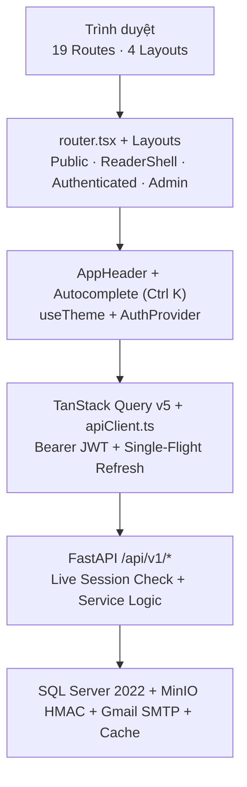

# Từ điển Giao diện Web → Code thực tế (`QL-DocTruyen`)

> **Dự án:** Hệ thống Đọc truyện Manga & Webtoon — Manga Reader (`QL-DocTruyen`)  
> **Khảo sát source:** ngày 22/11/2026 tại commit `3a52a2a` (`2026-11-22`)  
> **Phạm vi:** 45 file React 19 / TypeScript & CSS trong `apps/web/src/`, 4 Layout Boundaries, 19 Routes, kết nối tới 12 Domain Modules FastAPI trong `apps/api/src/manga_reader/`.  
> **Mục đích:** tra ngược từ mọi tên màn hình, tab, nút bấm, nhãn lọc, modal, drawer hoặc biểu đồ người dùng nhìn thấy trên trình duyệt (`Ctrl+F`) sang đúng file `.tsx`, hook, hàm xử lý sự kiện, phương thức `apiClient.ts`, endpoint API và service Backend xử lý tương ứng.

---

## Cách tra cứu và ranh giới kiểm kê

1. **Cách tra nhanh:** nhấn `Ctrl+F` và gõ đúng chữ hiện trên màn hình (ví dụ `"Advanced Manga Search"`, `"Cover Art Gallery"`, `"Group by Volume"`, `"Apply Resolution"`, `"Update Password"`, `"Forgot Password"`, `"Reader Display & Controls"`, `"Clone or Merge Existing Lists"`). Mỗi mục cung cấp đầy đủ: **Từ khóa UI**, **Cha → con**, **Hiển thị / Quyền vào**, **Luồng code** và **File/hàm**.
2. **Tách biệt ranh giới Client/Server:** mọi kiểm soát hiển thị trên React (`AuthenticatedLayout`, `AdminLayout`, ẩn/hiện nút theo `isAuthenticated` / `isAdmin`) chỉ phục vụ trải nghiệm UI. Mọi quy tắc bảo mật và bất biến nghiệp vụ đều được Backend (`dependencies.py` + Service) kiểm tra lại độc lập trên SQL Server.
3. **Liên kết cặp tài liệu:** muốn xem luồng nghiệp vụ theo mã Use Case (`UC-1..UC-8`) mở [USECASE_CODE_TRACEABILITY.md](USECASE_CODE_TRACEABILITY.md); muốn tra sâu REST DTO & SQL Server Tables/Indexes/Triggers mở [BACKEND_API_AND_DATABASE_DICTIONARY.md](BACKEND_API_AND_DATABASE_DICTIONARY.md).



---

## Cây màn hình cấp cao

```text
AppProviders (QueryClientProvider + AuthProvider)
└── AppRoutes (19 Routes trên 4 Layout Boundaries)
    ├── AppHeader (toàn cục: Logo, Nav, Ctrl+K Live Search Manga/Creators, UserAvatar, Dark/Light Theme)
    ├── [PublicLayout] (/ , /explore , /search/advanced , /search , /manga/:slug , /author/:id/:slug , /profile/:username , /login , /register , /forgot-password , /verify-email , *)
    │   ├── UI-01 Cụm Xác thực (AuthPages.tsx)
    │   │   ├── UI-01.1 LoginPage (/login) + Modal OTP inline khi PENDING_VERIFICATION
    │   │   ├── UI-01.2 RegisterPage (/register) + Màn nhập OTP 120s
    │   │   ├── UI-01.3 ForgotPasswordPage (/forgot-password) — Wizard 3 bước + PasswordStrengthMeter
    │   │   └── UI-01.4 VerifyEmailPage (/verify-email)
    │   ├── UI-02 HomePage (/) — Continue Reading, Personalized Recs, Latest Updates (phân trang), Recently Added, Top Rated
    │   ├── UI-03 ExplorePage (/explore , /search/advanced , /search redirect)
    │   │   ├── UI-03.1 Tab "Manga Catalog & Advanced Filters" (Tag 3-state, Author/Artist Pickers, Presets, 3 View Modes, Phân trang)
    │   │   └── UI-03.2 Tab "Authors & Artists" (Live search creator, Role filter, Sort)
    │   ├── UI-04 MangaDetailPage (/manga/:slug)
    │   │   ├── UI-04.1 Hero Bìa, Also Known As (+ Cờ/Màu Ngôn Ngữ), Tách Authors (Story) & Artists (Illustration), Đọc/Trạng thái/Rating
    │   │   ├── UI-04.2 Cover Art Gallery lọc theo Locale + Lightbox phóng to
    │   │   ├── UI-04.3 Danh sách Chương (Group by Volume / No Volume / Flat List / Range 50 ch. / Jump to Ch.)
    │   │   └── UI-04.4 Dải Gợi ý (Similar Manga ITEM_BASED & Content Matches CONTENT_BASED)
    │   ├── UI-05 CommentsSection (trong MangaDetailPage & Chapter Comments Drawer)
    │   ├── UI-06 AuthorDetailPage (/author/:creatorId/:slug) — Bio Markdown + Tách Works as Author & Works as Artist
    │   └── UI-11 ProfilePage (/profile/:username) — Công khai / Đổi Avatar / Report User
    │
    ├── [ReaderShellLayout] (/manga/:slug/read , /manga/:slug/chapter/:chapterId)
    │   └── UI-07 ChapterReaderPage
    │       ├── UI-07.1 Top Toolbar, Chapter Selector Modal (Volume + Range 50 ch.), Bottom Scrubber & Focus Mode (F)
    │       ├── UI-07.2 Canvas 3 Chế độ (Vertical Webtoon / Single / Double Spread + LTR/RTL + Fit Mode) + PageImage Hybrid & Retry
    │       ├── UI-07.3 Reader Settings Drawer (đồng bộ DB + localStorage) & Keyboard Shortcuts
    │       └── UI-07.4 Slide-over Chapter Comments Drawer & Tracking Tiến độ / Valid View (15s)
    │
    ├── [AuthenticatedLayout] (chặn nếu !isAuthenticated -> 403 Sign in required)
    │   ├── UI-08 LibraryPage (/library) — 6 Tab trạng thái, Search/Tag/Status filter, Đổi nhanh trạng thái
    │   ├── UI-09 HistoryPage (/history) — Cover Art từng bản ghi, Nhóm theo ngày, Nhãn Valid View, Resume
    │   ├── UI-10 ReadingListsPage (/reading-lists) & ReadingListDetailPage (/reading-lists/:listId)
    │   │   ├── UI-10.1 Quản lý List & Clone/Merge Lists (confirmEmpty)
    │   │   └── UI-10.2 Chi tiết List: Tab Items (Tìm/Lọc/Sắp xếp nội bộ) & Tab Metadata Stats (Donut + Radar + Top Authors/Artists)
    │   └── UI-12 AccountSettingsPage (/settings)
    │       ├── UI-12.1 Tab "Profile & Avatar" (Upload ảnh JPG/PNG/WebP lên MinIO + Bio + BirthDate privacy)
    │       ├── UI-12.2 Tab "Password & Security" (Security Center 2 cột + Confirm + PasswordStrengthMeter + Thu hồi phiên)
    │       ├── UI-12.3 Tab "Reader Preferences" (Interactive Layout Simulator + Slider Preload 0-10)
    │       ├── UI-12.4 Tab "Rating History" (Audit CREATE/UPDATE/REMOVE)
    │       └── UI-12.5 Tab "My Reading Stats" (KPI Cards + Funnel + Donut + Radar + Top Authors / Top Artists)
    │
    └── [AdminLayout] (/admin/*, chặn nếu !isAdmin -> 403 Administrator access required)
        ├── UI-13.1 AdminDashboardPage (/admin) — 5 KPI + Biểu đồ so sánh Top 12 + Visibility Donut + Bảng Metrics + Reconcile
        ├── UI-13.2 AdminAccountsPage (/admin/accounts) — Tra cứu/Khóa/Mở khóa Reader + Logs + Modal 3 tab Inspection
        ├── UI-13.3 AdminMangaPage (/admin/manga) — Hide / Show / Toggle CDC / Delete Permanently (sync guard)
        ├── UI-13.4 AdminReportsPage (/admin/reports) — Bàn làm việc 2 cột Queue + Plain-Language Inspector + Audit Timeline
        └── UI-13.5 AdminEtlPage (/admin/etl) — On-hold banner (VITE_EXTERNAL_ETL_ENABLED=false) hoặc Wizard ETL/CDC v2.0
```

---

<a id="ui-00"></a>
## UI-00 — Khung ứng dụng, Phiên đăng nhập & AppHeader toàn cục

### UI-00.1 — Khởi tạo Router, QueryClient & AuthProvider

**Từ khóa:** `AppProviders`, `AppRoutes`, `mr_access_token`, `mr_session_user`, `Bearer`, `mr_refresh_token`, `403 Forbidden`, `Sign in required`, `Administrator access required`.

**Cha → con:** `main.tsx` → `App.tsx` (`AppProviders`, `BrowserRouter`) → `router.tsx` (`AppRoutes`) → 4 Layout Boundaries (`PublicLayout`, `ReaderShellLayout`, `AuthenticatedLayout`, `AdminLayout`).

**Hiển thị / Quyền vào:**
- `PublicLayout`: mở tự do cho mọi visitor.
- `ReaderShellLayout`: mở tự do với khung nền tối riêng cho trình đọc (`--mr-bg-reader`).
- `AuthenticatedLayout` ([AuthenticatedLayout.tsx#L9-L66](../../apps/web/src/layouts/AuthenticatedLayout.tsx#L9-L66)): kiểm tra `isAuthenticated` (`user !== null && user.status === "ACTIVE"`). Nếu chưa đăng nhập, hiển thị `403 Forbidden` kèm nút `"Sign In"` có `?next=<returnUrl>`.
- `AdminLayout` ([AdminLayout.tsx#L22-L75](../../apps/web/src/layouts/AdminLayout.tsx#L22-L75)): kiểm tra `isAdmin` (`isAuthenticated && user.role === "ADMIN"`), ngược lại hiển thị `ForbiddenState`. Link `Source ETL & CDC` trong sidebar chỉ xuất hiện khi `frontendConfig.externalEtlEnabled === true`.

**Luồng code:**
1. `AuthProvider` ([authContext.tsx#L29-L123](../../apps/web/src/services/authContext.tsx#L29-L123)) lưu token và hồ sơ rút gọn trong `window.sessionStorage` (`mr_access_token`, `mr_session_user`) và gắn hàm `getAccessToken` + `refreshSession` vào `apiClient.configureAuth()`.
2. `ApiClient.requestRaw()` ([apiClient.ts#L141-L205](../../apps/web/src/services/apiClient.ts#L141-L205)) gọi qua `fetchWithLocalFallback()` ([apiClient.ts#L89-L121](../../apps/web/src/services/apiClient.ts#L89-L121)) — nếu proxy bị lỗi mạng cục bộ khi đang chạy localhost (và không phải `AbortError`), tự fallback sang `:8020` hoặc trả mã lỗi có cấu trúc `NETWORK_UNREACHABLE`; đồng thời [vite.config.ts#L5-L24](../../apps/web/vite.config.ts#L5-L24) cấu hình proxy `/api` cho cả `server` (`:5173`) lẫn `preview` (`:4173`). Request tự gắn header `X-Request-ID`, `Authorization: Bearer <token>` và `credentials: "include"`. Nếu API trả `401` (không phải đường dẫn `/auth/*`), client khóa hàng đợi qua `this.inflightRefresh` (single-flight lock), gọi `POST /api/v1/auth/refresh` một lần duy nhất rồi lặp lại request gốc; nếu refresh thất bại thì gọi `clearSession()`.

**File/hàm:** [App.tsx#L12-L43](../../apps/web/src/app/App.tsx#L12-L43), [router.tsx#L33-L81](../../apps/web/src/app/router.tsx#L33-L81), [authContext.tsx#L29-L123](../../apps/web/src/services/authContext.tsx#L29-L123), [apiClient.ts#L89-L213](../../apps/web/src/services/apiClient.ts#L89-L213), [vite.config.ts#L5-L24](../../apps/web/vite.config.ts#L5-L24), [AuthenticatedLayout.tsx#L9-L66](../../apps/web/src/layouts/AuthenticatedLayout.tsx#L9-L66), [AdminLayout.tsx#L22-L75](../../apps/web/src/layouts/AdminLayout.tsx#L22-L75).

### UI-00.2 — AppHeader, Live Autocomplete Search (`Ctrl+K`) & Dark/Light Theme

**Từ khóa:** `Explore`, `Advanced Search`, `Library`, `My Lists`, `History`, `Settings`, `Admin`, `Search manga, alt titles, authors...`, `Ctrl K`, `Manga Titles`, `Authors & Artists`, `Sign In`, `Register`, `Sign Out`, `Light`, `Dark`.

**Luồng code:**
1. `AppHeader` ([AppHeader.tsx#L9-L441](../../apps/web/src/components/AppHeader.tsx#L9-L441)) lắng nghe phím tắt `Ctrl+K` / `Cmd+K` (`L21-L38`, bỏ qua nếu đang gõ trong input/textarea khác) để focus ô tìm kiếm.
2. Khi gõ từ khóa, `useEffect` (`L40-L64`) chờ `200ms` rồi gọi `apiClient.autocomplete(trimmed, controller.signal)` → `GET /api/v1/manga/autocomplete`. Dropdown kết quả (`#header-search-listbox`, `L251-L351`) tách rõ 2 nhóm `"Manga Titles"` và `"Authors & Artists"`, điều hướng bằng phím `ArrowUp/ArrowDown/Enter/Escape`. Nhấn Enter không chọn item sẽ chuyển tới `/search/advanced?q=...`.
3. Nút Theme dùng `useTheme()` ([useTheme.ts#L15-L28](../../apps/web/src/hooks/useTheme.ts#L15-L28)) chuyển đổi biến CSS `dark`/`light` trong `localStorage` (`manga-reader-theme`). User Avatar badge (`UserAvatar.tsx`) gắn link về `/profile/${user.username}`.

**File/hàm:** [AppHeader.tsx#L9-L441](../../apps/web/src/components/AppHeader.tsx#L9-L441), [useTheme.ts#L5-L28](../../apps/web/src/hooks/useTheme.ts#L5-L28), [UserAvatar.tsx#L10-L46](../../apps/web/src/components/UserAvatar.tsx#L10-L46), [catalog_discovery/router.py#L112-L119](../../apps/api/src/manga_reader/modules/catalog_discovery/presentation/router.py#L112-L119).

---

<a id="ui-01"></a>
## UI-01 — Cụm màn hình Xác thực (`AuthPages.tsx`)

### UI-01.1 — Đăng nhập (`LoginPage`) & Kích hoạt OTP tại chỗ

**Từ khóa:** `Sign In`, `Username or Email`, `Password`, `Forgot password?`, `Verify Email via OTP`, `Need an account? Register`, `Your verification OTP has been sent`.

**Luồng code:**
1. `LoginPage` (`/login`, [AuthPages.tsx#L13-L336](../../apps/web/src/features/auth/AuthPages.tsx#L13-L336)) gọi `loginWithCredentials(identifier.trim(), password)` → `POST /api/v1/auth/login`.
2. Nếu thành công: chuyển `/admin` (nếu `role === "ADMIN"` và không có `?next`) hoặc `nextPath`.
3. Nếu API trả `403 EMAIL_NOT_VERIFIED`: `LoginPage` chuyển ngay sang giao diện nhập OTP 6 chữ số (`handleVerifyOtp`, `L74-L89` → `POST /api/v1/auth/verify-otp`) kèm đồng hồ đếm ngược gửi lại `handleResend` (`60s` cooldown). Khi `verifyOtp` thành công, tự động hoàn tất đăng nhập lại bằng thông tin vừa nhập. Nếu API trả `403 ACCOUNT_LOCKED`, hiện thông báo lý do khóa.

### UI-01.2 — Đăng ký (`RegisterPage`) & Xác thực Email OTP

**Từ khóa:** `Create Account`, `Email`, `Username`, `Display Name`, `Password`, `Register & Send OTP`, `Enter 6-digit OTP`, `Verify & Activate Account`, `Resend Code`.

**Luồng code:** `RegisterPage` (`/register`, [AuthPages.tsx#L338-L588](../../apps/web/src/features/auth/AuthPages.tsx#L338-L588)) submit `apiClient.register()` → `POST /api/v1/auth/register`. Backend lưu cache OTP `120s`, gửi mail qua `SmtpEmailAdapter` (`smtp.gmail.com:587`) và trả về thông báo xác nhận **không bao gồm mã OTP**. UI chuyển bước sang ô nhập mã 6 số với bộ đếm ngược TTL `120s`.

### UI-01.3 — Quên mật khẩu 3 bước (`ForgotPasswordPage`)

**Từ khóa:** `Account Recovery`, `Forgot Password`, `1. Account`, `2. Email OTP`, `3. New Password`, `Send Reset OTP Code`, `6-digit Reset OTP`, `Verify OTP Code`, `New Strong Password`, `Confirm New Password`, `Reset Password`.

**Luồng code:** `ForgotPasswordPage` (`/forgot-password`, [AuthPages.tsx#L590-L935](../../apps/web/src/features/auth/AuthPages.tsx#L590-L935)) dẫn người dùng qua 3 bước với thanh tiến trình stepper:
1. Bước 1 (`handleRequestReset`, `L614-L636`): `POST /api/v1/auth/forgot-password` → gửi OTP qua Gmail SMTP (không lộ OTP ra client).
2. Bước 2 (`handleVerifyResetOtp`, `L650-L668`): `POST /api/v1/auth/verify-reset-otp` → xác thực mã trước khi mở form nhập mật khẩu.
3. Bước 3 (`handleConfirmReset`, `L669-L702`): tích hợp `<PasswordStrengthMeter />` kiểm độ mạnh + đối khớp `Confirm New Password` + gọi `POST /api/v1/auth/reset-password` → đặt lại mật khẩu và thu hồi toàn bộ phiên cũ.

### UI-01.4 — Xác thực Email độc lập (`VerifyEmailPage`)

**Từ khóa:** `Verify Your Email`, `Account Email`, `6-digit OTP Code`, `Verify Account`.

**File/hàm:** [AuthPages.tsx#L13-L1087](../../apps/web/src/features/auth/AuthPages.tsx#L13-L1087), [PasswordStrengthMeter.tsx#L8-L123](../../apps/web/src/components/PasswordStrengthMeter.tsx#L8-L123), [account_auth/router.py#L101-L205](../../apps/api/src/manga_reader/modules/account_auth/presentation/router.py#L101-L205), [account_auth/service.py#L109-L500](../../apps/api/src/manga_reader/modules/account_auth/application/service.py#L109-L500), [account_auth/service.py#L835-L1045](../../apps/api/src/manga_reader/modules/account_auth/application/service.py#L835-L1045).

---

<a id="ui-02"></a>
## UI-02 — Trang chủ Khám phá (`HomePage`)

**Từ khóa:** `Continue Reading`, `Recommended For You`, `Latest Chapter Updates`, `Recently Added`, `Top Rated`, `Browse Full Catalog`, `Advanced Filters`, `Personalized (User-Based CF)`, `Popular Catalog Picks`.

**Cha → con:** `PublicLayout` → `HomePage` → Các lưới `MangaCard` (`compact` & `comfortable`) + `CatalogPagination`.

**Luồng code:**
1. `HomePage` ([HomePage.tsx#L12-L369](../../apps/web/src/features/discovery/HomePage.tsx#L12-L369)) phát động song song 5 truy vấn TanStack Query:
   - `latestQuery`: `listCatalog({ sort: "UPDATED_DESC", page: latestPage, pageSize: 24 })` kèm phân trang và tự cuộn mượt về `#home-latest-updated` (`L310-L315`).
   - `recentlyAddedQuery`: `listCatalog({ sort: "CREATED_DESC", page: 1, pageSize: 6 })`.
   - `topRatedQuery`: `listCatalog({ sort: "RATING_DESC", page: 1, pageSize: 6 })`.
   - Khi `isAuthenticated` đúng: `myRecsQuery` (`GET /api/v1/recommendations/me`) và `historyQuery` (`GET /api/v1/reader/history?page=1`) được kích hoạt để dựng dải `"Continue Reading"` (khử trùng lặp theo `mangaId` giữ bản ghi mới nhất) và dải `"Recommended For You"`.
2. Khi đang tải, từng section hiển thị khung xương `LoadingState` đúng variant (`cards`, `strip`) để chống giật layout.

**File/hàm:** [HomePage.tsx#L12-L369](../../apps/web/src/features/discovery/HomePage.tsx#L12-L369), [MangaCard.tsx#L17-L372](../../apps/web/src/components/MangaCard.tsx#L17-L372), [CatalogPagination.tsx#L22-L143](../../apps/web/src/components/CatalogPagination.tsx#L22-L143).

---

<a id="ui-03"></a>
## UI-03 — Trang Tìm kiếm & Lọc nâng cao hợp nhất (`ExplorePage`)

**Hiển thị / Quyền vào:** dùng chung 1 component `ExplorePage` ([ExplorePage.tsx#L174-L1802](../../apps/web/src/features/discovery/ExplorePage.tsx#L174-L1802)) cho cả 3 route `/explore`, `/search/advanced` (mặc định mở sẵn panel bộ lọc nâng cao `isAdvancedRoute = true`) và `/search` ([SearchPage.tsx#L1-L5](../../apps/web/src/features/discovery/SearchPage.tsx#L1-L5)). Hai bộ lọc cá nhân `Hide manga in my reading list` / `Hide manga in my custom lists` chỉ hiện khi `isAuthenticated` đúng.

### UI-03.1 — Tab `"Manga Catalog & Advanced Filters"`

**Từ khóa:** `Explore Catalog`, `Advanced Manga Search`, `Manga Catalog & Advanced Filters`, `Sort catalog`, `Grid / Compact / List`, `Filters`, `Clear all`, `Quick presets`, `Top Rated (8.0+)`, `Completed Series`, `Safe Only`, `Has Vietnamese Chapters`, `Has English Chapters`, `Filter tags...`, `GROUP_OR / ALL_AND / ANY_OR`, `Apply Filters`.

**Luồng code:**
1. Gõ ô `"Filter by title or alternative title"` kích hoạt debounce `300ms` (`L271-L292`), ghi tham số `q` lên `URLSearchParams` và chuyển `sort=RELEVANCE`.
2. Bấm 5 nút `Quick presets` (`L954-L1012`) áp bộ lọc mẫu ngay lập tức. Thanh `Active Filter Chips Bar` (`L1017-L1046`) cho phép bấm `✕` để gỡ từng điều kiện lọc bất kỳ.
3. Trong `Advanced filters` (`L1049-L1750`):
   - Tag 3-state `cycleTag(slug)` (`L435-L445`): click chuyển vòng `Không chọn → Include (xanh) → Exclude (đỏ) → Không chọn`. Hỗ trợ tìm tên tag (`tagFilterQuery`), lọc nhóm (`Genre`, `Theme`, `Format`, `Content`) và chọn `tagMode` (`GROUP_OR`, `ALL_AND`, `ANY_OR`).
   - Hai ô `Author` & `Artist` dùng component nội bộ `CreatorPickerField` (`L88-L172`) gọi `GET /api/v1/creators/search?q=...&role=...` sau `200ms`.
   - Các điều kiện khác: `Content Rating`, `Demographic`, `Publication Status`, `Original Language` (kèm ô nhập mã ISO tự do), `Chapter Language`, `Year From / To`, `Exported Chapters Min / Max`, `Minimum Rating` (+ `Include unrated`), `Minimum Views`, `Recently Added`. Kiểm tra hợp lệ `yearFrom <= yearTo` & `chaptersMin <= chaptersMax` trước khi đẩy URL và gọi `GET /api/v1/manga`.

### UI-03.2 — Tab `"Authors & Artists"`

**Từ khóa:** `Search Authors & Artists`, `All roles`, `Author`, `Artist`, `Most Public Works`, `Name (A–Z)`.

**Luồng code:** chọn tab `creators` chuyển sang gọi `apiClient.searchCreators(appliedQ, roleFilter)` (`L332-L345`), hỗ trợ lọc vai trò, sắp xếp Client và phân trang `CatalogPagination`.

**File/hàm:** [ExplorePage.tsx#L12-L1802](../../apps/web/src/features/discovery/ExplorePage.tsx#L12-L1802), [SearchPage.tsx#L1-L5](../../apps/web/src/features/discovery/SearchPage.tsx#L1-L5), [catalog_discovery/router.py#L25-L157](../../apps/api/src/manga_reader/modules/catalog_discovery/presentation/router.py#L25-L157), [catalog_discovery/service.py#L257-L942](../../apps/api/src/manga_reader/modules/catalog_discovery/application/service.py#L257-L942).

---

<a id="ui-04"></a>
## UI-04 — Trang Chi tiết Truyện (`MangaDetailPage`)

**Hiển thị / Quyền vào:** công khai cho mọi người với manga `PUBLIC/ACTIVE` (manga ẩn/xóa trả `NotFoundState`). Thanh `Your Rating`, dropdown `Reading status`, nút `+ Reading Lists` và `Report Issue` chỉ hiện khi `isAuthenticated` đúng.

### UI-04.1 — Hero Bìa, Also Known As, Tách Author/Artist & Thao tác đọc

**Từ khóa:** `Also Known As`, `Authors (Story)`, `Artists (Illustration)`, `Continue Reading`, `Read from Beginning`, `Start Reading`, `Metadata-only entry (0 exported chapters)`, `Reading status`, `+ Reading Lists`, `Report Issue`, `Your Rating (1–10)`.

**Luồng code:**
1. `MangaDetailPage` ([MangaDetailPage.tsx#L39-L990](../../apps/web/src/features/manga/MangaDetailPage.tsx#L39-L990)) tải `getMangaDetail(slug)`.
2. Cột trái hiển thị bìa chính (bấm mở Lightbox) + badge đếm tổng số bìa + thẻ thống kê điểm TB & `valid views` + khung **`Also Known As`** hiển thị tên thay thế kèm huy hiệu màu và quốc kỳ ngôn ngữ từ `resolveLocaleBadge()` ([localization.ts#L291-L320](../../apps/web/src/utils/localization.ts#L291-L320)); nếu >5 tên có nút `"View all"` và ô lọc tìm kiếm tên thay thế (`L507-L595`).
3. Cột phải tách riêng 2 hộp: **`Authors (Story)`** (`role === "author"`) và **`Artists (Illustration)`** (`role === "artist"`) (`L669-L749`) với link sang `/author/:creatorId/:slug`. Phần mô tả dài >320 ký tự được render qua `<FormattedMarkdownText>` (kèm `break-words [overflow-wrap:anywhere]`) và nút `"Show full synopsis"` / `"Show less"`.
4. Thanh chấm điểm `1–10` (`L404-L436`, `L856-L900`) vô hiệu hóa nút điểm nếu `!viewerState.canRate` (chưa mở chương nào), gọi `PUT/DELETE /api/v1/manga/{mangaId}/rating` và vô hiệu hóa lại query detail & rating history.

### UI-04.2 — Cover Art Gallery theo Locale & Lightbox

**Từ khóa:** `Cover Art Gallery`, `Volume Asc ↑ / Volume Desc ↓`, `All Locales`, `Cover artwork lightbox`.

**Luồng code:** ([MangaDetailPage.tsx#L137-L238](../../apps/web/src/features/manga/MangaDetailPage.tsx#L137-L238), `L992-L1098`, `L1608-L1694`): lọc danh sách `manga.coverArts` theo `locale` (sắp xếp tab ưu tiên ngôn ngữ gốc trước nhờ `getLocalePriority()`), chống trùng lặp bìa theo tập ưu tiên locale đang chọn, click mở Lightbox toàn màn hình.

### UI-04.3 — Danh sách Chương nhóm theo Volume / No Volume & Dải Gợi ý

**Từ khóa:** `Group by Volume`, `Flat List`, `No Volume (Unassigned)`, `Expand All Volumes`, `Collapse All`, `Search ch., vol., or group...`, `Jump to Ch. #`, `Filter chapter volume`, `Filter chapter language`, `Chapter ranges`, `Similar Manga`, `Content Matches`.

**Luồng code:** ([MangaDetailPage.tsx#L253-L355](../../apps/web/src/features/manga/MangaDetailPage.tsx#L253-L355), `L1100-L1593`):
- Mặc định chế độ `VOLUME_GROUPS`: phân bucket theo `volume`, tách riêng nhóm `"No Volume (Unassigned)"` (`__NONE__`), sắp xếp thông minh qua `compareVolumeKeys()`, bấm từng tiêu đề tập để đóng/mở (`collapsedVolumes`).
- Chế độ `FLAT`: chia cụm 50 chương (`CHAPTER_GROUP_SIZE = 50`) + `CatalogPagination` (25/50/100 chương/trang).
- Ô `"Jump to Ch. #"` tìm khớp `chapterNumber` để nhảy thẳng vào chương cần đọc.
- Cuối trang hiển thị 2 dải gợi ý: `Similar Manga` (`ITEM_BASED`) và `Content Matches` (`CONTENT_BASED`).

**File/hàm:** [MangaDetailPage.tsx#L15-L1697](../../apps/web/src/features/manga/MangaDetailPage.tsx#L15-L1697), [localization.ts#L10-L372](../../apps/web/src/utils/localization.ts#L10-L372), [AddToListsModal.tsx](../../apps/web/src/components/AddToListsModal.tsx), [ReportModal.tsx](../../apps/web/src/components/ReportModal.tsx).

---

<a id="ui-05"></a>
## UI-05 — Khu vực Bình luận & Phản hồi (`CommentsSection`)

**Từ khóa:** `Discussion & Comments`, `Filter text or user...`, `Filter spoiler comments`, `Filter comment scope`, `Sort comments`, `Contains spoiler`, `Reveal Spoiler`, `Spoiler locked by Admin`, `Reply`, `Edit`, `Edited history`, `Delete`, `Like`, `Dislike`, `Report`, `[Bình luận đã bị xóa]`.

**Cha → con:** Được nhúng tại cuối `MangaDetailPage` (mặc định `scope=ALL`) và trong `Chapter comments drawer` của `ChapterReaderPage` (mặc định `scope=CHAPTER` cho `chapterId` đang đọc).

**Luồng code:**
1. `CommentsSection` ([CommentsSection.tsx#L462-L729](../../apps/web/src/features/manga/CommentsSection.tsx#L462-L729)) gọi `GET /api/v1/comments` với `mangaId`, `chapterId`, `scope`, `sort` (`NEWEST`, `OLDEST`, `MOST_LIKED`), `page`. Bộ lọc text và spoiler lọc tức thì trên tập đã tải.
2. `CommentCard` ([CommentsSection.tsx#L18-L461](../../apps/web/src/features/manga/CommentsSection.tsx#L18-L461)):
   - Tự ẩn nội dung nếu `comment.isSpoiler && !spoilerRevealed && !comment.isDeleted`; hiện huy hiệu `"Spoiler"` hoặc `"Locked by Admin"` nếu `isSpoilerLockedByAdmin`. Khi chủ comment bấm `"Edit"` trên comment bị Admin khóa spoiler, checkbox `"Contains spoiler"` bị vô hiệu hóa (`disabled`).
   - Đệ quy hiển thị cây trả lời 1 cấp (`replies`); nút `"Reply"` chỉ xuất hiện ở comment gốc chưa bị xóa.
   - Bấm `"Edited history"` gọi `GET /api/v1/comments/{commentId}/history` mở danh sách phiên bản cũ ngay dưới card.
   - Bấm `Like` / `Dislike` gọi `PUT /api/v1/comments/{id}/reaction` với desired-state (`null` nếu bấm lại nút đang chọn).

**File/hàm:** [CommentsSection.tsx#L16-L729](../../apps/web/src/features/manga/CommentsSection.tsx#L16-L729), [comments_reactions/router.py#L43-L158](../../apps/api/src/manga_reader/modules/comments_reactions/presentation/router.py#L43-L158), [comments_reactions/service.py#L94-L547](../../apps/api/src/manga_reader/modules/comments_reactions/application/service.py#L94-L547).

---

<a id="ui-06"></a>
## UI-06 — Trang Hồ sơ Tác giả / Họa sĩ (`AuthorDetailPage`)

**Từ khóa:** `Author / Artist Profile`, `Biography language`, `Filter works by role`, `All Roles`, `Author (Story)`, `Artist (Illustration)`, `Works as Author (Story)`, `Works as Artist (Illustration)`.

**Luồng code:**
1. `AuthorDetailPage` ([AuthorDetailPage.tsx#L10-L343](../../apps/web/src/features/creator/AuthorDetailPage.tsx#L10-L343)) gọi `GET /api/v1/creators/{id}` và `GET /api/v1/creators/{id}/manga`.
2. Phần tiểu sử dùng `<FormattedMarkdownText content={displayedBio} />` (định dạng sạch tiêu đề, `**Native Name:**`, danh sách bullet và tự động nhận diện link URL) kèm selector chọn ngôn ngữ tiểu sử (`localizedBiographies`) và danh sách link mạng xã hội (`creator.links`).
3. Phần tác phẩm lọc qua AJAX không reload (`role`, `tag`, `status`, `sort`, `titleFilter`, `CatalogPagination`) và **tách làm 2 grid riêng** `Works as Author (Story)` vs `Works as Artist (Illustration)` (`L275-L325`).

**File/hàm:** [AuthorDetailPage.tsx#L10-L343](../../apps/web/src/features/creator/AuthorDetailPage.tsx#L10-L343), [FormattedMarkdownText.tsx#L96-L238](../../apps/web/src/components/FormattedMarkdownText.tsx#L96-L238).

---

<a id="ui-07"></a>
## UI-07 — Trình đọc Chương đa chế độ (`ChapterReaderPage`)

**Hiển thị / Quyền vào:** Chạy bên trong `ReaderShellLayout` ([ReaderShellLayout.tsx#L7-L16](../../apps/web/src/layouts/ReaderShellLayout.tsx#L7-L16)). Mở được cho cả Guest lẫn Reader `ACTIVE`; khi là Reader `ACTIVE` sẽ tự lưu tiến độ đọc lên DB và tạo phiên lịch sử đọc; khi là Guest lưu cài đặt trình đọc vào `localStorage`.

### UI-07.1 — Thanh công cụ dính trên cùng, Ngăn kéo Cài đặt & Modal Chọn Chương

**Từ khóa:** `⚙ Settings`, `Focus (F)`, `Show Toolbar (F)`, `💬 Comments`, `Report`, `All Chapters`, `Reader Display & Controls`, `Display Mode`, `Reading Direction`, `Fit Mode`, `Canvas Background`, `Webtoon Page Gap`, `Solo cover in double-page`, `Preload Ahead`, `Chapter Comments`, `Chapter selector`.

**Luồng code:**
1. Ngăn kéo cài đặt (`drawerOpen`, [ChapterReaderPage.tsx#L641-L793](../../apps/web/src/features/reader/ChapterReaderPage.tsx#L641-L793)) **được neo trực tiếp bên trong khối `sticky top-0 z-30` của thanh toolbar** nên luôn hiển thị trọn vẹn trong viewport bất kể người dùng đã cuộn xuống trang bao nhiêu (xử lý dứt điểm lỗi khó click hoặc trôi khỏi màn hình).
2. Ngăn kéo bình luận chương (`commentsOpen`, `L935-L989`) mở dạng slide-over overlay cố định (`fixed inset-0 z-50`), hỗ trợ click nền tối để đóng, gắn sẵn `<CommentsSection mangaId={...} chapterId={...} />`.
3. Nút `"All Chapters (...)"` mở `Chapter selector` (`L992-L1150`): modal cho phép tìm kiếm, lọc theo Volume, chọn nhóm 50 chương và phân trang 25 chương/trang.

### UI-07.2 — Canvas 3 Chế độ, Phím tắt & Tracking Tiến độ / Valid View

**Luồng code:**
1. `loadChapter()` ([ChapterReaderPage.tsx#L182-L231](../../apps/web/src/features/reader/ChapterReaderPage.tsx#L182-L231)) gọi `GET /api/v1/reader/open` với `actionType` (`START`, `CONTINUE` hoặc `SELECT`), nhận `pages` (đã ký HMAC), `initialPage`, `historyId`, `prevChapter`/`nextChapter` và `settings` (nếu đã đăng nhập ưu tiên server settings).
2. `IntersectionObserver` (`L278-L294`) theo dõi trang đang hiển thị khi cuộn Webtoon; `useEffect` (`L243-L263`) debounce `350ms` gửi `PUT /api/v1/reader/progress` kèm `clientSequence++` đơn điệu để lưu điểm dừng chính xác vào `reader_progress`.
3. `useEffect` (`L232-L241`) hẹn giờ 15 giây gọi `POST /api/v1/reader/view-session/{historyId}/complete` để backend xét cấp `is_valid_view = True`.
4. Phím tắt (`onKeyDown`, `L316-L355`): `←/→` hoặc `A/D` lật trang (tự đảo chiều khi `RTL`), `S` bật/tắt Settings Drawer, `C` bật/tắt Comments Drawer, `F` bật/tắt Focus Mode, `M` xoay vòng `displayMode`, `Escape` đóng mọi drawer/modal.
5. Prefetch ảnh kế tiếp (`L265-L276`) tải trước `preloadPageCount` ảnh tiếp theo qua `new Image()`.

**File/hàm:** [ChapterReaderPage.tsx#L18-L1181](../../apps/web/src/features/reader/ChapterReaderPage.tsx#L18-L1181), [reader_engine/router.py#L60-L416](../../apps/api/src/manga_reader/modules/reader_engine/presentation/router.py#L60-L416), [reader_engine/service.py#L299-L715](../../apps/api/src/manga_reader/modules/reader_engine/application/service.py#L299-L715).

---

<a id="ui-08"></a>
## UI-08 — Trang Thư viện Cá nhân (`LibraryPage`)

**Từ khóa:** `My Reading Library`, `All`, `Reading`, `Plan to Read`, `Completed`, `On Hold`, `Dropped`, `Filter titles in library...`, `Filter publication status`, `Filter library by tag`, `Sort library`, `Continue Page ...`, `Remove from library`.

**Hiển thị / Quyền vào:** yêu cầu đăng nhập (`AuthenticatedLayout`).

**Luồng code:** `LibraryPage` ([LibraryPage.tsx#L26-L400](../../apps/web/src/features/account/LibraryPage.tsx#L26-L400)) tải `GET /api/v1/account/me/reading-status` (`listMyReadingStatuses()`), hiển thị 6 tab đếm số lượng theo trạng thái đọc, tìm kiếm tức thời trên tựa/tag/creator, lọc theo trạng thái xuất bản & tag, sắp xếp và phân trang. Mỗi thẻ truyện cho phép chuyển đổi trạng thái đọc ngay tại chỗ (`handleStatusUpdate`, `L102-L120`) hoặc bấm `"Continue Reading"` nhảy vào chương & trang lưu dở.

**File/hàm:** [LibraryPage.tsx#L9-L400](../../apps/web/src/features/account/LibraryPage.tsx#L9-L400), [reader_engine/router.py#L198-L235](../../apps/api/src/manga_reader/modules/reader_engine/presentation/router.py#L198-L235).

---

<a id="ui-09"></a>
## UI-09 — Trang Lịch sử Đọc (`HistoryPage`)

**Từ khóa:** `Reading History`, `Filter title or chapter...`, `Filter reading session type`, `Valid View`, `Quick Open`, `Today`, `Yesterday`, `Resume Page`.

**Hiển thị / Quyền vào:** yêu cầu đăng nhập (`AuthenticatedLayout`).

**Luồng code:** `HistoryPage` ([HistoryPage.tsx#L20-L283](../../apps/web/src/features/account/HistoryPage.tsx#L20-L283)) gọi `GET /api/v1/reader/history` (`getReadingHistory(page, pageSize)`), gom nhóm các phiên đọc theo mốc ngày (`getDateBucket`), hiển thị **Cover Art** (`mangaCoverUrl`) ở bên trái mỗi thẻ giúp độc giả nhận diện bằng hình ảnh, hiển thị thời lượng đọc (`readingDurationSeconds`), badge `Valid View` / `Quick Open` và link đọc tiếp `resumeChapterId`.

**File/hàm:** [HistoryPage.tsx#L8-L283](../../apps/web/src/features/account/HistoryPage.tsx#L8-L283), [reader_engine/service.py#L716-L801](../../apps/api/src/manga_reader/modules/reader_engine/application/service.py#L716-L801).

---

<a id="ui-10"></a>
## UI-10 — Cụm màn hình Danh sách Đọc Riêng tư

### UI-10.1 — Tổng quan & Tạo / Gộp Reading Lists (`ReadingListsPage`)

**Từ khóa:** `My Reading Lists`, `Search your lists by name...`, `Sort reading lists`, `Create New Private List`, `List name (unique per account)`, `Clone or Merge Existing Lists (UC-8.2)`, `Confirm creating empty merged list`.

**Luồng code:** `ReadingListsPage` ([ReadingListsPage.tsx#L12-L434](../../apps/web/src/features/lists/ReadingListsPage.tsx#L12-L434)) dùng `useDebouncedValue(search, 250)` gọi `GET /api/v1/lists/my`, hiển thị thẻ danh sách kèm `<ReadingListCover variant="card" />` (collage 1–4 ảnh bìa từ `previewCovers` hoặc SVG mặc định `"Empty List"` khi trống). Form tạo gọi `POST /api/v1/lists`; form Clone/Merge (`submitMerge`, `L62-L99`) gọi `POST /api/v1/lists/merge-create`. Nếu các list nguồn đều rỗng, server trả `409 EMPTY_SOURCE_LISTS_CONFIRMATION_REQUIRED` và UI mở checkbox xác nhận `confirmEmpty`.

### UI-10.2 — Chi tiết, Lọc nội bộ & Thống kê List (`ReadingListDetailPage`)

**Từ khóa:** `Edit Details`, `Delete List`, `Manga Titles`, `Dynamic Metadata Statistics`, `Filter items in list...`, `Filter by publication status`, `Filter by my reading status`, `Tag Distribution Breakdown`, `Top Authors in This List`, `Top Artists in This List`, `Danh sách chưa có truyện nào để thống kê`.

**Luồng code:** `ReadingListDetailPage` ([ReadingListDetailPage.tsx#L16-L648](../../apps/web/src/features/lists/ReadingListDetailPage.tsx#L16-L648)) hiển thị `<ReadingListCover variant="detail" />` ở header danh sách, đồng thời tải song song chi tiết, items (qua debounced query + bộ lọc Tag/Publication Status/Reading Status/Sort) và metadata stats. Tại tab `"Dynamic Metadata Statistics"` (`L427-L645`), nếu danh sách rỗng hiển thị thông điệp chuẩn; nếu có dữ liệu hiển thị KPI, `InteractiveDonutChart`, `GenreRadarChart` và 2 bảng xếp hạng tách biệt **`Top Authors in This List`** vs **`Top Artists in This List`**.

**File/hàm:** [ReadingListsPage.tsx#L10-L434](../../apps/web/src/features/lists/ReadingListsPage.tsx#L10-L434), [ReadingListDetailPage.tsx#L16-L648](../../apps/web/src/features/lists/ReadingListDetailPage.tsx#L16-L648), [ReadingListCover.tsx#L11-L187](../../apps/web/src/components/ReadingListCover.tsx#L11-L187), [AddToListsModal.tsx#L13-L268](../../apps/web/src/components/AddToListsModal.tsx#L13-L268), [reading_lists/router.py#L42-L250](../../apps/api/src/manga_reader/modules/reading_lists/presentation/router.py#L42-L250).

---

<a id="ui-11"></a>
## UI-11 — Trang Hồ sơ Công khai (`ProfilePage`)

**Từ khóa:** `Change avatar image`, `Upload new avatar image`, `Birth Date`, `Email`, `Edit Settings`, `Report User`.

**Luồng code:** `ProfilePage` (`/profile/:username`, [ProfilePage.tsx#L10-L203](../../apps/web/src/features/account/ProfilePage.tsx#L10-L203)) gọi `GET /api/v1/profiles/{username}`. Nếu `user.accountId === profile.accountId` (`isOwnProfile`): cho phép chọn ảnh avatar tải thẳng lên `POST /api/v1/account/avatar` và có nút link tới `/settings`; nếu xem hồ sơ người khác và đã đăng nhập: hiện nút `"Report User"` mở `ReportModal` (`kind="ACCOUNT"`). Email chỉ xuất hiện khi server trả về (chính chủ hoặc Admin).

**File/hàm:** [ProfilePage.tsx#L10-L203](../../apps/web/src/features/account/ProfilePage.tsx#L10-L203).

---

<a id="ui-12"></a>
## UI-12 — Trung tâm Cài đặt Tài khoản & Thống kê (`SettingsPage`)

**Hiển thị / Quyền vào:** `/settings` nằm trong `AuthenticatedLayout`. Gồm **5 tab** ([SettingsPage.tsx#L272-L279](../../apps/web/src/features/account/SettingsPage.tsx#L272-L279)): `Profile & Avatar`, `Password & Security`, `Reader Preferences`, `Rating History`, `My Reading Stats`.

### UI-12.1 — Tab `"Profile & Avatar"`

**Từ khóa:** `Profile Details`, `Display Name`, `Bio`, `Birth Date`, `Show birth date on public profile`, `Save Profile`, `Avatar Image`, `Choose avatar image file`, `Upload New Avatar`.

**Luồng code:** ([SettingsPage.tsx#L161-L216](../../apps/web/src/features/account/SettingsPage.tsx#L161-L216), `L328-L541`): lưu thông tin qua `PATCH /api/v1/account/profile`; chọn tệp ảnh xem trước bằng `URL.createObjectURL(avatarFile)` và upload multipart qua `POST /api/v1/account/avatar`.

### UI-12.2 — Tab `"Password & Security"`

**Từ khóa:** `Password Management`, `Change Password`, `Current Password`, `New Strong Password`, `Confirm New Password`, `Update Password`, `Forgot current password? Reset via Email OTP →`, `Account Security & Verification`, `Reset Password via OTP`, `Verify Email OTP`, `Sign Out Session`, `Protection Controls`.

**Luồng code:** ([SettingsPage.tsx#L217-L246](../../apps/web/src/features/account/SettingsPage.tsx#L217-L246), `L543-L795`): bố cục 2 cột; cột trái tích hợp show/hide password, kiểm khớp mật khẩu xác nhận và `<PasswordStrengthMeter />` (bắt buộc không trùng mật khẩu cũ, đủ 8+ ký tự/hoa/thường/số/ký tự đặc biệt), gọi `PUT /api/v1/account/password`; cột phải hiển thị thông tin xác thực và lối tắt sang `/forgot-password` & `/verify-email`.

### UI-12.3 — Tab `"Reader Preferences"`

**Từ khóa:** `Default Reader Settings`, `Display Mode`, `Reading Direction`, `Fit Mode`, `Preload Page Count`, `Save Preferences`, `Live Reader Simulator`, `Chapter Reader Keyboard Shortcuts`.

**Luồng code:** ([SettingsPage.tsx#L247-L270](../../apps/web/src/features/account/SettingsPage.tsx#L247-L270), `L797-L1400`): khởi tạo an toàn tránh undefined khi test mock rỗng, sync với `GET/PUT /api/v1/reader/settings` và `localStorage`, đồng thời vẽ mô hình trực quan `"Live Reader Simulator"` thay đổi hình dáng khung trang theo đúng chế độ Webtoon / Single / Double & LTR / RTL theo thời gian thực.

### UI-12.4 — Tab `"Rating History"`

**Từ khóa:** `Filter rated manga titles...`, `Filter rating action type`, `Created`, `Updated`, `Removed`.

**Luồng code:** ([SettingsPage.tsx#L139-L154](../../apps/web/src/features/account/SettingsPage.tsx#L139-L154), `L1402-L1516`): gọi `GET /api/v1/account/me/rating-history`, lọc Client (chuẩn hóa `NFC`) theo tên truyện / loại thao tác và phân trang.

### UI-12.5 — Tab `"My Reading Stats"`

**Từ khóa:** `Valid Reads`, `Chapter Opens`, `Top Genres Radar`, `Top Authors (Story)`, `Top Artists (Illustration)`.

**Luồng code:** ([SettingsPage.tsx#L155-L159](../../apps/web/src/features/account/SettingsPage.tsx#L155-L159), `L1518-L1940`): gọi `GET /api/v1/account/me/reading-statistics`, kết xuất KPI cards, `EngagementFunnelChart`, `InteractiveDonutChart`, `GenreRadarChart` và 2 bảng tách riêng `Top Authors (Story)` vs `Top Artists (Illustration)` — đã gỡ bỏ hoàn toàn phần text narrative theo yêu cầu gọn gàng trực quan.

**File/hàm:** [SettingsPage.tsx#L35-L1943](../../apps/web/src/features/account/SettingsPage.tsx#L35-L1943), [PasswordStrengthMeter.tsx#L8-L123](../../apps/web/src/components/PasswordStrengthMeter.tsx#L8-L123), [DataStoryCharts.tsx#L23-L781](../../apps/web/src/components/DataStoryCharts.tsx#L23-L781).

---

<a id="ui-13"></a>
## UI-13 — Cụm màn hình Quản trị viên (`AdminPages.tsx`)

**Hiển thị / Quyền vào:** Bao bởi `AdminLayout` (`/admin/*`). Yêu cầu `user.role === "ADMIN"` & `status === "ACTIVE"`.

### UI-13.1 — `AdminDashboardPage` (`/admin`)

**Từ khóa:** `Admin — Analytics Dashboard`, `Reconcile Denormalized Counters`, `Total Mangas`, `Valid Views`, `List Additions`, `Comments`, `Pending Reports`, `Top Manga Performance Comparison`, `Catalog Visibility Split`, `Top Manga Interaction Metrics`.

**Luồng code:** ([AdminPages.tsx#L390-L750](../../apps/web/src/features/admin/AdminPages.tsx#L390-L750)): gọi `GET /api/v1/admin/manga/statistics`, dựng 5 KPI Cards, biểu đồ cột/đường chuyển đổi được 4 chỉ số (`InteractiveTrendChart`), biểu đồ tròn tỷ lệ ẩn/hiện (`InteractiveDonutChart`), bảng Top 100 truyện có lọc/tìm/sắp xếp/phân trang 20 dòng và nút đối soát `POST /api/v1/admin/reconcile`.

### UI-13.2 — `AdminAccountsPage` (`/admin/accounts`)

**Từ khóa:** `Admin — Accounts & Activity Logs`, `Search username, email, display name...`, `Filter account status`, `Lock/Unlock audit reason...`, `Lock Account`, `Unlock Account`, `Logs & Stats`, `System Activity Logs`, `Account Inspection & Logs`, `Reader Behavior Statistics`.

**Luồng code:** ([AdminPages.tsx#L751-L1492](../../apps/web/src/features/admin/AdminPages.tsx#L751-L1492)): tải `adminListAccounts` (debounce 280ms) + `adminListActivityLogs`, gắn handler `handleLockToggle()` (`L797-L812`) và `inspectReaderStats()` (`L814-L833`). Nút `"Logs & Stats"` mở Modal Inspection gồm 3 khối: lọc log của tài khoản, thống kê hành vi Reader kèm biểu đồ Donut/Radar và 2 bảng tách riêng Authors vs Artists. Toàn bộ dòng nhật ký được dịch sang tiếng người dễ hiểu qua `formatActivityLogSummary()` (`L103-L162`).

### UI-13.3 — `AdminMangaPage` (`/admin/manga`)

**Từ khóa:** `Admin — Manga Catalog Management`, `Search manga title or slug...`, `Moderation reason...`, `Hide`, `Show`, `Enable CDC / Disable CDC`, `Delete Permanently`.

**Luồng code:** ([AdminPages.tsx#L1493-L1740](../../apps/web/src/features/admin/AdminPages.tsx#L1493-L1740)): gọi `GET /api/v1/admin/manga`, gán action qua `runAction()` (`L1516-L1528`), khóa nút `"Delete Permanently"` nếu `m.isSyncing` đúng, yêu cầu lý do khi ẩn/xóa.

### UI-13.4 — `AdminReportsPage` (`/admin/reports`)

**Từ khóa:** `Admin — Moderation Reports Queue`, `Pending Review`, `Resolved`, `Dismissed`, `Auto-Closed`, `Inspect`, `Case Inspector`, `Target State`, `Moderation Decision`, `Resolution Note (required)`, `Ignore all future reports on this manga`, `Apply Resolution`, `Moderation Audit Timeline`.

**Luồng code:** ([AdminPages.tsx#L1741-L2424](../../apps/web/src/features/admin/AdminPages.tsx#L1741-L2424)): thiết kế dạng **Moderation Workbench 2 cột**:
- Cột trái: KPI triage strip + thanh lọc 3 loại (`COMMENT`/`MANGA`/`ACCOUNT`), pill chuyển trạng thái nhanh, tìm kiếm và danh sách phân trang.
- Cột phải dính (`sticky`): `<ReportTargetCard />` ([AdminPages.tsx#L164-L386](../../apps/web/src/features/admin/AdminPages.tsx#L164-L386)) giải nghĩa dữ liệu snapshot + trạng thái sống của mục tiêu bằng ngôn ngữ bình thường (tác giả comment, tên truyện, link mở trực tiếp, cảnh báo spoiler/bị xóa), khung `Moderation Decision` chỉ liệt kê `allowedActions` hợp lệ, gợi ý ghi chú nhanh `QUICK_NOTES`, nút `"Apply Resolution"` và timeline lịch sử xử lý (`ADMIN` / `SYSTEM`).

### UI-13.5 — `AdminEtlPage` (`/admin/etl`)

**Từ khóa:** `External ETL & CDC Integration Paused`, `Admin — Source ETL & CDC Console`, `Upstream Package v2.0 Catalog`, `Direct Package v2.0 JSON Ingestion`, `Recent ETL Jobs`, `Retry Failed Item`.

**Luồng code:** ([AdminPages.tsx#L2425-L2730](../../apps/web/src/features/admin/AdminPages.tsx#L2425-L2730)): kiểm `frontendConfig.externalEtlEnabled`; khi `false` trả panel trạng thái tạm ngưng kèm ghi chú chế độ đọc kho local; khi `true` mở form chọn từng manga + checkbox CDC, ô dán Package v2.0 JSON (`adminStartEtlSync`) và chi tiết job/retry.

**File/hàm:** [AdminPages.tsx#L24-L2730](../../apps/web/src/features/admin/AdminPages.tsx#L24-L2730), [DataStoryCharts.tsx#L23-L781](../../apps/web/src/components/DataStoryCharts.tsx#L23-L781).

---

<a id="ui-14"></a>
## UI-14 — Thư viện Component dùng chung

| Component | Đường dẫn & Dòng | Trách nhiệm & Điểm cần nhớ |
|---|---|---|
| `MangaCard` | [MangaCard.tsx#L17-L372](../../apps/web/src/components/MangaCard.tsx#L17-L372) | 3 layout (`comfortable`, `compact`, `list`), badge rating theo màu an toàn, tách dòng hiển thị **Author:** và **Artist:** rõ ràng, hiển thị `No Cover` an toàn khi ảnh lỗi. |
| `CatalogPagination` | [CatalogPagination.tsx#L22-L143](../../apps/web/src/components/CatalogPagination.tsx#L22-L143) | Phân trang rút gọn thông minh (`1 ... n-2..n+2 ... total`), nút `First / Prev / Next / Last` + ô `"Go to page"` nhập số trang nhảy thẳng. |
| `DataStoryCharts` | [DataStoryCharts.tsx#L23-L781](../../apps/web/src/components/DataStoryCharts.tsx#L23-L781) | 4 biểu đồ SVG thuần không phụ thuộc thư viện nặng: `InteractiveDonutChart` (giới hạn tâm chống tràn chữ & tự xuống dòng chú thích), `InteractiveTrendChart` (Bar/Line + đường TB), `GenreRadarChart` (`viewBox` mở rộng chống cắt nhãn), `EngagementFunnelChart`. |
| `ReadingListCover` | [ReadingListCover.tsx#L11-L187](../../apps/web/src/components/ReadingListCover.tsx#L11-L187) | Hiển thị ảnh bìa collage 1–4 ảnh từ truyện trong Reading List (`card` / `detail` / `thumb`) kèm ảnh bìa mặc định SVG `"Empty List"` khi danh sách trống. |
| `FormattedMarkdownText` | [FormattedMarkdownText.tsx#L96-L238](../../apps/web/src/components/FormattedMarkdownText.tsx#L96-L238) | Chuyển Markdown tiểu sử/mô tả (`#`, `**bold**`, `*italic*`, `` `[link](url)` ``, `Key: Value`, bullet list) thành JSX an toàn chống XSS kèm ngắt dòng chống tràn khung. |
| `PasswordStrengthMeter` | [PasswordStrengthMeter.tsx#L8-L123](../../apps/web/src/components/PasswordStrengthMeter.tsx#L8-L123) | Thanh đo 4 cấp (`Weak`, `Fair`, `Good`, `Strong`) + checklist 6 tiêu chí live (độ dài >=8, chữ hoa, chữ thường, số, ký tự đặc biệt, khác mật khẩu cũ). |
| `AddToListsModal` | [AddToListsModal.tsx#L13-L268](../../apps/web/src/components/AddToListsModal.tsx#L13-L268) | Quản lý checklist đồng bộ `PUT /manga/{id}/my-list-memberships`, kèm ảnh bìa mini `ReadingListCover`, quick-create list và cảnh báo khi bỏ chọn list cũ. |
| `ReportModal` | [ReportModal.tsx#L31-L207](../../apps/web/src/components/ReportModal.tsx#L31-L207) | Modal dùng chung cho cả 3 loại `ACCOUNT`, `MANGA` (+ `chapterId`), `COMMENT` với danh mục lý do chuẩn `REASON_OPTIONS`. |
| `StateViews` | [StateViews.tsx#L10-L393](../../apps/web/src/components/StateViews.tsx#L10-L393) | Chuẩn hóa 5 trạng thái bắt buộc cho mọi trang: `LoadingState` (skeleton `cards`/`list`/`table`/`detail`/`dashboard`/`strip` + hiệu ứng shimmer), `EmptyState`, `ErrorState` (có `onRetry`), `ForbiddenState`, `NotFoundState`. |
| `UserAvatar` | [UserAvatar.tsx#L10-L46](../../apps/web/src/components/UserAvatar.tsx#L10-L46) | Hiển thị ảnh avatar `xs`/`sm`/`md`/`lg`, tự rơi về chữ cái đầu tên người dùng nếu `src` trống hoặc tải ảnh lỗi. |

---

<a id="ui-15"></a>
## UI-15 — Điểm tra nhanh từ câu hỏi sang tài liệu

| Nếu người dùng / giám khảo hỏi về... | Mở mục này | Đường chạy code tương ứng |
|---|---|---|
| "Tại sao trước đây không click được Settings/Comments trong trình đọc?" | [UI-07.1](#ui-07) | `ChapterReaderPage` ghim `Reader Settings Drawer` vào khối `sticky top-0 z-30` và đặt `Comments Drawer` trong `fixed inset-0 z-50` nên không bao giờ bị trôi ngoài viewport hay chìm dưới ảnh trang. |
| "Trang Search vs Advanced Search có bị trùng không?" | [UI-03](#ui-03) | `/search` là wrapper của `ExplorePage`; toàn bộ `/explore`, `/search/advanced`, `/search` gộp thành một trung tâm tìm kiếm & lọc duy nhất. |
| "Trang Reports sao trước lại thấy JSON khó hiểu?" | [UI-13.4](#ui-13) | Đã thay hoàn toàn JSON thô bằng `<ReportTargetCard />` & `formatActivityLogSummary()` dịch sẵn ngữ cảnh đọc được ngay bằng mắt thường. |
| "Sao Forgot Password không hiện OTP để test?" | [UI-01.3](#ui-01) | Hệ thống đã xóa bỏ hoàn toàn `devOtpPreview`; OTP 120s chỉ lưu dạng hash trong Cache và gửi qua Gmail SMTP thực (`SmtpEmailAdapter`). |
| "Author với Artist tách nhau ở những màn nào?" | [UI-04.1](#ui-04), [UI-06](#ui-06), [UI-10.2](#ui-10), [UI-12.5](#ui-12), [UI-13.2](#ui-13) | Mọi màn hình (`MangaCard`, `MangaDetailPage`, `AuthorDetailPage`, `ReadingListDetailPage`, `SettingsPage`, `AdminAccountsPage`) đều tách 2 khu vực `Authors (Story)` và `Artists (Illustration)`. |
| "Nhóm Chapter có Volume và No Volume hoạt động ra sao?" | [UI-04.3](#ui-04) | `MangaDetailPage` gom nhóm `volumeGroups`, dùng `compareVolumeKeys` xếp số tập tăng/giảm và tách riêng chương không có tập vào `"No Volume (Unassigned)"`. |
| "Tiếng Việt có dấu trong comment / list có bị lỗi `?` hay `&amp;` không?" | [UI-05](#ui-05), [UI-12.1](#ui-12) | Backend cấu hình `use_setinputsizes=False` cho `mssql+aioodbc`, dùng cột `Unicode`/`UnicodeText`, và `sanitize_user_text()` chuẩn hóa `NFC` không dùng `html.escape()` gây mã hóa kép `&amp;`. |
| "Reading List lấy ảnh bìa từ đâu và list trống hiện gì?" | [UI-10](#ui-10), [UI-14](#ui-14) | `ReadingListService._fetch_list_cover_map()` trả tối đa 4 URL bìa ký HMAC (`previewCovers`/`coverUrl`) và `<ReadingListCover />` vẽ collage 1–4 ảnh hoặc SVG `"Empty List"` mặc định. |

---

<a id="ui-16"></a>
## UI-16 — Bản đồ các file Frontend được rà

| Nhóm UI | Các file mã nguồn (`apps/web/src/...`) |
|---|---|
| Khởi động, Router & Layouts | `main.tsx`, `app/App.tsx`, `app/router.tsx`, `layouts/PublicLayout.tsx`, `layouts/ReaderShellLayout.tsx`, `layouts/AuthenticatedLayout.tsx`, `layouts/AdminLayout.tsx`, `styles/index.css`, `styles/tokens.css` |
| API, Auth State & Hooks | `services/apiClient.ts`, `services/apiTypes.ts`, `services/authContext.tsx`, `services/authStore.ts`, `services/config.ts`, `hooks/useAuth.ts`, `hooks/useDebouncedValue.ts`, `hooks/useHealthStatus.ts`, `hooks/useTheme.ts`, `utils/localization.ts` |
| Shared Components | `components/AppHeader.tsx`, `components/AddToListsModal.tsx`, `components/CatalogPagination.tsx`, `components/DataStoryCharts.tsx`, `components/FormattedMarkdownText.tsx`, `components/MangaCard.tsx`, `components/PasswordStrengthMeter.tsx`, `components/ReadingListCover.tsx`, `components/ReportModal.tsx`, `components/StateViews.tsx`, `components/UserAvatar.tsx` |
| Feature: Auth | `features/auth/AuthPages.tsx` |
| Feature: Discovery & Creator | `features/discovery/HomePage.tsx`, `features/discovery/ExplorePage.tsx`, `features/discovery/SearchPage.tsx`, `features/creator/AuthorDetailPage.tsx` |
| Feature: Manga, Comments & Reader | `features/manga/MangaDetailPage.tsx`, `features/manga/CommentsSection.tsx`, `features/reader/ChapterReaderPage.tsx` |
| Feature: Account & Lists | `features/account/LibraryPage.tsx`, `features/account/HistoryPage.tsx`, `features/account/ProfilePage.tsx`, `features/account/SettingsPage.tsx`, `features/lists/ReadingListsPage.tsx`, `features/lists/ReadingListDetailPage.tsx` |
| Feature: Admin | `features/admin/AdminPages.tsx` |
